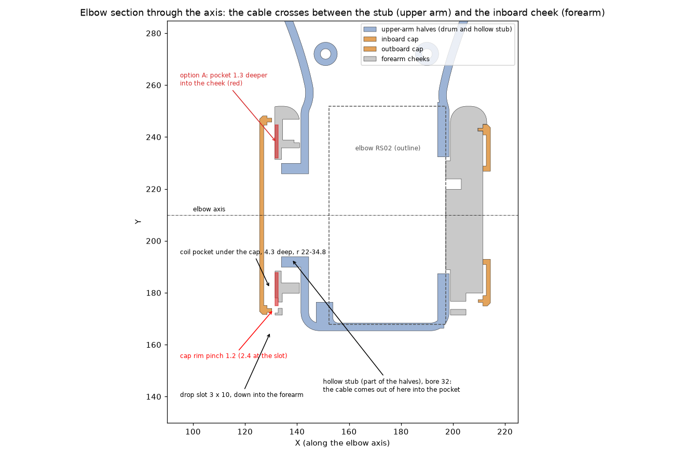
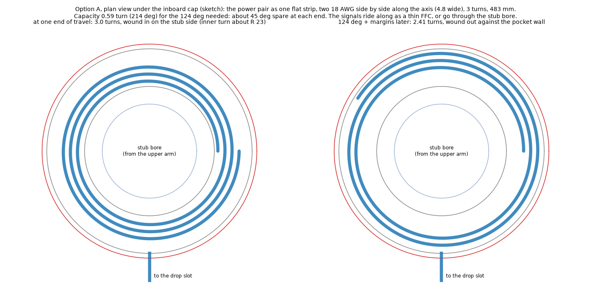
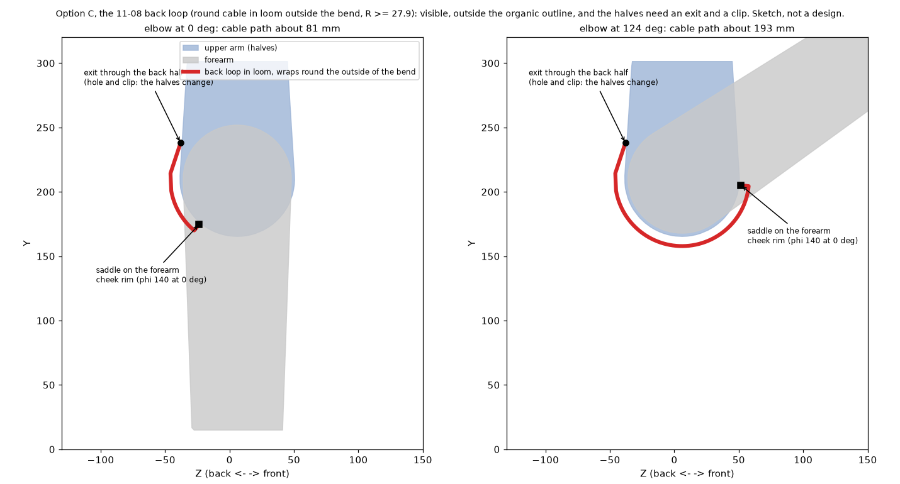

# Elbow cable crossing: options for Joey (2026-11-15)

**Decision (Joey, 2026-11-15 05:05Z): option A3, the inside spiral, rig first.** The halves print only after the rig passes, the bench passes and the corrected hub exists.

**Correction 2026-11-15:** the signal wire is 28 AWG (1.2 mm), per the 11-11 scheme, pending the coordinator's single definition, not 26 AWG at 1.1. The 26 AWG figures below scale with OD: about 10 % more bundle. The recommendation is unchanged (signals on an FFC). Power across the elbow is one 18 AWG pair, confirmed by the power board thread.

**The question:** how 2 × 18 AWG power plus up to three 26 AWG signal pairs cross the elbow through 0-124 deg for many cycles, and
whether that changes the upper-arm halves Joey prints next.

**Short answer:**
- The cable as built today cannot work. The coil pocket under the inboard cap has no room for a coil to wind and unwind.
- **Recommended: option A3.** A flat clock-spring of the power pair under the inboard cap, with the signals riding along as a thin
  flat cable (FFC).
  - It changes only forearm parts: the inboard cheek's pocket goes 1.3 mm deeper, the cap rim is opened over the drop, the drop
    slot is widened, and there is a small clip.
  - **The halves do not change.**
- **The one choice for Joey:** signals on a thin FFC (best), or as 26 AWG wires through the stub bore (works on paper but is
  marginal, and needs the rig).

Nothing here is built. These are exploration numbers from `organic_master.py` and the current exports. No print files or released
CAD were changed.

## What we're working with

- **Where the joint turns.** The rotation is between the hollow stub, which belongs to the upper-arm halves (bore Ø32, X 134-141.5),
  and the inboard cheek with its cap, which belong to the forearm.
- **The outboard side is no use.** It is the RS02's output, with no hollow pass through it.
- **The free space is:**
  - the stub bore, Ø32 by about 20-25 mm along the axis, counting through to the RS02's back;
  - the pocket under the inboard cap, r 22-34.8 by 4.3 deep;
  - a drop slot down the cheek, 3 × 10.
  - Under the cap rim (r 36) the gap is only 1.2 mm, or 2.4 at the drop.
- **Flex limit used: bend radius at least 10 × the wire's outside diameter for repeated flexing. ASSUMED.**
  - There is no datasheet for this wire in the repo; cable makers quote about 7.5-10 × for continuous-flex cable.
  - That gives 18 AWG (OD 2.4, assumed until Joey measures his wire) R ≥ 24, and 26 AWG (OD about 1.1) R ≥ 11.

## The options

| | How it crosses | Fits? (numbers) | Bend vs the 10 × limit | Fatigue risk | Changes | Halves |
| --- | --- | --- | --- | --- | --- | --- |
| **A0, as built today** | the whole 3 × 12 bundle as one flat coil in the pocket | **No.** The bundle fills 12 of the 12.8 mm radially and can't change radius. The 124 deg needs about 7-9 mm. | - | - | - | - |
| **A1, rolling U-loop** in the pocket | the strip turns back on itself between the two walls | **No.** The U-turn radius is (12.8 - 2.4) / 2 = 5.2. | 2.2 × OD, far below 10 × | very high | - | - |
| **A2, twist through the stub bore** | a loose helix round the axis, about 1 turn over 20-25 mm | 18 AWG: no. 26 AWG only: just. | 18 AWG: R 9.4-10.4, about 4 ×. 26 AWG: about 8.5-9.5 × | 18 AWG high; 26 AWG moderate | a clip at each end | none |
| **A3, flat clock-spring of the power pair** (recommended) | the two 18 AWG side by side along the axis, as one 4.8-wide strip, 3 turns, 483 mm, in the cap pocket | **Yes.** Capacity 0.59 turn (214 deg) for 124 deg: about 45 deg spare at each end. Needs the pocket 5.5 deep (today 4.3). | inner turn about R 23 at one end of travel, about 9.7 × (at the limit, only at that end) | moderate: the turns slide on each other and on the cap and cheek faces | inboard cheek, cap rim, drop slot, a stub clip | **none** |
| A3 + signals on a thin FFC (6-8 way, 0.15 thick, about 4 wide), wound with the power strip | | **Yes.** Capacity 201 deg. | FFC fine | low for the FFC | as A3 | none |
| A3 + signals as 26 AWG wires wound with the power strip | | Only just: capacity 146 deg, 11 deg spare | R about 22.5, 9.4 × | moderate to high (no margin) | as A3 | none |
| A3 + signals as 26 AWG twisting through the stub bore (A2) | | Just | about 8.5-9.5 × | moderate | as A3, plus a bore clip | none |
| **B, internal, small change to the halves** | e.g. more axial length for a twist, from the drum interior behind the RS02 | No useful variant. The space behind the RS02 is about 11 mm, and with the stub and pocket the total stays about 25 mm. A twist needs about 60 mm for 18 AWG at 9 × OD. | - | - | - | - |
| **C, outside back loop** (the 11-08 requirement) | round cable in loom outside the bend, from an exit in the back half to a saddle on the forearm cheek rim (phi 140) | Yes. The path grows from about 81 to about 193 mm over 124 deg, so the loop carries about 112 mm of slack. | R ≥ 27.9 (11.6 ×) | low | back half: an exit hole and clip; forearm: a saddle | **change** |

**A3, plan view:**

**C, side view:**

## A3 in detail (recommended)

- **Power strip.** The two 18 AWG wires lie side by side along the elbow axis, 4.8 wide, one wire thick (2.4) radially.
  - Three turns, about 483 mm.
  - Its inner end leaves the stub bore and its outer end goes into the drop slot (θ 180, straight down).
  - Wound in, it lies on the stub side, inner turn about R 23. Wound out, it lies against the pocket wall at r 34.8, about 2.4
    turns.
  - The elbow's 124 deg uses 0.34 of the 0.59 turn available.
- **Signals.** A thin FFC wound on top of the power strip: CAN and the reserve on 6-8 ways. It adds about 0.15 to the radial
  stack, and capacity stays 201 deg.
  - If Joey wants round 26 AWG instead, run them separately through the stub bore as a loose twist (about 9 × OD, marginal) and
    prove it on the rig first.
  - Joey's own rule allows power and CAN to route separately.
- **Changes, all in forearm parts:**
  1. **Inboard cheek:** pocket floor 1.3 deeper over r 22-34.8 (X 131.5 to 132.8). That makes the pocket 5.6 deep.
     - **Assumption to check:** the 6808 outer race's shoulder (r 21.5-28) gets thinner, from 2.5 to 1.2 mm. Check the bearing's
       axial hold.
     - Outside r 28 the stop-lug slot (X 134.5-141, r 29.5-36.5) still has 1.7 mm of wall.
  2. **Cap rim and cheek recess over the drop:** opened to the full pocket depth and about 12 wide. Today 1.2 / 2.4.
  3. **Drop slot:** 4 × 12, already planned for the rebuild, plus a lead-in from the pocket.
  4. **A small printed clip**, snapped into the end of the stub bore, to hold the strip's inner end to the upper-arm side. The stub
     belongs to the halves; the clip is a separate part, so the halves don't change.
- **The halves: no change.** Everything above is at X 125.6-141 in forearm parts, apart from the clip, which only sits in the
  stub's existing bore. The halves' passages (neck, rib gap, down to the stub) already meet the 3.5 × 13 reserve.
- **Outer shapes:** no change. The cap stays where it is, and the pocket goes into the cheek, not out.

## Assumptions checked (2026-11-15)

- **The thinner bearing shoulder is OK on paper.**
  - In the inboard cheek, the 6808's outer race sits on an annular lip, r 21.5-26, X 131.5-134, 2.5 thick, cantilevered 4.5 mm
    inward from the cheek wall. The race's outer ring bears on about r 23.7-26.
  - Thinned to 1.2 mm at 100 N axial: shear across the lip root about 0.5 MPa; bending about 6 MPa in the layer plane (the cheek
    disc prints flat, layers normal to the axis), SF about 7.5 against 45. At 300 N, SF about 2.5.
  - 1.2 mm is 6 layers, printable.
  - Elsewhere the deeper floor leaves 1.7 mm of wall over the stop-lug slot.
  - No FE is needed at this level.
- **The cap can't take the extra depth instead.** It is a 1.6 mm plate whose outer face is the arm's outline. Moving it out by 1.3
  would grow the elbow, and thinning it to 0.3 is not a part. So the depth goes into the cheek.
- **The rig is ready:** `cad/upper-arm/ELBOW_CABLE_RIG.md`. The files are on holly-pc in `C:\joe\prints\elbow-cable-rig\`, not
  in git. Generator: `cad/scripts/arm/elbow_cable_rig.py`.
- **New find while building the rig: the bend where the strip leaves the stub bore.** It turns from along the axis to radial over
  the 5.6 mm depth, so about R 5 there. That is static (that end is tied and turns with the stub), but it is about 2 × OD, below
  the usual 4-6 × for a static bend. A lead-in round on the bore's edge (R 3 or more) belongs in the design. The rig's notch shows
  whether it kinks.

## Assumptions not yet checked

1. **The wire.** 18 AWG OD 2.4 and 26 AWG OD 1.1 are not measured. Joey to caliper the wire he buys; a fatter 18 AWG cuts A3's
   margin.
2. **The flex limit** of 10 × OD is a guideline, not a datasheet value.
3. **The thinner bearing shoulder**, 1.2 mm of PETG under the 6808 outer race.
4. **Friction.** Silicone insulation is tacky, so the turns may stick rather than slide. A PTFE film disc on each face of the pocket,
   or the FFC wound with the strip, would help. The rig shows which.
5. **The strip stays a strip.** The two loose wires have to stay side by side; a few dabs of silicone or a thin tape every 50 mm
   might be needed.
6. **CAN on an FFC** is acceptable for Joey's electronics. The forearm's own yaw already plans an FFC clock spring.

## The rig that would prove A3

Minimal, after the idea of the shoulder thread's cable rigs (a pitch tray and lid in `C:\joe\prints\cable-rigs`):
- **Two prints:**
  - a tray with the cheek's pocket (r 22-34.8, 5.6 deep) and the drop exit;
  - a lid with the cap's rim and a centre boss standing in for the stub, with a lever arm.
- **Wind** the real 18 AWG pair, three turns, plus the FFC or the 26 AWG pairs.
- **Cycle** 0-124 deg by hand, 1000 times. Mark the strip and watch for:
  - any end of travel jamming;
  - turns climbing over each other;
  - the inner turn going below about R 23;
  - insulation wear;
  - the hand-feel torque.
- About 1-2 h of printing and an evening of cycling. It needs no halves and no hub.

## Recommendation

**A3, power as a flat clock-spring under the inboard cap, signals as an FFC wound with it.**
- **The halves print as they are.** The work is in the forearm rebuild: cheek pocket, cap rim, drop slot and a stub clip.
- Prove it on the small rig before the forearm is printed.
- **C (outside back loop)** is the fallback if the rig fails. It is low-risk for fatigue, but visible, outside the organic outline,
  and it changes the halves.
- So if Joey wants C kept open, the halves should wait. If he accepts A3 (rig to follow), they can print now.
