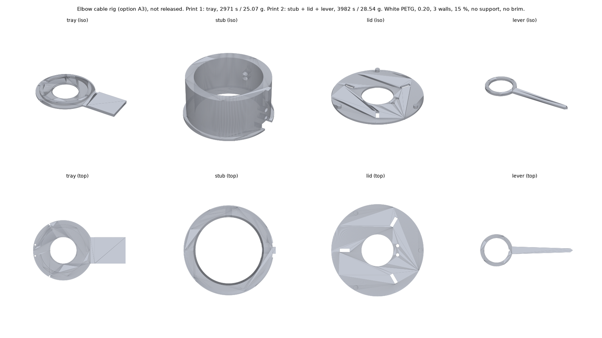

# Elbow cable rig: does the power coil survive the elbow's swing? (option A3)

**Status: ready to print. Option A3 chosen by Joey, 2026-11-15, rig first** (`cad/reviews/upper-arm/20261115_elbow-cable/ELBOW_CABLE_STUDY.md`). It
tests the elbow's cable coil at full size before any forearm part changes. It needs no hub and no halves.

## 1. Print (white PETG, Cool Plate SuperTack, cheap settings: 0.20, 3 walls, 15 %, no support, no brim)

Files on Joey-PC in `J:\code\prints\elbow-cable-rig\` (copied 2026-11-15, 3MF hashes checked), and on holly-pc in
`C:\joe\prints\elbow-cable-rig\`:

| # | File | What it is | Time | PETG |
| --- | --- | --- | --- | --- |
| 1 | `elbow_cable_rig_tray\elbow_cable_rig_tray.3mf` | the forearm side: the coil pocket, the drop exit, a clamp tab | 50 min | 25 g |
| 2 | `elbow_cable_rig_parts\elbow_cable_rig_parts.3mf` | the stub (the upper arm side), the lid (the cap) and the lever | 66 min | 29 g |

About 2 h and 54 g. Everything prints the way it lies.

## 2. What to have

- **18 AWG silicone wire, two pieces of 750 mm** (the arm's power wire; cut from what you'll use in the arm).
- **Thin tape** (masking or electrical).
- **3 small cable ties** (2.5 mm).
- **A G-clamp**, to hold the tray's tab to a table edge.
- **For the signal test, pick one:**
  - **FFC stand-in:** a strip of thin plastic (cut from a plastic folder or sheet protector), 4.5 mm wide and 700 mm long, taped
    end to end if needed. It behaves like a flat flex cable. Nothing to buy for the test.
  - **Or the signal wire itself, 28 AWG (1.2 mm), per the 11-11 scheme, pending a single project-wide definition: three pairs of 300 mm**, if you have it. If you don't, skip that part.
- Nothing needs buying. A real FFC (8-way, 0.5 mm pitch, about 700 mm) only matters later, for the arm.

## 3. Set up

1. Clamp the tray's tab to a table edge so the round part hangs out past the edge, pocket up.
2. Drop the stub into the centre hole from above. Its thin flange sits flush in the pocket floor, and the tube hangs below.
3. Push the lever onto the tube's bottom end (the key lines up), pointer out.
4. **Make the power strip:** lay the two 18 AWG wires side by side and tape them together every 50 mm, so they stay one flat strip,
   4.8 wide.
5. Feed one end up through the stub's bore from below. Bring it out over the notch at the top. Tie it with a cable tie through the
   two holes below the notch. That is the upper arm end.
6. **Wind it:**
   - Turn the lever to the first mark (the notch in the tray's edge at 118°): that is 0°.
   - Wind the strip **3 turns clockwise, seen from above**, snug round the stub, flat in the pocket, with the strip standing on its
     edge (the two wires one above the other).
   - Lead the tail out through the gap in the pocket wall, and tie it to the two holes outside the gap. That is the forearm end.
7. **Signals, pick one:**
   - FFC stand-in: tape it to the power strip's side at both ends and wind it with the strip.
   - 28 AWG pairs: run the pairs straight down through the stub's bore. Tie them to the two holes near the bottom of the tube (upper
     arm end) and to the two holes next to the lid's centre hole (forearm end).
8. Put the lid on: three pegs into the wall top.

## 4. Test

**Swing the lever from the 0° mark (118°) to the 124° mark (242°) and back.** That is one cycle; it unwinds the coil, and back
winds it in. Hold the tray's tab, not the stub.

**First 200 cycles,** then lift the lid and look:

| Look for | Good | Stop and send me photos |
| --- | --- | --- |
| How the lever feels | smooth all the way, the same both ways | it sticks, jumps, or gets harder near one end |
| The turns | stay flat, one layer, side by side | a turn climbs over another, or the strip twists flat |
| The ends of travel | at 242°: the outer turn just touches the wall. At 118°: the inner turn sits round the stub without pinching. | the strip wedges against the wall or crushes at the stub notch |
| The strip | the two wires still one above the other, tape holding | they split apart or roll |
| The insulation | clean | shiny rubbed bands, cuts, or a kink at the stub notch or the wall gap |
| The signals | FFC flat, no creases; or the 28 AWG pairs twisting freely in the bore | the FFC creases, or the wires knot or rub on the bore edge |

**If all good, keep going to about 1000 cycles** and look again. Take photos at 0, 200 and 1000 cycles, from above with the lid
off, at both ends of the swing.

## 5. Results to send me

- Cycles done.
- Lever feel: smooth / sticky / jumps, and where.
- Turns: still one layer?
- Wear: any, and where.
- Signal option tried, and how it behaved.
- Photos.

## 6. What happens after

- **All good to 1000 cycles:** A3 holds. It goes into the forearm rebuild: the inboard cheek pocket 1.3 mm deeper, the cap rim
  opened over the drop, the drop slot 4 × 12, and a clip in the stub bore. The upper-arm halves don't change.
- **It sticks, climbs or wears:** stop and send me the photos. The next tries are PTFE tape on the pocket faces, fewer turns, or
  the outside loop (option C).
