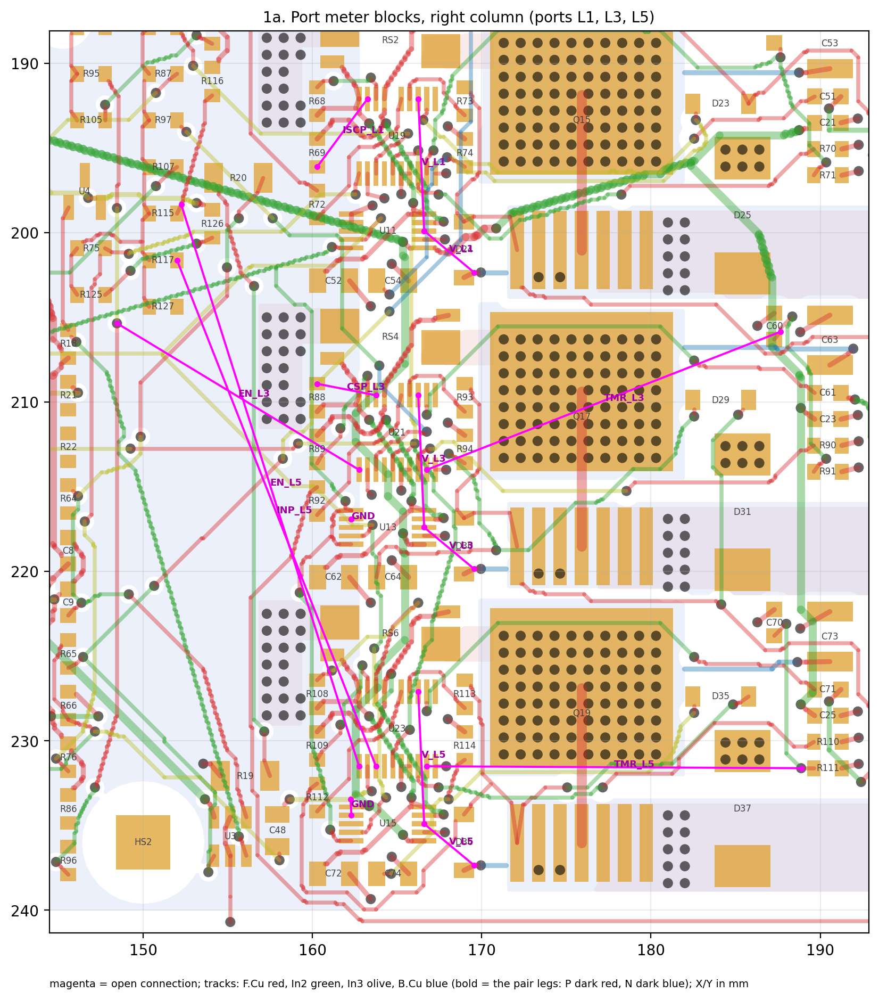
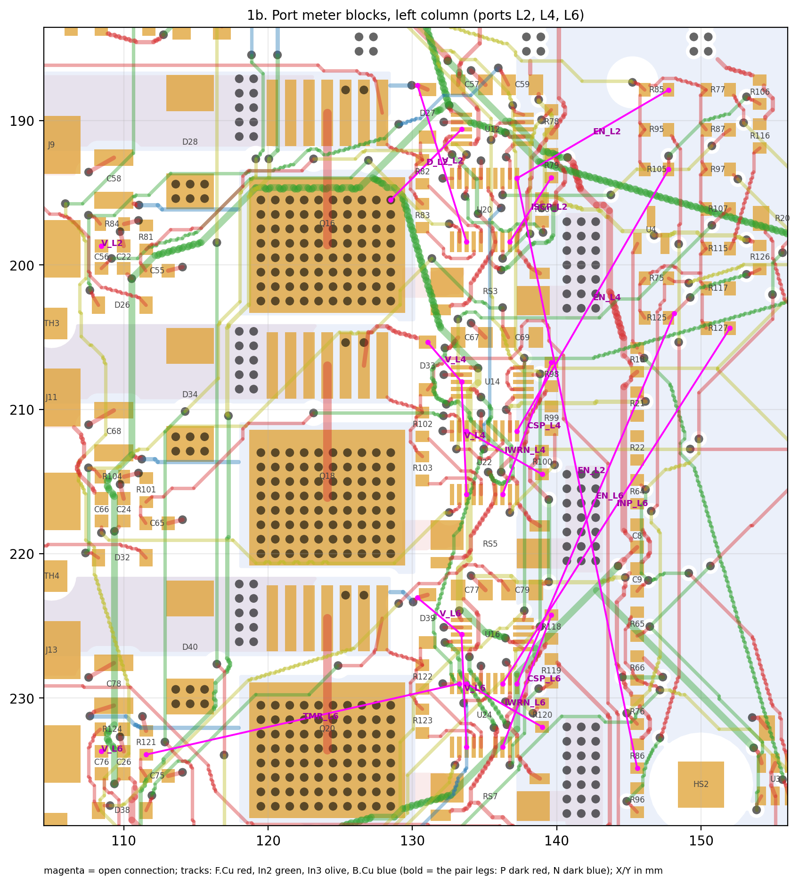
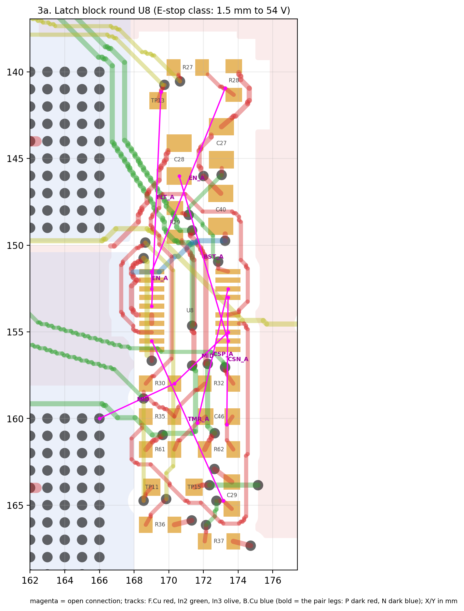
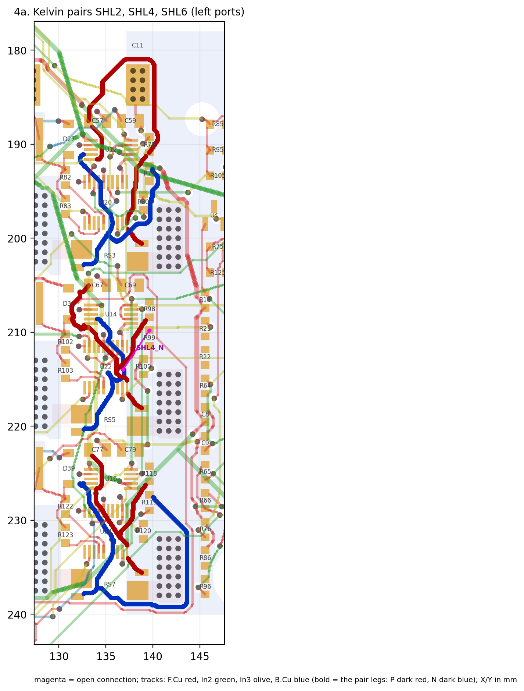

# Hand finishing the rev B5 board

The scripts leave **59 open connections on 44 nets** (2026-11-09). DRC and route_checks are clean as it stands.
What's left is blocked by copper already in place, so it needs KiCad's push-and-shove router. Expect about 3–4 h for the
connections plus 1–2 h for the Kelvin pairs. The full list is [open_nets.csv](open_nets.csv), and the background is in
[LAYOUT_RULES.md](../LAYOUT_RULES.md), "Hand finishing".

## 1. Setup

1. Use the worktree on Joey-PC: `J:\code\roark-wt\power-board`. It already has `power-board-route` checked out. Run
   `git pull` there. (`J:\code\roark` can't switch to this branch while the worktree holds it.)
2. Open `hardware\power-board\layout\marengo_pdu_revb.kicad_pcb` in **KiCad 10.0** (10.0.8 here).
3. Check the rules are loaded: File → Board Setup → Design Rules → Custom Rules should show `estop_to_54v` and the
   U1/U2/U7 fine-pitch rules. Net Classes should show ESTOP and HV54.
4. Router: Route → Interactive Router Settings → Mode **Shove**. Shove mode never places a DRC violation. Keep the
   track width "from net class" (0.2 mm signals, 0.25 mm GND and 54 V taps) and vias at 0.6/0.3 mm.
5. Turn the ratsnest on (left toolbar, "Show ratsnest"). Locked tracks are the finished gate, UVLO and well-paired
   Kelvin routes (SHL1, SHL3, SHL5 and SH). Shove won't move them.

## 2. Order of work

Coordinates are KiCad X/Y in mm. Each group has a picture with the open connections in magenta. Route signals on F.Cu
where there's room, otherwise In2 or In3 (signal layers between the GND planes). **Never route on In1 or In4**: they are
the solid GND planes.

### 1a. Port meter blocks, right column (L1, L3, L5): 15 connections

- **V_L taps** (all three ports, same pattern): eFuse U19/U21/U23 pin 13 (X 166.2) to meter U11/U13/U15 pin 8
  (X 166.6), about 8 mm straight down. Then pin 8 to the V_L stub at X 169.6. Use F.Cu with a dog-leg round the meter
  pins, or drop to In3 next to the pin.
- Singles:
  - ISCP_L1: R69 to U19 pin 19.
  - CSP_L3: R88 to U21 pin 18.
  - EN_L3 and EN_L5: from the RUN_P column at X 148–152 to U21/U23 pin 1. These are long runs; use In3.
  - INP_L5: R117 to U23 pin 3, also on In3.
  - TMR_L3 and TMR_L5: U21/U23 pin 9 out to the timer caps at X 188.
  - GND: U13 pin 2 and U15 pin 2, a short stub and a via each.
- Template: port L1's EN, CSP and INP lines are finished. Copy their shape for L3 and L5.

### 1b. Port meter blocks, left column (L2, L4, L6): 19 connections

- **V_L taps**, mirrored: U20/U22/U24 pin 13 (X 133.8) to U12/U14/U16 pin 8 (X 133.4), then on to D33 or the
  V_L stub at X 130.3.
- **C56 and C76 pin 2** (X 108.4, Y 198.7 and Y 233.7) aren't joined to their own V_L2/V_L6 pour. Add a short wide
  track from the pad onto the pour.
- Singles:
  - CSP_L4 and CSP_L6: U22/U24 pin 18 to R98/R118.
  - ISCP_L2: U20 pin 19 to R79.
  - IWRN_L4 and IWRN_L6: U22/U24 pin 8 to R100/R120.
  - D_L2: U12 pin 8 to the via at (128.5, 195.5).
- Long runs, all on In3:
  - EN_L2, EN_L4 and EN_L6: the RUN_P column at X 145–148 to U20/U22/U24 pin 1.
  - INP_L6: R127 to U24 pin 3.
  - TMR_L6: U24 pin 9 to R121 at X 111.5.

### 2. Remaining singles: 11 connections
| Group | Net | From | To | Picture |
|---|---|---|---|---|
| U7 | BRK_P | R26 pin 1 (135.2, 124.2) | U7 pin 7 (135.7, 122.0) | [s_u7](renders/hand_finish_s_u7.png) |
| U7 | BRK_PG | track end (121.7, 124.8) | U7 pin 8 (136.2, 122.0) | same |
| CL taps | CL_HY | R22 pin 2 (145.6, 211.8) | R64 pin 1 (145.6, 216.6) | [s_cl](renders/hand_finish_s_cl.png) |
| CL taps | CL_OUT | R22 pin 1 (145.6, 213.5) | track end (150.7, 220.8) | same |
| CL taps | CL_SENSE | In3 track end (147.6, 214.2) | R21 pin 1 (145.6, 210.4) | same |
| | CWD | U25 pin 2 (104.2, 247.3) | C81 pin 1 (124.3, 241.9) | [s_cwd](renders/hand_finish_s_cwd.png) |
| | FB_CTL | U2 pin 2 (109.4, 154.6) | R7 pin 2 (104.5, 162.8) | [s_fb](renders/hand_finish_s_fb.png) |
| | G2 | R2 pin 2 (124.8, 139.3) | Q2 pin 1, gate (153.2, 160.2) | [s_g2](renders/hand_finish_s_g2.png) |
| | MID_Z | D14 pin 2 (106.3, 183.5) | R48 pin 1 (116.8, 144.2) | [s_zener](renders/hand_finish_s_zener.png) |
| | VB_Z | D16 pin 2 (111.7, 183.5) | R58 pin 1 (117.5, 139.9) | same |
| GND | 2 F.Cu GND fill islands | click the two GND "zone to zone" items in the DRC list | add a GND via in each, or delete the island | – |

G2 rides 54 V. Keep it on F.Cu over In1 with GND beside it, like GATE.

### 3. Latch block (E-stop class, 1.5 mm from every 54 V net): 12 connections

- Round U8 (X 169–174, Y 151–156):
  - EN_A: U8 pin 1 to pin 3 (go round pin 2, which is GND), and pin 1 up to (173.2, 140.9).
  - FLT_A: U8 pin 5 up to (169.6, 141.2).
  - BST_A: C28 pin 1 (170.6, 146.0) to U8 pin 12.
  - CSN_A and CSP_A: U8 pins 17 and 18 down to (173.3, 160.3) and (171.7, 160.2).
  - MID: R30 pin 2 (170.3, 158.0) to U8 pin 13 and to the via at (166.0, 160.0).
  - TMR_A: U8 pin 9 to (173.2, 164.8).
- L_B ([picture](renders/hand_finish_l_lb.png)): the track end at (114.0, 162.2) to C7 pin 1, and R12 pin 2 to the In2
  track end at (117.2, 148.3).
- MID tap ([picture](renders/hand_finish_l_mid.png)): D14 pin 1 (103.0, 183.5) to R47 pin 1 (122.6, 248.4), a long
  54 V run on In2 or In3. Keep it 1.5 mm from the E-stop nets in the latch block.
- The custom rule enforces the 1.5 mm, and KiCad won't let you place closer. Inside U1, U2 and U7's courtyards 0.15 mm
  applies.

### 4. Kelvin re-pairs: last

- Re-route SHL2 (0 % paired), SHL4 (25 %; SHL4_N is also open at R99) and SHL6 (33 %) as tight pairs. Picture 4b
  ([SH9](renders/hand_finish_kelvin_sh9.png)) shows SH9 (8 %) from RS9 to U7.
- What a good pair looks like: both legs leave the shunt's Kelvin pads together and run side by side to the meter's
  IN+/IN- pins:

```
 shunt (4-pad Kelvin)                                 meter / eFuse
  P pad ─┐                                        ┌─ IN+ (SHLx_P)
         ╞═══ P and N side by side, 0.2 mm apart ═╡
  N pad ─┘    same layer, no other net between    └─ IN- (SHLx_N)
              at most one via each, placed together
```

- SHL1, SHL3 and SHL5 (about 53 % paired, locked) show the pattern. Delete the old leg first (select the track, `U` to
  select the whole net segment, Delete), then route P, then N alongside it.

## 3. Don'ts
- **No new vias in the VBUS band, Y 180–190 mm, X 130–160** (the L6 VBUS pour where the full 60 A flows). 27 vias
  are already there. If a route there is easy to move, move it out.
- Don't unlock or drag locked tracks.
- Keep E-stop nets (ESTOP class) at 1.5 mm from 54 V copper; the DRC holds it, so don't turn DRC off to force a route.
- Don't route on In1 or In4, and don't put vias in pads (hand assembly).

## 4. Finish
In PowerShell:

```
cd J:\code\roark-wt\power-board\hardware\power-board\schematic
& "C:\Program Files\KiCad\10.0\bin\kicad-cli.exe" pcb drc --format json --schematic-parity -o $env:TEMP\drc.json ..\layout\marengo_pdu_revb.kicad_pcb
python tools\open_nets.py $env:TEMP\drc.json ..\layout\open_nets.csv
& "C:\Program Files\KiCad\10.0\bin\python.exe" tools\route_checks.py ..\layout\marengo_pdu_revb.kicad_pcb
& "C:\Program Files\KiCad\10.0\bin\kicad-cli.exe" sch export netlist --format kicadsexpr -o $env:TEMP\net.net marengo_pdu_revb.kicad_sch
python -I tools\check.py tools $env:TEMP\net.net
```

You're done when:
- DRC shows 0 violations other than the 8 library notices;
- open_nets.csv lists only its header;
- route_checks shows 0 clearance violations;
- check.py shows `FAILS 0`.

Then commit and push:

```
cd J:\code\roark-wt\power-board
git add hardware/power-board/layout/marengo_pdu_revb.kicad_pcb hardware/power-board/layout/open_nets.csv
git commit -m "power-board: hand-finished routing"
git push
```

Or just say "done" in the project and Claude will run the checks, re-render and push.
