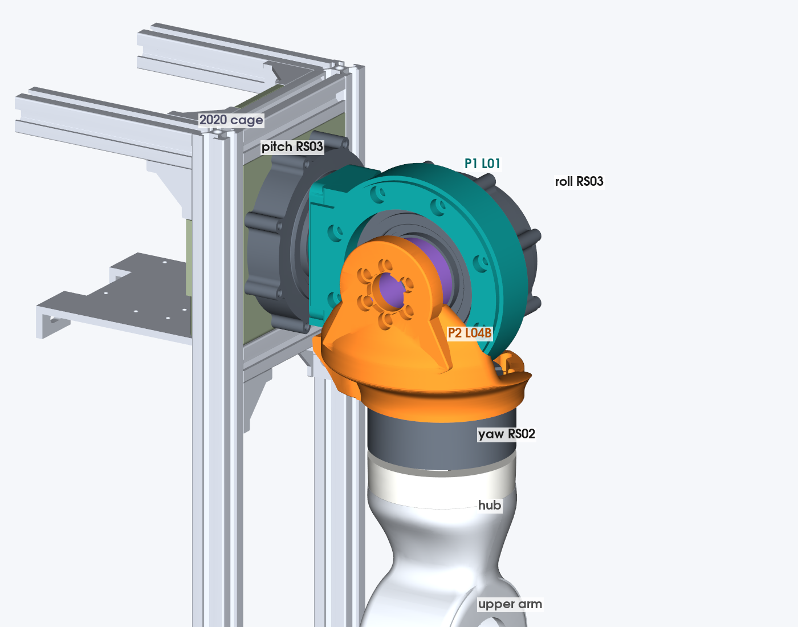

# Left shoulder measurement study (2026-11-11)

Read-only study of the current left shoulder: torso pitch RS03 → P1 L01 → roll RS03 → PF03 spacer → P2 L04B → yaw RS02
(rear face) → shoulder hub → frozen upper arm (`left-arm-organic`). No CAD was changed. SolidWorks was not launched: every
number below comes from the STEP files with Python (cadquery/OCP 7.9, trimesh, scipy), unless it says "from notes".

## 0. Frame and method

- **Frame:** the torso STEP frame, mm. X lateral (+X outboard, left arm), Y up, Z forward (REP-103 x-forward maps to +Z; the
  layout's `F_TORSO` axes say the same). Torso midplane X 0.
- **Placement:** P1, P2, spacer, roll RS03 and yaw RS02 STEPs are in the left "source" frame; they were placed with the
  documented left transform `[-1,0,0,97; 0,0,1,424.860667548201; 0,1,0,-0.0141253439872]` (P1 handoff). The hub and the
  upper arm exports are already in the torso frame. Pitch RS03, torso pitch mount and 2020 cage come from `TORSO.step`
  (components NAUO5, NAUO6 and the NAUO3 extrusions). All parts line up with no interference, which cross-checks the transform.
- **Axes (measured from the vendor cylinders):**
  - Pitch: along X, through Y 424.86, Z −0.014. Pitch RS03 output face X 97.0, rear face X 40.4.
  - Roll: along Z, through X 170.49, Y 424.86. Roll RS03 output face Z 30.64, rear face Z −25.96.
  - Yaw: along Y, through X 170.49, Z 5.99. RS02 output face Y 319.86, rear face Y 365.26.
  - Pitch and roll axes intersect (within 0.014 mm). The yaw axis is 5.99 mm forward of the pitch axis and passes through
    the roll axis.
- **Gaps and sweeps:** surfaces sampled at about 0.5 mm spacing and compared with KD-trees. Distances are good to about
  ±0.3 mm. "Contact" means under 0.5 mm. Motor rotors were split from stators by vendor geometry (RS03 rotor = r < 23.8 mm
  at the output; RS02 rotor = r < 21.8 mm below Y 323.5), so a part bolted to an output is not reported as touching it.
- **Mass:** CAD volume × PETG 1.27 g/cc, solid.

## 1. Inventory

| Part | File used (now in this repo) | Original | Date | Kind |
|---|---|---|---|---|
| P1 pitch bracket, left L01 (WO01 family) | `cad/reference/shoulder/shoulder_pitch_bracket_left_l01.step` | Codex `task\LEFT_ARM_FORK_20261105\geometry\P1_LEFT_WO01_L01_HOLD.step` | 2026-11-05 | STEP only (OCCT mirror of the right P1; no native file) |
| P2 roll bracket, left L04B | `cad/reference/shoulder/shoulder_roll_bracket_left_l04b.step` | Codex `task\LEFT_P2_L04B_PRINT_REVIEW_20261105\geometry\P2_LEFT_L04B_ONE_SIDE_RELIEF_HOLD.step` | 2026-11-05 | STEP only |
| PF03 printed roll spacer | `cad/reference/shoulder/shoulder_roll_spacer_left_pf03.step` | Codex `task\LEFT_ARM_V1_LAYOUT_20261106\inputs\SPACER.step` | 2026-11-05 | STEP (from BREP) |
| Roll RS03, placed | `cad/reference/shoulder/shoulder_roll_rs03_placed_left.step` | Codex `...\LEFT_ARM_V1_LAYOUT_20261106\inputs\ROLL_RS03.step` | 2026-11-05 | Vendor RS03 geometry from the torso export, 23 solids, translated |
| Yaw RS02, placed (clock 172.12°) | `cad/reference/shoulder/shoulder_yaw_rs02_placed_left.step` | Codex `...\inputs\YAW_RS02.step` | 2026-11-05 | Vendor RS02, placed |
| Shoulder hub | `cad/reference/shoulder/upper_arm_hub_left.step` | `J:\code\roark-wt\left-arm\cad\exports\upper-arm\upper_arm_hub_left.step` (native `upper_arm_hub_left.SLDPRT` there) | 2026-11-09 | Native + STEP |
| Pitch RS03, torso pitch mount, 2020 cage | not copied (75 MB) | Codex `...\inputs\TORSO.step` = `marengo_torso_asm.STEP` | 2026-11-05 | STEP assembly |
| Upper arm (frozen) | read from `J:\code\roark-wt\left-arm-organic\cad\exports\upper-arm\*.STL` | left-arm-organic worktree | 2026-11-10 | Native + STL |
| Vendor RS03 / RS02 | `cad/vendor/robstride/vendor_robstride_rs03.stp`, `vendor_robstride_rs02.step` | `C:\Users\joeyl\OneDrive\Desktop\robot\Actuators\RobStride\` | 2026-02 / 03 | Vendor STEP |

- **Assemblies:** no native assembly holds the left shoulder with the torso and the current upper arm. The nearest is
  `Codex\task\LEFT_ARM_V1_LAYOUT_20261106\LEFT_ARM_LAYOUT.SLDASM` (2026-11-06): P1/P2 as imported bodies, fixed, no mates, a
  simplified torso, an older upper arm, and a +38 mm X offset against the torso STEP frame. This study assembled the parts
  itself, in the torso frame, from the files above.
- **Also found:** marengo has a later `cad/shoulder/marengo_shoulder_p2_left_l05.SLDPRT` and
  `cad/exports/shoulder/marengo_p2_l05_left.step` (2026-11-06/07). L05 is 140,021 mm³ (−399 mm³ against L04B), same
  bounding box except source X max −9.18 (L04B −6.67). It is not the briefed part; everything below is L04B. Joey should
  say which P2 is current.
- **Hardware:** from the WO01 hardware sheet (marengo `cad/reviews/shoulder/20261102_wo01-exploded-views/09`), confirmed
  by hole counts in the STEP files (section 6).

## 2. Printed parts

| Part | Bounding box X × Y × Z (mm) | Volume (mm³) | Mass, solid PETG (g) | Notes mass |
|---|---|---|---|---|
| P1 L01 | 131.0 × 115.0 × 63.6 (X 97.0–228.0, Y 367.4–482.4, Z −24.0–39.5) | 133,725 | **169.8** | 172.73 g sliced job incl. support (notes) |
| P2 L04B | 122.8 × 102.0 × 109.5 (X 103.7–226.5, Y 351.9–453.9, Z −37.5–72.0) | 140,420 | **178.3** | 188.6 g sliced job incl. support (notes) |
| PF03 spacer | Ø44 / Ø21.5 × 20 (Z 30.64–50.64) | 19,643 | **24.9** | 23.57 g sliced (notes) |
| Shoulder hub | 77.8 × 31.9 × 78.5 (Y 288.0–319.9) | 49,329 | **62.6** | 63.4 g sliced, 6 walls 50% (left-arm README) |
| **Total printed** | | | **435.6** | |

**Load-path sections** (cut areas from the meshes, mm²; "n" = separate pieces in the cut):

- **P1, planes X = const (pitch output toward roll ring):** pad at X 97.5: 1011 (Ø44 pad with Ø21.5 bore and six Ø6.1
  holes); X 102–108: 3291–3475 (pad block); X 115.5–121.5: 2408 → 1641; narrowest at **X 126–127.5: 968–982 (n 3 → 1)**
  where the pad block runs into the ring. The ring around the roll RS03 is r 53.5–79.5, Z −20 to 39.5.
- **P1 thinnest features:** six 1.38 mm ligaments around the pitch bores (notes, `P1_L01_START_HERE`). Ray-cast wall
  thickness: 1st percentile 1.43 mm, 5th 3.97 mm, median 11.4 mm.
- **P2, planes Y = const (roll plate down to RS02 bowl):** plate and gussets around the spacer, Y 415.5–433.5: **294–507
  (n 2–4)**, smallest at Y 430.5 (above the axis); just below the axis Y 418.5–421.5: 373; neck Y 406.5–412.5: 826–1101;
  bowl Y 352–385: 1959–2957. The plate is Z 50.64 to about 62, its gusset roots reach r 66.6, and the bore boss front is Z 72.
- **P2 thinnest features:** 1.974 mm material chord at the L04B relief remnant (notes, `LOCAL_MATERIAL_RAYS`). Ray-cast:
  1st percentile 1.53 mm, 5th 3.91 mm, median 12.2 mm. The RS02 seat ring is interrupted on its lower sectors by the L03/L04B
  openings (notes).
- **Spacer:** a 11.25 mm wall ring with six Ø6.1 holes on PCD 30.4; ligament between a hole and the bore 1.38 mm (ray-cast).
- **Hub, planes Y = const:** lugs Y 288–295: 150–215 (n 2–4); spigot r 28–35.8, Y 296–302: 1745–2528; window band Y 303–306:
  1213 (n 7); plate Y 317–319.9: 3731. The six windows and the floor opening leave the window band as the hub's narrowest
  full section.

**Print orientation and supports** (from notes; not re-sliced here):

| Part | Orientation | Supports |
|---|---|---|
| P1 L01 | Source +Y face (world +Z, the front) down, built along source −Y; 375 G-code layers | Normal auto 45°: under all 8 roll-housing seats, all 6 horizontal pitch bores, the Ø21.5 opening crown, pad underside. 6 walls / 100% |
| P2 L04B | Upright as installed, RS02 ring face down, 102 mm tall, 45° plate rotation | In the side relief, outer overhangs, central roll opening, horizontal bores; must come out through the bottom/side opening |
| PF03 | Axis vertical | None (notes) |
| Hub | RS02 face down | None noted |

## 3. Moving interfaces, gaps and cantilevers

**What rotates against what:**

| Joint | Moving side | Fixed side | Smallest gap, neutral pose (measured) | Over the joint's travel |
|---|---|---|---|---|
| Pitch | P1 and everything outboard | Pitch RS03 stator, torso pitch mount, cage | P1 ↔ pitch stator **4.75** (X 101.7, under the pad block); P2 ↔ pitch stator 9.17; P1 ↔ cage 29.3; P1 ↔ pitch mount 26.8 | Constant: no contact anywhere in −180…+180° (3° steps) |
| Roll | Spacer, P2, yaw RS02, hub, arm | Roll RS03 stator, P1, and the torso | P2 ↔ P1 **1.48** (r ≈ 56–59 from the roll axis, Z 34–36: P2's lower arms run around P1's front lip); yaw RS02 rear ↔ P1 **2.10** (Y 365.3); spacer ↔ roll stator 5.3; P2 ↔ roll stator 9.4; yaw RS02 ↔ roll RS03 10.3 | P2 ↔ P1 stays 1.48–1.50 for all outward roll; **inward contact at −4.5…−5°** |
| Yaw | Hub, upper arm | Yaw RS02 stator, P2 | Hub ↔ RS02 stator **3.41** (axial, hub top Y 319.86 against the housing underside, r 21.8–39.3); hub ↔ P2 32.0; arm ↔ RS02 21.9 | Constant: no contact in 0–360° |

- **Rub risks:** P2 ↔ P1 at 1.48 mm is a printed-on-printed running clearance swept by the whole roll travel; any tilt of the
  roll output under load closes it. Yaw RS02 rear ↔ P1 at 2.10 mm is the same kind of gap. Hub ↔ RS02 at 3.41 mm is a printed
  face running against the motor housing.
- **RS03 output face (vendor solid grouping):** the rotor is the inner disc r ≤ 23.5 mm, flush with the face; a groove r
  24–28 mm sits 3.7 mm down; a **stationary ring r 28–35 mm is flush with the output face**; the housing beyond r 36 is 2.5 mm
  below it. Anything bolted to an RS03 output must stay inside r ≈ 27 near the face. P1's pad reaches r 22.1 at the face and
  r 23.3 within 3 mm; the spacer r 22.0. Both clear today.
- **What carries the overturning moment:** each motor's own output bearing alone. Nothing else touches across any joint
  (gaps above), and there is no second bearing or thrust face anywhere in the shoulder.

**Cantilevers (measured):**

| Distance | Value |
|---|---|
| Pitch RS03 output face (X 97.0) → roll axis / arm centreline (X 170.49) | **73.5 mm** |
| Pitch RS03 rear face → output face | 56.6 mm (X 40.4–97.0) |
| Roll RS03 output face (Z 30.64) → spacer/P2 face | 20.0 mm (spacer) |
| Roll RS03 output face → P2 front (bore boss) | 41.4 mm |
| Roll RS03 output face → yaw axis | **24.65 mm behind the face** (yaw axis Z 5.99): P2 folds back over the roll motor |
| Roll axis → RS02 rear face / output face | 59.6 mm / 105.0 mm (vertical) |
| RS02 rear face → output face | **45.4 mm** (Y 365.26 → 319.86) |
| Arm centreline from torso midplane / from the cage side (X 75) | **170.49 mm / 95.5 mm** |
| Shoulder height (pitch axis) | Y 424.86 (cage top Y 495) |

**Static moment on each output bearing** (estimate; motor masses "task supplied" in the layout's `mass_torque.json` —
RS03 880 g, RS02 405 g, RS00 310 g — printed parts from CAD; no upper-arm shells, hand, cables or payload):

- Pitch RS03 output: 23.3 N at 71.4 mm from the face → **1.66 N·m tilting**, in every pose (gravity is always across the
  pitch axis). About 1.8 N·m with the hub and arm shells.
- Roll RS03 output: distal mass 1.32 kg. Arm hanging: 13.0 N radial, 0.25 N·m tilting. **Arm pitched 90° forward: 2.26 N·m
  tilting** (COM 174 mm from the roll axis), carried through the 20 mm printed spacer.
- Yaw RS02 output: elbow + RS00 0.72 kg at 161 mm → **1.13 N·m** tilting with the arm horizontal (about 1.3 N·m with hub and
  shells).
- The RS03/RS02 output-bearing moment ratings were not found in the files (not measured).

## 4. Room for support bearings

Radii are from each joint's axis, measured per axial station (`room.py`).

**Pitch (housing Ø93 body, Ø106 over the eight cast lugs, X 40.4–97):**

- X 75–97 (cage side to output face): **nothing but the motor**, r > 53 free all round; the cage and pitch mount end at X 75.
  P1 starts at X 97 (pad r ≤ 23) and widens to r 48.8 from X 102. So a **thin-section ring around the housing** fits here:
  for example bore ≥ 108, axial ≤ 20, outer race carried by a P1 skirt reaching back from X 102 to about X 78. 6808 (40×52×7)
  cannot go round the housing.
- Far side (inboard of the pitch rear face X 40.4): 80.8 mm free between the two pitch motors at shoulder height, but a
  far-side bearing needs a shaft through the RS03, and the RS03 is not hollow (rear cover is closed). Not usable.

**Roll (housing Ø93/Ø106, Z −26 to 28; output Ø47):**

- **Front, beside the output:** free ring r 22 (spacer) to r 40 (P1 front-lip bore) for Z 30.64–39.54 (8.9 mm), then r 22 to
  r 57 for Z 39.5–45 under the P2 plate. A bearing seated in P1's front lip with its inner race on a widened spacer fits:
  6809 (45×58×7), 6810 (50×65×7) or 6811 (55×72×9) at OD ≤ 80, 7–9 mm wide. 6808 bore (40) is smaller than the Ø44 spacer.
- **P1 front lip OD Ø115 (r 57.5), Z 29–39.5:** P2 already runs round it at 1.48 mm on its lower half. A large thin-section
  bearing or printed plain bushing could sit on this lip.
- **Far side (behind the roll rear face Z −25.96):** a free disc r < 59 from Z −26 back past Z −45 (the RS02 top and P2 bowl
  start at r 59–60; pitch motor at r ≥ 73.5). Room for a 6808 or larger on the roll axis, but it needs a P2 arm wrapping round
  the back of the roll motor and a stub on the RS03 rear cover, which has no mounting feature.
- Clearance to the cage and torso through roll travel: see section 7 (roll inward is blocked at −5° by P2 on P1, long before
  the frame).

**Yaw (RS02 housing Ø78.5, Y 323.9–351.9; rear cap Ø65 to Y 365.3):**

- **Around the housing, Y 324–352: nothing** within r < 56 (P2's bowl starts at Y 351.9 with inner r 32.5–35.5; hub and arm
  below Y 319.9). A thin-section ring (bore ≥ 82, up to ~28 mm wide) round the housing fits, outer race in a P2 skirt extended
  down from Y 352, inner race on a hub collar rising from Y 320. 6808 cannot go round the housing.
- Below the output: the hub (r ≤ 39.3) and the arm's Ø71.6 hub seat fill Y 288–320; a 6808 inside the hub spigot (r 28) is
  only possible with the hub redesigned.
- Above the rear face: P1 is 2.10 mm away (moves with roll), so no far-side yaw bearing.

## 5. Wire path

**Connectors as assembled (from the vendor models):**

| Motor | Where | Facing | Notes |
|---|---|---|---|
| Pitch RS03 | Two bays on the rear-cover flats, X 40.4–55 (inside the cage), at ≈ −52° and +128° from up toward forward (one up-and-back, one down-and-forward) | Radial | Inside the torso; pitch wiring never crosses a joint |
| Roll RS03 | Two bays on the rear-cover flats, X 145.5–195.5, Z −26 to −8: top bay Y 460.9–474.1, bottom bay Y 375.6–388.9 | Radial, up and down | P1 does not cover them (P1 at the top/bottom sectors only from Z 12). The **bottom bay faces the yaw RS02 10.3 mm below, which rolls relative to it**; the top bay has open air above. The vendor model shows the bays but not the XT30/GH1.25 bodies, so which bay holds which plug is not measured |
| Yaw RS02 | Two radial XT30(2+2) sockets 180° apart on the rear cap, Y ≈ 352–365, at ≈ 172° (inboard, −X) and ≈ −8° (outboard) | Radial | The inboard socket sits in P2 L04B's 14.3 mm bottom-open side relief; plug-to-P2 gaps 1.0 mm, lead 1.19 mm (notes) |

**Openings and free sections:**

| Place | Free section (measured) | Against the reserve |
|---|---|---|
| Cage side at the shoulder (X 75, Y 373.6–475, Z ±50) | **2.3 mm² free**: the torso pitch mount ring fills the window | Closed. The arm trunk must leave the cage through its front/back faces, above the top rail (Y 495) or below Y 353.6 |
| Round the pitch housing, X 75–97 | Annulus r 53 outward, 22 mm long, nothing in it | Meets 4 × 14.5 and Ø10 easily. Best place for a pitch service loop or clock spring |
| P1 pad bore along the pitch axis | Ø21.5, X 97–117.8 | Blind: closed by the pitch output disc at X 97; opens 2.4 mm from the roll housing. Not a path |
| Roll front window, above the roll axis | Z 39.54 (P1 lip end) to Z 50.64 (P2 plate): **11.1 mm axial**, r 22–57, over the whole upper half | Meets 4 × 14.5 and Ø10. Crossing here puts the cable near the roll axis (r ≈ 25–40) |
| Spacer / P2 bore | Ø21.5 × 41 mm along the roll axis | Blind at the roll output disc; open only to the front. Not a crossing |
| Behind the roll motor | Z < −26, r < 59 free | Meets the reserve; the roll top bay plugs straight up here |
| P2 ↔ P1 below the roll axis | 1.48 mm | No |
| RS02 rear ↔ P1 | 2.10 mm | No |
| P2 side relief at the RS02 socket | 14.3 mm wide, bottom-open (notes) | Fits the RS02 plug; carries no trunk |
| **Into the upper arm across yaw** | The only path is the **3.41 mm axial gap** between the hub top (Y 319.86) and the RS02 housing underside, r 21.8–39.3, into the hub's six windows | **Below the 3.5 × 13 reserve; Ø10/Ø9 impossible.** The hub covers the arm's top opening (hub seat Ø71.8), and the arm has no side opening near the hub. No passage exists today |

**Rotation each crossing sees:**

- **Pitch:** no geometric limit; the brief's range is about 180° forward and under 90° back, so up to **~270°** at the
  pitch crossing. The cable must loop round the pitch housing (X 75–97) from a cage face to P1/roll.
- **Roll:** outward travel has no geometric stop; inward is blocked at −5°. The cable from P1/roll RS03 to P2/RS02 sees the
  full roll range.
- **Yaw:** unlimited by geometry. The trunk and the elbow RS02's own cable both have to get from the fixed RS02/P2 side into
  the rotating hub; the measured path for that is 3.41 mm (above).

## 6. Fasteners and assembly order

Hole patterns measured in the STEP files; screw lengths from the WO01 hardware sheet.

| Interface | Holes measured | Hardware (sheet) | Access |
|---|---|---|---|
| A. Pitch RS03 output → P1 pad | 6 × Ø6.1 on PCD 30.4 at −134 + 60k°, X 97–108.7; Ø9.6 counterbore X 108.7–114.1; Ø11 X 114.1–117.8 | 6 × M4 × 18, washers OD9, 6 limiters OD6 × 11.75 | Heads face the roll motor: the hole ends at X 117.8 and the roll housing is at X 120.24, **2.4 mm away**. An M4 × 18 cannot go in or out with the roll RS03 fitted. P1 goes on the pitch output first |
| B. Roll RS03 housing → P1 ring | 8 × Ø4.5 on PCD 98 at 22 + 45k°, Z 28.3–33.9; Ø9.6 counterbore to the lip face | 8 × M4 × 14, washers, no limiters | Heads face +Z. The 4 upper screws are clear. The **4 lower screws (−22, −68, −112, −158°) are covered by P2's lower arms 8.7–12 mm above the heads** in the neutral roll pose: fit before P2, or roll P2 outward to reach them |
| C. Roll output → spacer → P2 | 6 × Ø6.1 on PCD 30.4 at 30 + 60k°; Ø9 counterbore Z 57.6–61.6 in P2 | 6 × M4 × 35, 6 underhead spacers OD8 × 3, 6 limiters OD6 × 27 | From the front of P2; clear |
| D. RS02 rear → P2 | 5 × Ø4.6 on PCD 73 at −136, −96, −56, 64, 104°; Ø7.8 counterbore; 3 Ø7.6 reliefs at −176, −16, 24° | 5 × M3 × 12, washers, 5 limiters OD4.5 × 7 | 4 of 5 driver paths blocked once P2 is on the roll (notes). RS02 to P2 first, then P2 to the roll |
| E. Hub → RS02 output | 6 × Ø4.3 on PCD 24 (5 with Ø8.8/Ø10 counterbores) | M4 (length not in files) | From below, before the arm halves |
| F. Arm halves → hub lugs | 2 × M3 × 40 at X 147.5 / 193.5, Y 292 | 2 × M3 × 40 (left-arm README) | From the arm's back half |
| Unknown | P1: 2 × Ø12 at R 38.9 about the pitch axis, X 101.7–110.7 (34°, 146°) | — | Purpose not found (possibly tool access) |

Totals in the shoulder (A–D): 25 screws, 19 washers, 6 underhead spacers, 17 limiters (sheet); plus hub 6 × M4 and 2 × M3 × 40.
The sheet says the M4 screws are owned, washers/spacers are not, and limiter inventory is unconfirmed.

**Assembly order this forces:** pitch output ← P1 (A) → roll RS03 into P1 (B, all 8) → RS02 onto P2 (D) → spacer + P2 onto
roll output (C) → hub onto RS02 (E) → arm halves (F). Taking P1 off the pitch motor needs the roll motor out first, which
needs P2 off first.

## 7. Travel and hard stops

| Axis | Geometric limit (sweeps at neutral other joints) | Hard stop |
|---|---|---|
| Pitch | None in −180…+180° (closest: P2 ↔ pitch stator 9.17, P1 ↔ cage 26.9 at 123° back) | None |
| Roll outward (arm away from the body, + about +Z) | None to +180° (P2 ↔ P1 stays 1.48) | None |
| Roll inward (toward the torso) | **−4.5 to −5°: P2's inboard lower corner (X 108–114, Y 379, Z 8–21) hits the underside of P1's pad block.** Then yaw RS02 ↔ P1 at −30°, hub ↔ cage at −36°, arm ↔ cage at −21° | None; the first contact is printed part on printed part |
| Yaw | None in 0–360° | None |

The torso shell, head and other arm were not in the model (only the 2020 cage and pitch mount), so pitch/roll limits against
them are not measured. Notes say sampled +5° inward / −90° outward were never approved as limits.

## 8. Weak, awkward or likely to fail

1. **All three joints hang on the motor output bearings alone.** Measured tilting moments 1.7 N·m (pitch), up to 2.3 N·m
   (roll, through a 20 mm printed spacer), 1.1–1.3 N·m (yaw), before shells, hand, payload or dynamics.
2. **Roll inward travel is about 5°.** P2 hits P1 at −4.5…−5°. The arm cannot be brought in toward the body at all.
3. **Printed parts run 1.48 mm (P2 on P1) and 2.10 mm (RS02 on P1) apart through the whole roll range.** Small deflection
   or layer roughness gives rubbing.
4. **No cable entry into the upper arm.** The only path across yaw is a 3.41 mm slot between the hub and the RS02, under the
   3.5 × 13 reserve and well under Ø9/Ø10.
5. **The cage side is closed at the shoulder** (pitch mount fills it); the arm trunk has to leave the cage another way and
   loop ~270° round the pitch housing.
6. **Roll RS03 bottom connector bay faces the yaw RS02 10.3 mm below,** which moves with roll. Only the top bay is usable.
7. **Service order is deep:** removing P1 means removing P2 and the roll motor first (pitch screw heads 2.4 mm from the roll
   housing); 4 roll-housing screws are under P2.
8. **Thin printed features on the load path:** six 1.38 mm pitch ligaments in P1; a 1.97 mm chord at P2's relief remnant and
   an interrupted RS02 seat ring; hub lugs 150–215 mm² with two M3 × 40 carrying the arm into the hub.
9. **Unresolved datum:** the pitch output hole pattern is 7.83 mm off P1's holes at the exported clock (−29.9° rotation
   fixes it numerically). Anatomical left vs STEP +X was flagged as unconfirmed in the P1 handoff.
10. **No hard stops** on any axis; software limits are the only protection, and the first contact inward is a printed corner.

## 9. Not measured

- Plug bodies, latches, cable exits and which RS03 bay holds XT30 vs GH1.25 (the vendor models show empty bays).
- RS03/RS02 output-bearing moment and axial ratings.
- Real thread engagement, preload, limiter fit, and the hub M4 screw length.
- Real print orientation and supports for P1/P2/spacer were taken from the review notes, not re-sliced; hub orientation from
  the left-arm README.
- Clearance against the torso shell, head, right arm and any covers (not in the model), and pitch/roll travel in combined
  poses (sweeps were one joint at a time from neutral).
- Deflection under load: all gaps are nominal CAD.
- Upper-arm parts were read from the frozen worktree's STL exports; nothing there was opened in SolidWorks or changed.

## Pictures

| File | What |
|---|---|
| [O1_overall_iso.png](O1_overall_iso.png) | Shoulder with the cage corner, torso pitch mount and frozen upper arm |
| [O3_overall_back.png](O3_overall_back.png) | Same, from behind and outboard |
| [E1_exploded.png](E1_exploded.png) | Exploded along the chain |
| [S1_pitch_axis_section.png](S1_pitch_axis_section.png) | Horizontal cut through the pitch and roll axes |
| [S2_roll_axis_section.png](S2_roll_axis_section.png) | Sagittal cut through the roll and yaw axes |
| [S3_yaw_axis_section.png](S3_yaw_axis_section.png) | Frontal cut through the yaw and pitch axes |
| [D1_yaw_crossing_inboard.png](D1_yaw_crossing_inboard.png) | Inboard view of the yaw crossing: RS02 socket in the P2 relief, hub gap |
| [D2_roll_rs03_top_connector_bay.png](D2_roll_rs03_top_connector_bay.png) | Roll RS03 top connector bay (vendor model) |

Analysis scripts are in [scripts/](scripts/) (they expect the copied STEP files and `TORSO.step` at the paths in their headers).
