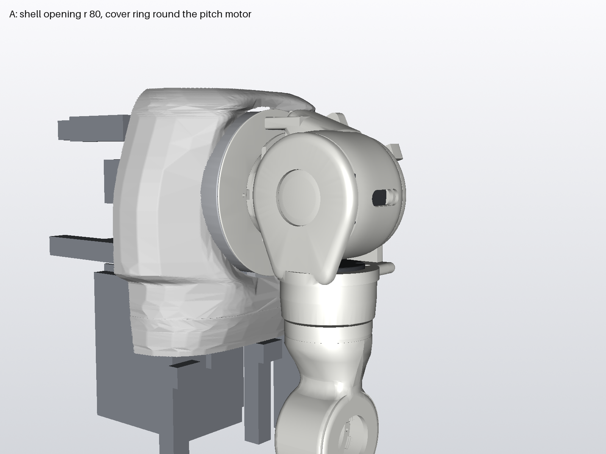

# Left shoulder, roll drum and fork: first SolidWorks pass (2026-11-11)

The agreed concept ([concept-roll-fork/CONCEPT.md](../concept-roll-fork/CONCEPT.md), "drum and fork, no yaw ring") as
SolidWorks parts, dressed twice for the look of the organic arm.

- **Built by:** scripts in [cad/scripts/shoulder/](../../../../cad/scripts/shoulder/) (dims.py holds every dimension).
- **Files:** [cad/shoulder/left/](../../../../cad/shoulder/left/).
- **Frame:** parts are modelled in the old-frame torso coordinates of CONCEPT.md (X outboard, Y up, Z forward, mm).
  The rev A frame sits 38 mm further inboard on the assembly mate TORSO_X_SHIFT.
- **Shell:** option A, chosen by Joey: opening r 80.
- **Not done in this pass:** FEA and print files.

## Files

| File | What |
|---|---|
| `shoulder_skeleton_left.SLDPRT` | Pitch, roll and yaw axes; motor faces; interface sketches (bolt circles, keep-outs, 6808 section, passage sections, stop centrelines) |
| `shoulder_roll_drum_left.SLDPRT` | P1: closed drum round the roll RS03, pitch pad and flared neck, cable trunk under a spine fairing, branch to the RS03 top bay, 5 spokes for the flange ring |
| `shoulder_pitch_flange_ring_left.SLDPRT` | Moving front wall of the pitch loop channel, its own part: 1.8 mm, prints flat, 5 x M3 into inserts in the spokes |
| `shoulder_roll_cap_left.SLDPRT` | Rear cap: hollow stub OD 40.0 / bore 25 with 1 mm land, radial channel, 2 stop lugs, 3 x M4 ears |
| `shoulder_fork_front_left.SLDPRT` | Dome cap on the roll output (r 55), RS02 seat ring, cuff round the RS02, socket pockets and tap, joint pad |
| `shoulder_fork_rear_left.SLDPRT` | Rear cheek with the 6808 seat (Ø52), arm with power and signal channels, yaw exit |
| `shoulder_fork_cap_left.SLDPRT` | Domed press-in cap over the 6 front screws |
| `shoulder_hub_left.SLDPRT` | Hub with the dished top, on the frozen hub; spigot extension and second lug pair prepared, suppressed |
| `shoulder_pitch_loop_cover_left.SLDPRT` | Fixed cover round the pitch motor, bottom feed (FEED_*), 4 M5 placeholder pads |
| `shoulder_left_asm.SLDASM` | Everything above plus the motors, the 6808, the frozen upper arm and the rev A frame |
| `ref/` | Imported references: pitch RS03 as placed, rev A frame, upper arm halves and ring |

## Roll stops

- **Values:** inward **-11 deg** (confirmed), outward +110 deg.
- **Where to change them:** one place in `shoulder_roll_cap_left`, Tools > Equations: the global variables
  `ROLL_STOP_IN` and `ROLL_STOP_OUT`.
- **How they drive the lugs:** each variable sets one reference plane through the roll axis (`STOP_IN_AXIS`,
  `STOP_OUT_AXIS`). That plane carries the lug's contact face, set off by the arm's half-width.
- **Tested:** setting -15 and back to -11 rebuilds the lug in the right place.

## Masses (solid PETG 1.27 g/cc, SolidWorks volumes)

| Part | Bare (g) | Round 2 (g) | Organic, final (g) | What the cosmetics cost (organic) |
|---|---|---|---|---|
| Drum with pitch adaptor | 189.0 | 232.5 | **238.3** | Crowned closed skin with pockets under it, about +24 g; neck flare, about +10 g; lofted spine over trunk B and the branch, about +17 g |
| Flange ring | 29.2 | 29.2 | **29.2** | |
| Rear cap with stub and lugs | 74.1 | 79.5 | **75.2** | Closed plate, +6.8 g; rim follows the drum's r 54.5 end |
| Fork front | 92.2 | 153.9 | **140.8** | Crowned dome cap, pocketed behind (5 pockets), about +18 g; cuff with a gentle swell, 1.6 mm at the hub, about +31 g |
| Fork rear | 63.4 | 61.0 | **60.6** | R6 back dome, rounded arm and joint lugs |
| Fork press-in cap | 6.6 | 6.6 | **5.5** | Recessed 1.5 mm below the crown, like the arm's caps |
| Hub | 60.2 | 60.2 | **60.2** | Prepared features suppressed |
| **Shoulder total** | **514.7** | **622.9** | **609.8** | Working number about 600 g |
| Pitch loop cover (torso side) | 102.5 | 102.3 | **102.3** | |

- The round-2 rear web (cuff to fork rear arm) is dropped. It sat 0.5 mm off the fork rear arm and carried no load, so it
  was purely cosmetic (6.5 g).
- If mass matters, drop in this order:
  1. the spine (trunk B and the branch then show as rounded ducts), about 17 g
  2. a partial cuff (outboard and front faces only), about 12 g
- The drum skin and the cuff stay (Joey).

## Size

| | X | Y | Z |
|---|---|---|---|
| Body without cover and ring (old frame) | 97-227.5 | 288-500 | -56.7 to 51 |

- Rev A: add 38 to X.
- Every part fits the P2S 256 mm cube. The largest is the cover, 38.9 x 200.7 x 151.7.

## Checks

**Static interference** (exact solid booleans):

- The printed parts against the vendor RS03/RS02 and each other: none, after the fixes below.
- The SolidWorks interference check at the brief's 36 poses (neutral and roll -11 / +45 / +110, each at pitch
  -30 / 0 / +90 and yaw -90 / 0 / +90) found no shoulder-to-shoulder, shoulder-to-motor or shoulder-to-arm interference.
  - Its hits against the frame part are shell parts in that model: the cover and drum against `shellpart__collar_1`,
    the drum against two collar screws, and the ring against the upper spine pad (6.45 mm³). The remaining hits are the
    frame model's own pitch RS03 envelope and bracket against our pitch RS03.
  - The frozen upper arm's own ring and keys overlap by 1.6 mm³ (not a shoulder part).

**Running clearances** (`check_clearance.py`; samples 0.7 mm, ±0.4 mm):

- **Coverage:**
  - the 36 brief poses
  - roll -11…+110 in 3 deg steps at yaw -90/0/+90
  - pitch -90…+180 at roll -11/0/+110
  - yaw -90…+90
- **Against:** the rev A frame (moved -38 X; shell parts excluded) and the pitch RS03.
- **Result:** on the organic final parts, every moving pair is **2.0 mm or more**. The only contacts are the intended
  stop contacts:

| Pair | Min (mm) | Pose (pitch, roll, yaw) |
|---|---|---|
| Fork rear arm ↔ stop lug | 0.02 | roll -11 and +110 (intended) |
| Flange ring ↔ cover | 2.00 | any (designed axial gap) |
| Fork rear ↔ hub | 2.16 | roll -11, yaw 78 |
| Fork front (cuff) ↔ hub | 2.17 | roll 110, yaw -12 (the yaw gap under the cuff) |
| Flange ring ↔ fork front | 2.40 | roll -12 (1 deg past the stop) |
| Drum ↔ cover | 2.41 | pitch 150 |
| Cap ↔ fork rear | 2.50 | any |
| Drum ↔ RS02 | 2.54 | roll 97 |
| Drum ↔ fork front (dome) | 3.00 | |
| Drum ↔ rev A frame | 3.50 | pitch -30 |

- Round 1's neck flare sat where the fork front's socket-tap sector and the RS02 swing in at the inward stop (0.04 mm).
  It was caught by this sweep, and the flare is now trimmed below Y = RY - 41.

**Stops:**

| Roll | Arm to lug |
|---|---|
| -10 | 0.72 |
| -11 | 0.04-0.06 |
| 110 | 0.02 |

At both stops everything else is 2.0 mm or more away.

## Rev A frame and shell: inward roll from 0 to -25 deg

`check_reva.py`: roll in 1 deg steps, yaw -90…+90 in 15 deg steps. Contact means under 0.5 mm.

| Pitch | Frame (and the 6 mm PETG gusset allowance) | Shell skin (opening region ignored) |
|---|---|---|
| -30 | roll -21: upper arm on hardpoint H5 | roll -14: hub, yaw 15 |
| 0 | none to -25 | roll -13: upper arm, yaw -60 |
| +24 | roll -20: upper arm on hardpoint H5, yaw -75 | roll -15: hub, yaw -75 |
| +90 | none to -25 | none to -25 with the r 80 opening |

- **Frame:**
  - no contact with the frame, the PETG gusset allowance (Z ±76) or the pitch wing inside -11…+110
  - at roll -11 the nearest frame point is 25.5 mm away (top side rail)
- **Shell skin:** at roll -11 it is 3.5 mm or more from every moving part outside the opening (`check_shell_trim.py`). No
  trim is needed for the -11 stop. The skin limits inward roll at -13…-15, so rev A allows more than -11 only with a
  reshaped skin there.
- **Lower spine pad** (`shellpart__spine_lower_1`, rev A X 73-129, Y 166-295, Z -124 to -77):
  - The upper arm reaches it at pitch -30 from roll -8, and is **0.01 mm** from it at -11 (yaw -45).
  - **Minimum trim for 3 mm at the -11 stop:** up to 2.99 mm off the pad's outboard end, over rev A X 119.4-129,
    Y 202-276. That means the pad ending at about X 126, with its outboard edge eased by 3 mm.
  - Picture: [C1_spine_pad_contact.png](C1_spine_pad_contact.png).
- **Shell skin contact:** first at pitch 0, roll -13, yaw -60, past the stop. Picture:
  [C2_shell_skin_contact.png](C2_shell_skin_contact.png).

**Shell changes for option A**, for the body shell work:

1. Shoulder opening enlarged to **r 80** round the pitch axis. The fixed cover ring is r 75.9; the moving flange ring is
   r 77.5 and sits outboard of the skin.
2. The shell collar (r 60 at X 135-137) and its **8 screws** at r about 45 are removed. They overlap the cover and sit where
   the drum's spokes turn.
3. The **upper spine pad** ends inboard of rev A **X 140**. It overlaps the moving flange ring by about 0.5 mm, and is
   1.1 mm from the cover.
4. The **lower spine pad** is trimmed as above (end at about X 126) for 3 mm at the -11 stop.

## Hub: prepared for the arm joint work (nothing active)

The frozen interface is unchanged: spigot r 35.8 at Y 296-302, lugs, seam bolts, hub screws, cable window at 7.9 deg.
Two suppressed features are driven by global variables in `shoulder_hub_left`:

- **`SPIGOT_EXT`:** a ring r 28-35.8 below Y 296.
  - `SPIGOT_EXT_LEN` sets the length (6 mm placeholder).
  - The draft angle is in the feature: `SPIGOT_TAPER` is not linked yet.
  - `SPIGOT_EXT_ON` = 1 turns it on.
- **`LUG2`:** a second lug pair r 19-30, ±15 deg, Y 288-296.
  - Its plane through the yaw axis is set by `LUG2_ANGLE` (90 = at 90 deg to the seam).
  - `LUG2_ON` = 1 turns it on.
  - No bolt holes until the arm thread gives positions.

**Where a second lug pair fits:**

- The existing lugs sit at yaw angles 0 and 180 deg (on the seam), r 19-30, Y 288-295.
- At ±90 deg (front and back, mid-half) the arm halves have only their wall there (r 33-40). The same r 19-30 sector is free
  over Y 288-296, so a pair at 90 deg fits.
- It is clear of the cable window (7.9 deg, above Y 298) and of the yaw cable loop (above Y 315.8).
- The arm halves would need matching bosses on their inner walls at ±90 deg.
- **Not checked yet:** 23 N·m bending plus yaw torque.

## What changed against the mock-up

1. **Inward stop -11 deg** (was -15).
2. **Pitch flange is its own flat part.** It sits at X 104.5-106.3 on five drum spokes.
3. **Cap ears at 125 / 148 / 212 deg.** The ears at 165 and 200 deg hit the flange ring.
4. **RS02 socket pockets 4 deg wider** each side.
5. **Relief in the drum wall** for an RS03 housing boss at r 50.25. It overlapped the vendor solid by 200 mm³; the concept
   never checked that fit.
6. **Pitch loop cover: bottom feed and M5 pads** for the rev A frame:
   - The duct rises in the void under the step overhang (rev A X 101.6-112.4, Y 300-343).
   - It enters the cover bottom at about Y 349, Z -16.4 to +16.4 (power Z -14 to +2, signal Z +4 to +14).
   - The pads sit at the posts (Y 425, Z ±60), the step side rail (Y 363.6) and the top side rail (Y 485).
7. **Dressing for the look of the arm** (rounds 1 and 2):
   - Closed drum skin with the lightening under it, and one styled oval port for the pitch pad screws.
   - The neck flares into the drum.
   - Full dome cap r 55 on the fork front, running 3 mm in front of the drum lip. It covers the 8 lip screws: take the fork
     front off (6 screws under the press-in cap) before reaching them, as in the service order.
   - A cuff round the RS02, tapering to r 41.7, 2 mm above the hub rim, notched round the yaw exit.
   - A spine fairing over the trunk.
   - The rear cap and fork rear cheek with R6 edges.
   - The rear web from the cuff to the fork rear arm.

## Organic round (Joey: "organic", not excessive; stop being jarring next to the arm)

- **Drum:** the skin is a loft through crowned circles. It is r 54.5 at both ends and r 57 over the middle; r 57 is the most
  the RS02 swing allows (2.54 mm). The pockets under it follow the crown.
- **Rear cap:** its rim continues the drum's r 54.5 end.
- **Fork front:** its face crowns forward to Z 49 (an elliptical loft, 9 mm in, 7 mm forward). The press-in cap sits 1.5 mm
  below the crown rim, as the arm's caps sit in their recess.
- **Cuff:** a gentle convex swell, 2 mm above the hub rim.
- **Spine:** a low lofted spine covers trunk B and the branch, and its nose eases into the drum crown.
- **Rounded details:** the trunk on the neck has R5 edges, the fork-rear joint lugs R4.5 corners, the stop lugs R3.7.
- **Remaining box shapes:**
  - the trunk mouth on the neck top (rounded)
  - the fork rear arm seen from behind (rounded edges)
  - the cover's bottom feed, which sits inside the shell.

## Still open

- **Cover fixing:** the M5 pads are placeholders; the T-nut positions on the rev A rails are not checked.
- **Feed position:** waits for the final shell.
- **Printing:**
  - The fork front with the cuff prints as installed, with removable support under the RS02 seat ledge (open from below,
    no enclosed cavity). The seat face is then a supported face, so it needs checking.
  - The drum pockets open into the bore through the inner-wall windows (no enclosed cavity).
- **Bearing fits:** 6808 on the Ø40.0 printed stub, in the Ø52 printed housing, and inner-race retention.
- **Not analysed (no FEA in this pass):** stop-lug strength and impact; hub step ring and hub-to-arm joint (23 N·m bending
  plus yaw torque).
- **Deflection and stack-up:** all clearances are nominal CAD.
- **Plug bodies and cable flex life:** not checked.
- **Right shoulder:** a mirror, later.

## Method notes

- **Python environment:** a separate venv, `C:\joe\code\_venvs\shoulder` (cadquery 2.8, vtk, trimesh, shapely, pywin32).
  A package update by another job broke cadquery in the PC's shared Python.
- **SolidWorks:** one session-owned instance through `sw_instance.session()`. The shared import options were changed only
  for each import and restored right after.
- **Pitch RS03 reference:** in `TORSO.step` it is open shells. `sew_solid.py` sews it into 19 solids.

## Pictures

| File | What |
|---|---|
| [D1_look_shell_optionA.png](D1_look_shell_optionA.png) | Dressed, with the shell (option A), same camera as the option renders |
| [D2_front_clean.png](D2_front_clean.png) | Dressed, front-outboard, no frame or shell |
| [D3_back_clean.png](D3_back_clean.png) | Dressed, back |
| [D4_bare_vs_dressed.png](D4_bare_vs_dressed.png) | Bare first pass against dressed, front and back |
| [D5_whole_arm.png](D5_whole_arm.png) | With the whole organic arm (upper arm, elbow, forearm) |
| [D6_shoulder_vs_arm_render.png](D6_shoulder_vs_arm_render.png) | Beside the arm's own render |
| [C1_spine_pad_contact.png](C1_spine_pad_contact.png), [C2_shell_skin_contact.png](C2_shell_skin_contact.png) | The two shell contacts |
| [P1_look_front_outboard.png](P1_look_front_outboard.png) - [P5_today_vs_pass1.png](P5_today_vs_pass1.png) | Look, back, exploded, roll-axis section with bearing and cable path, today against the first pass |
