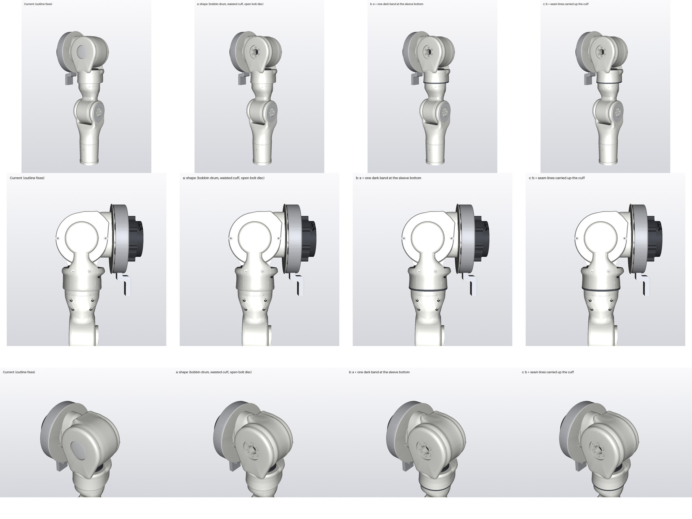

# Look options: match the organic arm (2026-11-11)

**Decision (Joey, 20:01Z): option a, shape only.** No dark band, no seam lines. It's applied to the real parts with a
milder drum relief (0.9 mm, held by 1.6 mm of skin over the parts inside the drum). Details are in CAD_NOTES.md,
"Look option a".

Three restrained variants on top of the outline-fix version (a71b446). Every detail copies something the arm already has
(`left-arm-organic`, read only). Nothing stands proud of the skin and there are no flat boxes.

Rows: front three-quarter with the whole arm, straight from behind, drum top. Columns: current, a, b, c.

| | What | Copies on the arm | Mass against current | Print cost |
|---|---|---|---|---|
| **a** shape | Drum as a bobbin: rolled rims r 57 at both ends, middle r 55.5 (never above the current r 57, so drum clearances hold). Cuff waisted about 1.5 mm at mid-height. Fork cap dropped: the 6 front screws show in the recessed disc. | Forearm cheeks (`forearm_organic_cheek_*`): rolled rims, smaller middle. Upper-arm neck: waist. Forearm and elbow end caps: the bolt circle open in a recessed disc. | about -14 g (drum -8.7, fork cap -5.5, port cap -1.0) | none |
| **b** a + one dark band | The sleeve's bottom 4 mm (below Y 318.6) in the arm's dark grey. | The forearm's dark stub ring at a section joint (`forearm_organic_stub_ring`, `#5d6168`). | same as a | one filament swap each on the fork front and fork rear (both print upright, so the band is their first layers), about 1-2 g of purge each |
| **c** b + seam lines | The arm's front/back seam carried up the cuff as a 1.0 x 0.6 mm shut line at yaw 0 and 180 deg. | The upper arm's seam between `upper_arm_organic_front` and `_back`. | about -0.05 g | none |

Tried and dropped from b: a whole dark rear cap and port cap. The cap read as a big dark plate, heavier than anything on
the arm, and the dark port cap read as a hole.

Caveats:

- These are look mock-ups built into `cad/_wip/look/`. The real parts are untouched.
- The variant forks predate the last fix in a71b446, the inboard cap that keeps the flange ring 2.2 mm off at the -11
  stop. Whichever variant is chosen gets rebuilt on the current sleeve and run through the full clearance, rev A and shell
  sweeps before it replaces anything.
- Files: `{now,a,b,c}_{front34,back,drumtop}.png`. Script: `../scripts/render_looks.py`.
