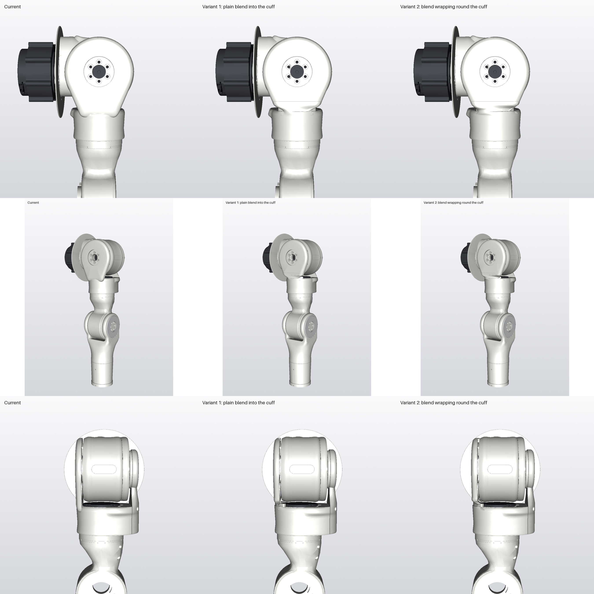

# Front blend: the fork front cheek running into the cuff (2026-11-12)

Joey (23:08Z): *"doesn't this kind of look like a tooth or something? is there a way to blend the front mounting face
into the bottom section a bit more without the two protruding lobe things?"* and (23:09Z) *"i wouldn't mind if it even
wrapped around a little bit, as long as the transition looks natural"*.

Rows: front, front three-quarter with the whole arm, side. Columns: current, variant 1, variant 2. These are mock-ups
built into `cad/_wip/look/fb1|fb2`; the real fork front is unchanged.

**What the lobes and notch were:**
- **Lobes:** the cheek outline is a hull of the r 55 dome circle and two r 10 circles at X ±22, Y 362. The two small
  circles are the lobes. They exist only to bring the cheek, which holds the roll output, down onto the RS02 seat ring:
  the load path from roll into yaw. No clearance, screw or print role.
- **Notch:** the cuff's 4 mm rounded top edge, dipping away under the cheek's straight bottom edge.

**How the variants are built** (`FRONT_BLEND` in `build_fork_front`):
- The cheek is cut flat at Y 372.
- One loft (`CHIN`) runs from the cuff's own front outline at Y 356 into the cheek's exact crowned section at the cut,
  so cheek and cuff form one surface.
- **Variant 1:** the chin starts from the cuff front at Z 40.5 and up.
- **Variant 2 (wrap):** the chin starts from Z 24, so its bottom wraps further round the cuff.

**Limits held in both:**
- Above the seat the chin stays at r 34.5 or more: 2 mm off the RS02 rear cap (r 32.5).
- It stays at Z 38.5 or more wherever it is within 59 of the roll axis: 2.5 off the drum's front face.

**Found while checking (true of the current part too):** the two front RS02 screws (yaw 64° and 104°) cannot be
reached by a straight driver from above; the cheek and dome are in the way. Both variants add two Ø7 access holes
straight down through the fork front above those screws, to be closed with flush press-in plugs (not modelled yet).
The holes account for most of the mass drop below.

| | Fork front (g) | Ring ↔ fork front at -11 | Cuff ↔ hub | Drum ↔ fork front | Shell skin at -11 (pitch -30 / 0 / +24 / +90) |
|---|---|---|---|---|---|
| Current | 144.6 | 2.11 | 2.13 | 3.00 | 2.29 / 3.7 / 3.02 / 7.8 |
| Variant 1 | 135.9 | 2.13 | 2.12 | 3.00 | 2.25 / 3.77 / 3.02 / 20.3 |
| Variant 2 | 136.1 | 2.12 | 2.12 | 3.00 | 2.25 / 3.78 / 3.03 / 20.3 |

- Moving-pair sweep (`check_clearance.py`, capped at 6 GB): every other pair is unchanged. The stop tooth is the
  intended contact. `clearance_fb1.json` and `clearance_fb2.json` hold the full results.
- The rev A frame, gusset and pitch-wing gap is unchanged (the chin is at the front, far from the frame).

**Still not perfect:**
- A faint shading line where the chin meets the cheek at Y 372.
- A small dip where the cuff's rounded rim meets the chin's sides.
- Both can be smoothed once one variant is chosen.

Script: `../../scripts/render_front_blend.py`.

## Round 2 on variant 2 (2026-11-12, coordinator's list)

**Load path:** the lobes carried the cheek into the seat ring. Measured as the front half of each Y-cut (Z > 5.99) just
above the seat, as area and section modulus for the roll torque (bending about an axis parallel to Z, in the layer
plane):

| | Narrowest W (mm³) | Where | Area there (mm²) |
|---|---|---|---|
| Current (lobes) | 6088 | Y 363 | 581 |
| First variants | 1650 (v1) / 2307 (v2) | Y 363-365 | 294 / 381 |
| **Variant 2 now** | **4296** | Y 363 | 476 |
| Variant 1 now | 3569 | Y 367 | 406 |

- The dome's own narrowest section on this path is W 4746 (Y 395). Variant 2 is now 9% under that existing weakest link.
- At a peak roll torque of about 60 N·m, that is roughly 14 MPa across the layers, layer SF about 1.6, against about 1.8
  at the current weakest link. **Flagged:** lower than today, but still above 1.5.
- **How it got back:**
  - The drum rule (Z ≥ 38.5) now applies only within 59 of the roll axis, so the chin's sides stay low.
  - A chin root, a ring segment r 34.5-41 over 40-140°, carries the cheek into the seat ring from Y 361.9 to 367.

**Faint line and dip:**
- The chin now carries on 6 mm up inside the cheek with the cheek's own section, so it meets with matching tangent.
- The cuff's 4 mm top round is switched off across the front (±35-60° fade), so the rim no longer dips beside the chin.
- **Remaining:** a faint line still shows at Y 372, where the cheek's crowned edge loft ends. Removing it fully means
  building cheek and chin as one loft from the dome down, which is a bigger rebuild. I'll do it on the chosen variant.

**RS02 access plugs** (`shoulder_fork_access_plugs_left`, mock-up, 0.7 g for both):
- Ø6.9 press-in in the Ø7 holes, 7 deep, top trimmed to the dome's r 55 surface.
- Each has a 2 x 1.2 mm pry notch on the back edge (toward the drum, out of sight); a small screwdriver there lifts it out.
- The 104° hole exits cleanly on the dome's top edge. The 64° hole sits on the cheek's back face (screw at Z 38.8 against
  the cheek's back at Z 39), so it is a half-open groove on the back of the cheek with only part of its rim on top.
- The RS02 goes onto the fork front on the bench, before the fork goes onto the roll output, so the drum is not in the
  driver's way.

**Masses:** variant 2 fork front 137.7 g plus plugs 0.7 g (current 144.6). Variant 1: 137.6 g.
