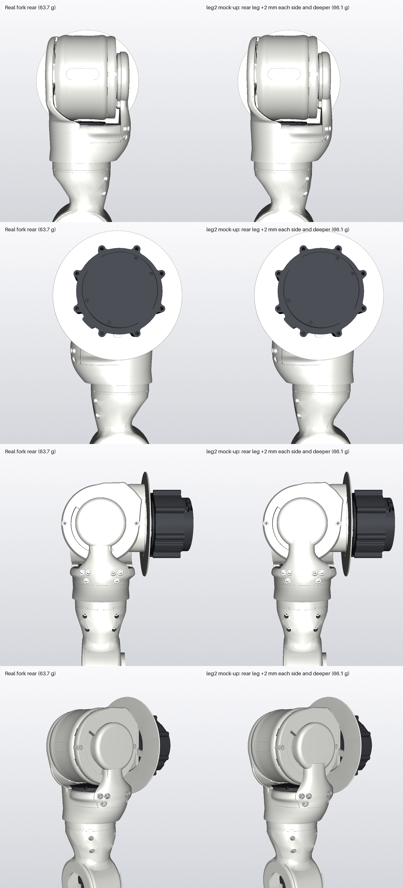

# leg2: a stiffer rear leg for the roll stop's torque path (mock-up, not on the real parts)

Rows: side outboard, side inboard, back, rear three-quarter. Columns: the real fork rear (r 47 sleeve, layout N joint),
and leg2 on the same parts.

**What it changes:**
- The rear leg's stations at Y 380 and 402 are 2 mm wider each side and 2 mm deeper.
- The 16 × 6 and 10 × 5 channels sit 1 mm further back, so the channel's front wall is 3.4 mm (was 2.4).
- About +2.4 g (66.1 against 63.7 g).
- Seen from outside: a slightly fuller neck under the housing, most visible from behind.

**What it buys** (stall FEA scaled to rated, 1 mm average, layer = tensile σy; leg2 was solved on the old sleeve with four
joint screws, the real parts with six):

| Zone | Real (r 47, layout N): rated / stall layer | leg2: rated / stall layer |
|---|---|---|
| Pad junction | 2.01 / 0.67 | 2.59 / 0.86 |
| Leg Y 380-395 | 1.89 / 0.63 | 2.43 / 0.81 |
| Joint zone | 1.49 / 0.50 | 1.65 / 0.55 |

- **The real parts already meet the rated target** (joint 1.49, accepted). leg2 adds margin at rated.
- **leg2 does not make the printed stop survive a 60 N·m stall:** layer 0.55-1.08.
- So leg2 only matters if Joey wants more rated margin. Whether the printed stop must survive a stall, or the controller
  limits (checks/B_ROLL_STOPS.md, "For software") cover it, is Joey's call.
