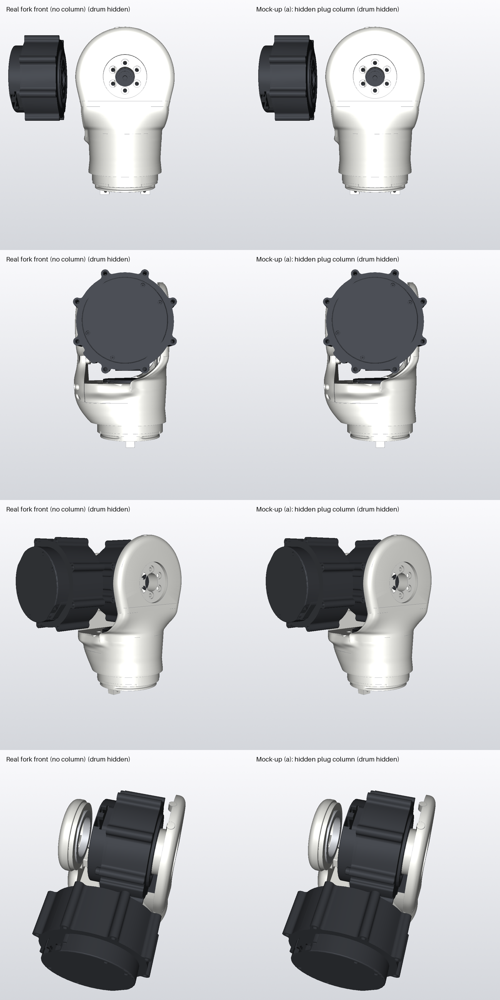
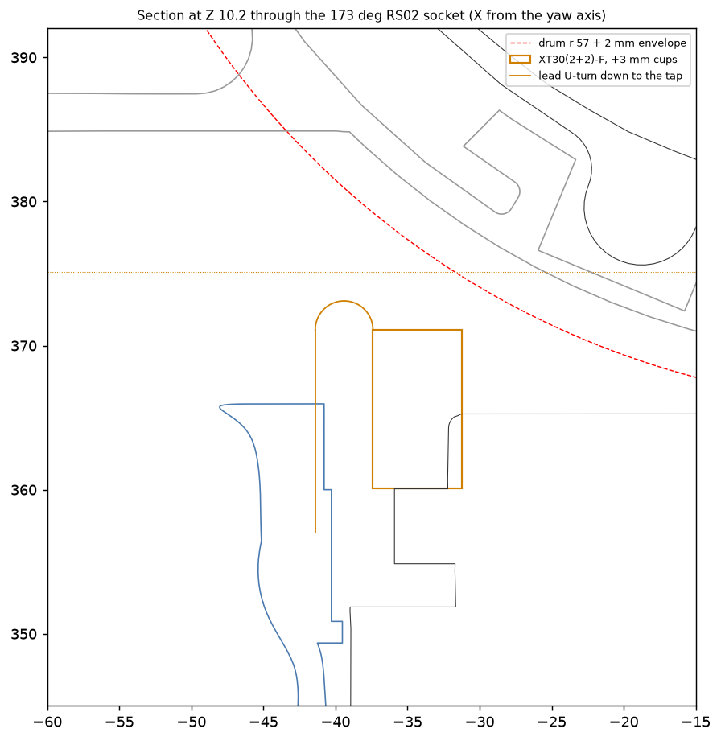
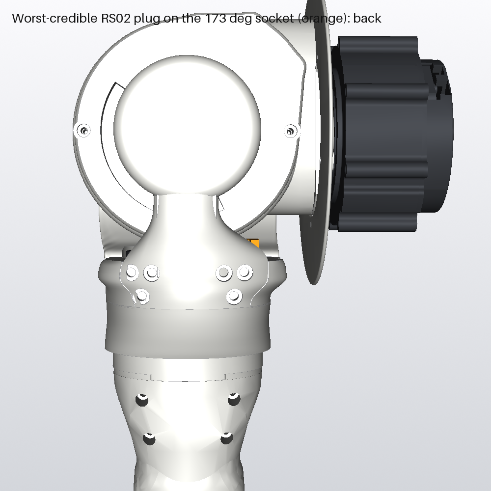
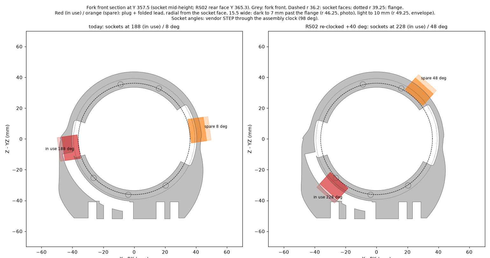
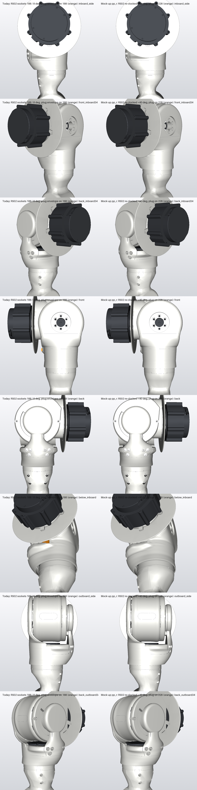
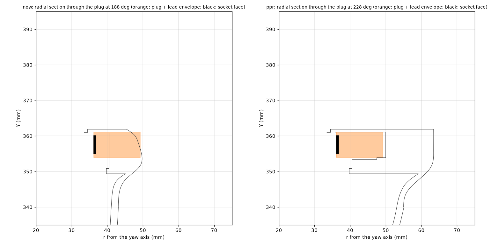
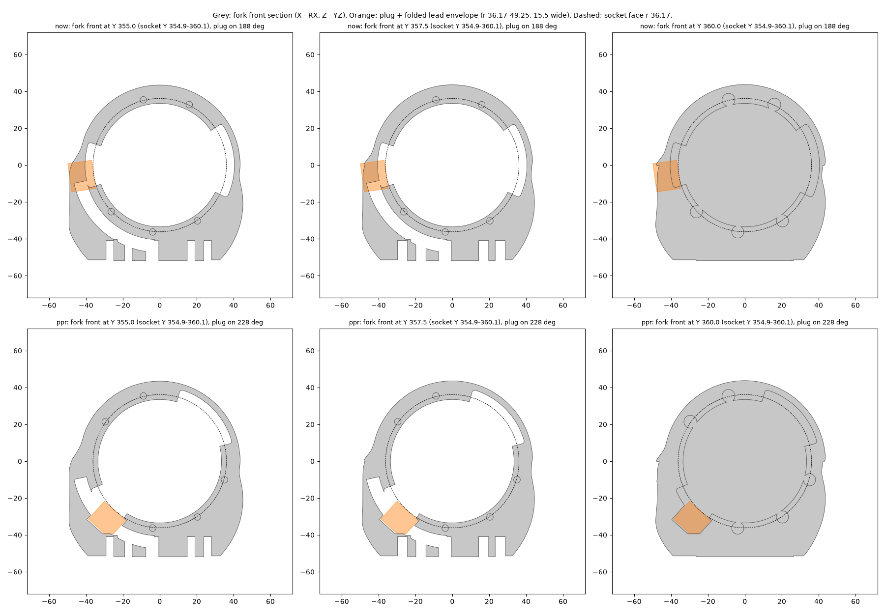
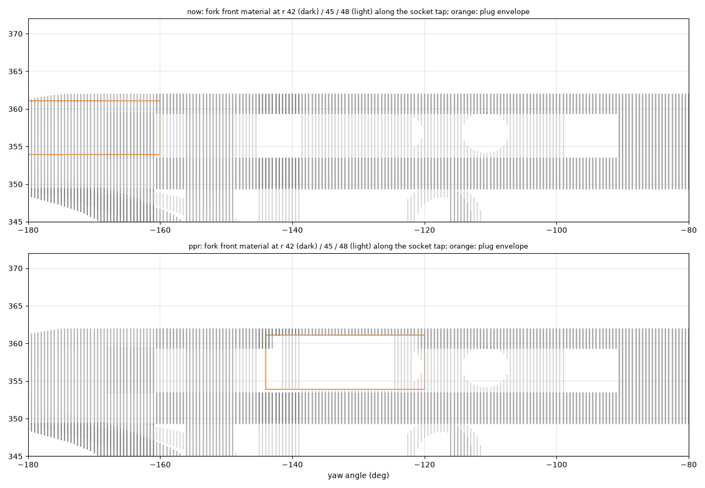

# RS02 plug pocket: getting the XT30(2+2)-F onto the RS02 (2026-11-12)

**The problem:** the r 47 assembly check found that the RS02's plug cannot reach its socket as modelled. This predates
r 47. See [CAD_NOTES.md](../../CAD_NOTES.md), "Side centre r 47, adopted".

## The connector

- **What it is:** one combined power + CAN connector, two per RS02 (in and out, for the daisy chain). Source: RobStride
  RS02 User Manual 260713, §2.3 (in jaylamping/marengo `hardware/docs/robstride/`).
  - board end: AMASS XT30PB(2+2)-M
  - lead end: AMASS XT30(2+2)-F
- **Board side**, AMASS XT30PW(2+2)-M drawing (LCSC-hosted AMASS spec, the horizontal variant of the same family):
  - mating face 15.50 × 5.20 mm, body 12.53 mm deep
  - power pins 5.0 apart, signal pins 2.0 apart, 3.85 between the power and signal rows
  - The vendor RS02 model's socket boss matches the 15.5 × 5.2 face, lying tangential on the rear face. So **the plug
    mates straight down (-Y) onto the socket**, and its lead leaves upward.
- **Lead side, XT30(2+2)-F:** 12.30 × 4.20 × 11.80 mm (retailer listing, bto.pl; no AMASS drawing found yet). Joey will
  measure a real one as confirmation.
- **Allowance used here:**
  - the plug stands up to 8 mm above the socket's top (Y 360.1), with partial engagement on the 4.6 mm exposed boss
  - +3 mm for solder cups and heat-shrink
  - a lead bend of R 4 for the 2 × power + 2 × CAN wires, which go flat and separate from the plug on
  - **total about 15 mm above Y 360.1**
- **Sockets on the vendor RS02:**
  - at yaw angles 173° (inboard, X -34, Z +10) and -7° (outboard, X +34, Z +2)
  - r 32.6-36.2, Y 355.5-360.1
- **The existing socket tap** (`TAP_ARC`, r 40.5-47.5, -168…-94°, Y 353.4-359.4) leads from the 173° socket to the back.
  So the 173° socket is the one in use. The -7° socket stays bare unless the arm's downstream motors chain from it (then
  it needs a mirrored tap on the outboard side).

## Where it is blocked today

Above each socket (X ±30.5…37.5, Z -5…17), as a fraction of the plug's column filled by the fork front:

| Y | 360.5 | 361.5 | 362.5-365.5 | 366.5 | 367.5 | 368.5 and up |
|---|---|---|---|---|---|---|
| filled | 0 | 0.51 (the seat ring's top 1 mm) | 0.26-0.20 (fb3 wrap edge, cuff top) | 0.13 | 0.07 | 0 (clear to the drum envelope at Y 375-378) |

Sideways, the cuff wall (r 41-45) closes the pocket.

## Options

### a. Hidden column inside the wall: recommended

- **What it is:**
  - Open a column straight up from the 173° socket: r 30.5-41, ±14° about 173° (16.5 mm tangential), from the socket top
    to Y 374.
  - It stays inside the wall: 2-4 mm to the outer skin, which is r 43-45 there.
  - At its top it meets the fork front's concave drum-facing surface (the r 59 cut), so its only opening is under the
    drum, invisible from outside.
  - The outer cuff skin and the top rim stay continuous. Nothing shows.
- **Lead path:** the plug's lead leaves upward, U-turns down in the column's outer part (r 38-41, R 4) and enters the
  existing socket tap at Y 359 → back cavity → yaw exit. Power and signal stay flat and separate after the plug.
- **Headroom:** the plug plus lead bend needs about 15 mm above Y 360.1. There is 15.4 mm to the drum's 2 mm envelope
  over the socket's whole width. **Tight:** the real plug's measurement decides it. With the retailer's 11.8 mm body it
  fits with about 2 mm to spare.
- **Assembly** (fork front on the bench, before it goes onto the roll output, so the drum is not there):
  1. Lay the bundles in the ring's back cavity.
  2. Slide the RS02 in bare from below. Fit its screws.
  3. Feed the lead in through the column's top opening, down past the socket into the tap, then push the plug straight
     down onto the socket from above.
     - It takes a push-stick or long-nose pliers on the plug body: the opening is 16.5 × 10 mm, too small for fingers.
     - To unplug: the same pliers, pulling straight up. There is no side access.
  4. Fit the fork rear, then put the fork on the roll output.
- **Print:** the column is vertical (upright print), with no overhang. Its top opening is on a down-facing curved surface
  that already needs support there (the RS02-cap clearance roof).

### b. Re-clock the RS02: rejected

- **Possible in principle:** the fork front's 5 screw holes and 3 reliefs (-176, -16, 24°) are one 9-position pattern on
  a 40° pitch. So the RS02 can turn in 40° steps without touching the hub, the frozen arm interface or the yaw stops.
  Its output zero is a software offset.
- **But the sockets lose headroom wherever they go.** The drum's r 59 envelope sits lowest over the back and front centre.

| Turn | Sockets at | Headroom to the drum envelope |
|---|---|---|
| 0 (now) | 173° / -7° (sides) | **15.4 mm** |
| +40° | -147° / 33° | 10.8 mm (the -147° one lands in the tap arc, out from under the wrap) |
| ±80° | ±107° / ±73° | 5.8 mm |
| -40° | 133° / -47° | 8.3 mm |

- The one useful by-product: at +40° the four screws at -176, -96, -56 and -16 are all reachable from above. That would
  drop the two dome access bores and plugs. But 10.8 mm is not enough for the plug.

### c. Notch with a flush printed cover: fallback

- **What it is:** open the column through the cuff top on the side, and close it with a press-in cover that continues the
  cuff surface, like the RS02 access plugs. It leaves a shut line only.
- **When:** only if (a) runs out of headroom with the real plug, because the notch gives room to bend the lead sideways.

## Next

- Mock-up of (a), `LOOK=pp_a`: front, side and three-quarter pictures, plus a section through the pocket. It is queued
  for the next SolidWorks gap.
- The real parts stay untouched until Joey has seen it.

## Check of (a), 2026-11-12: the power lead's bend does not fit. Not on the real part.

 

**What passes:**
- **Hidden:** front, inboard side, front three-quarter and top views are identical to the real part. The column opens
  only into the drum-facing surface.
- **Drum, at every roll angle:** the plug moves with the fork and the drum's 2 mm envelope is a cylinder about the roll
  axis. So the gap between the plug and the drum is the same at every roll angle, not only in the section.
- **Clearances:** the column only removes material (569 mm³), so all moving pairs are unchanged.

**What fails: the lead's bend above the plug.**
- **Wires assumed:**
  - power pair AWG20 (RS02 at 48 V: 7 Apk rated phase current, 23 Apk peak; manual 260713 §2.1), silicone, OD 1.9
  - CAN pair AWG26, OD 1.0
  - minimum bend radius about 3 × OD: R 5.7 for power, R 3.0 for CAN
- **Room:** the worst-credible plug's top (socket top + 8 + 3 for cups) is at Y 371.1. The drum envelope over the plug is
  at Y 374.8, so there is 3.7 mm above the plug.

| Lead | 90° turn needs | U-turn needs |
|---|---|---|
| AWG20 power | 6.6 mm | 13.3 wide × 6.6 high |
| AWG22 power | 5.2 mm | 10.5 × 5.2 |
| AWG26 CAN | 3.5 mm | 7.0 × 3.5 |

- The section's R 2 U-turn was drawn too tight. Splitting power and CAN into two thin leads doesn't save it, because the
  power pair alone needs 5.2-6.6 mm.
- **(a) works only if the real plug stands at most about 4 mm above the socket's top** (cups included). Then the power
  pair can turn 90° at R 5.7 and run back along a widened column top to the tap, not U-turn.
- **Joey's measurement decides:** the plug's height above the mated socket, and the wire gauges on the RS02 lead.

**There is no right-angle cable version of the XT30(2+2)-F.**
- AMASS's right-angle female (XT30PW-F family) is a PCB part. The angled wire-exit XT30AW is male only.
- **Fallbacks, in order:**
  1. **A small right-angle adapter.** An XT30PW(2+2)-F soldered to a thumbnail PCB, leads leaving sideways. It lowers the
     stack to the female body plus the board, about 7-8 mm above the socket, and needs no bend above it. Its outline goes
     into the column. It is a custom part, like the power board.
  2. **(c) Notch with a flush printed cover,** so the lead turns sideways through the wall under a cover. Look-affecting.
- **The real fork front is unchanged** (`PLUG_POCKET` is a mock-up switch again).

## Variant (a2): leads soldered across the cups at 90°, leaving sideways (on paper and by render)

**Stack:**
- Plug + cups + the wires laid across the cups, with heat-shrink: about Y 372.1 at worst credible.
- The drum's 2 mm envelope over the plug is at Y 374.8.
- **2.7 mm to spare. The stack fits.**

**AWG22 for the power pair is justified:**
- RS02 at 17 N·m and about 10 rad/s is about 170 W of mechanical power.
- At 48 V with losses, that is about 4-5 A at the supply.
- Silicone AWG22 carries about 8 A in short runs; this lead is under 0.3 m.
- That brings the power pair's bend to R 4.5 (OD 1.5). The CAN pair is AWG26 (R 3).

**Where the leads go after the plug: this is what fails.**
- **The leads leave sideways at about Y 369.6. To be hidden, they have to get below the cuff top (Y 361.9)** and into
  the socket tap (r 40.5-47.5, Y 353.4-359.4) or round to the back cavity.
- **A trough round the seat-ring top inside the wall (r 37-41) runs into the RS02 screw counterbores** at -136° and -96°
  (r up to 39.8). A trough outside them (r 40.5-46) is the existing socket tap, which is already below the cuff top.
- **So the leads must drop about 10 mm right beside the plug,** in a vertical bend of R 4.5-5.7. That needs a pocket about
  6 mm past the plug's end (173° → about 200°).
  - On the inboard-back side that pocket would rise above the cuff top (Y 361.9), between the cuff and the drum. There is
    no fork-front material there to hide it.
  - The render with a worst-credible plug and a sideways lead (orange) shows it **visible from straight behind**,
    through the gap between the cuff top and the drum.
  - It is hidden from the inboard side, the front, both three-quarters and from below. The plug body itself is hidden
    in all six views.
- **Plan bend radius is not the problem.** Round the cuff it is r 40+. The problem is the drop.

**Verdict:** (a2) fits the stack but not a hidden lead route.
- It would need a raised lip on the inboard-back of the cuff top to hide the drop: a small new visible feature.
- **Better:** the right-angle adapter board (fallback 1). Its leads leave sideways at the board, about 7-8 mm above the
  socket, which is low enough to run straight into the socket tap below the cuff top with no drop above it.
- As before, Joey's plug measurement decides between (a) and the fallbacks.

## Correction, 2026-11-13: the plug mates radially (side-facing socket)

**Correction:** Joey's photos of the real RS02 (plug pushed on, then pulled off) show the XT30(2+2)-F plug mating
**radially** into a slot in the side of the rear cover's rim, with its leads leaving straight out. It does not stand up
off the rear face. Everything above that assumes a plug pushed down onto the rear face (the 15 mm "headroom", the column,
variant a2) is superseded.

**The vendor STEP agrees, and so does our RS02 model.** I re-read the faces of `cad/vendor/robstride/vendor_robstride_rs02.step`:
- **Two sockets, 180° apart:** at **188° (the one in use, where the socket tap starts) and 8°** in our frame. That is the
  vendor's ±90° through the assembly's 98° clock (`build_asm.T_RS02`). The 173° / −7° used earlier in this file were
  mirrored.
- **Mating face:** r 36.17, facing radially outward, about 15.5 mm around the rim by 5.2 mm along the axis. The pins run
  radially.
- **Height:** Y 354.9-360.1, that is 5.2-10.4 mm below the RS02 rear face (Y 365.26), in the side of the rear cover.
- **So the model was right.** The earlier text here ("lying tangential on the rear face, so the plug mates straight
  down") misread it.

**Plug envelope used here** (no caliper data; Joey confirmed it is an unpluggable plug):
- Radial, from the socket face (r 36.17) to 10 mm past the flange (r 49.25), 15.5 wide.
- The folded taped lead measured 6-7 mm past the flange from the photos; 10 is the design margin.
- **Assumed:** the plug's size along the motor axis, from the XT30(2+2) data.

**Where it fits:** see the section at the socket's mid-height (Y 357.5), today and re-clocked:

- **Today's clocking (sockets 188 / 8°):** the in-use socket sits where the socket tap (r 40.5-47.5) starts, and the cuff
  skin there is at r 47.6-48.5.
  - The photo's folded lead (7 mm past the flange, r 46.25) just fits inside, leaving a 1-2 mm wall.
  - The 10 mm design envelope (r 49.25) breaks through the skin.
  - So today's clocking works only if the real lead folds to 7 mm or less, and the wall there would be thin.
- **RS02 re-clocked +40° (sockets 228 / 48°): recommended.**
  - At 228° the socket sits over the middle of the socket tap, and the skin is at r 55-60. Both envelopes stay inside the
    outline with several mm of wall.
  - The plug and its folded lead stay inside the outline. That needs the seat-ring socket pocket (as today) and about
    2-3 mm into the wall behind the tap, out to about r 50: all internal.
  - **Assembly:** with the fork front on the bench and the fork rear not yet fitted, the back cavity is open. The plug goes
    on radially in place, and its lead folds into the tap and runs to the back. The spare socket (48°) only needs its
    seat-ring pocket.
  - **Cost:**
    - The fork front's five RS02 screw holes move to the matching five of the nine-position 40° pattern.
    - The RS02's zero becomes a software offset.
    - The hub, the arm interface and the yaw stops do not change.
    - The two access bores and their plugs stay, but move from 64 / 104° to 104 / 144° (corrected below: the screw at
      144° is under the cheek too).

## Mock-up pp_r: RS02 re-clocked +40°, radial plug channel (2026-11-13)

**Built on a copy** (`LOOK=pp_r`, into `_wip/look/pp_r`). The real parts are unchanged. Script:
[render_plug_pocket_r.py](../../scripts/render_plug_pocket_r.py). Pictures: [radial/](radial/).

**What the copy changes** (all switched on by `LOOK=pp_r` in `dims.py` / `build_parts.py` / `build_asm.py`):
- **RS02 clock:** 98 → 138° in `build_asm.T_RS02`. The sockets move to 228° (in use) and 48° (spare).
- **The fork front's five RS02 screw holes, both socket pockets and the two access bores turn with it:**
  - Screws at -96 / -56 / -16 / 104 / 144°.
  - Socket pockets at 202-238° and 14-74°.
  - Access bores at 104 / 144°.
- **Why the bores stay:** a ray check through the real fork front shows the screw at 144° is under the cheek (blocked at
  Y 372.4), so its bore is needed. The 64° bore is no longer needed. The earlier "the bores may be dropped" was wrong.
- **PLUG_CHANNEL at 228°:**
  - r 36-50, 16.5 wide, Y 353.9-361.1: the plug and folded-lead envelope plus 0.5-0.75 mm.
  - It opens only into the socket pocket and the socket tap.
  - Its outer corner toward the back is clipped at Z - YZ -39.4. Unclipped, it ran 0.9 mm into the blind end of a fork
    joint insert bore (Ø5.6, X - RX -27, Y 356.9). The first render showed the plug through that bolt hole from straight
    behind. The clip leaves a 1.5 mm wall.
- **Mass:** 155.2 g against 154.3 g real. The 144° bore removes less material than the 64° one.

**Results** (orange in every picture: the plug and folded-lead envelope, r 36.17-49.25, 15.5 wide, Y 353.9-361.1):
- **Wall outside the envelope, along the radials:**
  - Today (socket at 188°): **-3.9 mm minimum (median -0.6)**. The envelope breaks through the skin. It is visible from the
    front and from below-inboard.
  - pp_r: **11.6 mm minimum (median 13.8)**.
- **pp_r against the look rule:** no orange in any outside view (straight behind, back three-quarter inboard and outboard,
  inboard and outboard side, front, below-inboard). Nothing breaks the outline, and no bulk is added.
  
- **Sections:**
  - Radial through the plug: 
  - Y 355 / 357.5 / 360: 
  - Lead route: the plug lands in the middle of the existing socket tap (-168..-94°), so the lead runs along the tap to
    TAP_LINK at -94° as today. 
- **Surface diff** (real against pp_r):
  - Changes are limited to the screw holes, the socket pockets, the channel and the access bores.
  - The only change that reaches the outside is the access-bore exit, which moves from 64° to 144°.
  - The 144° plug sits on the inboard flank at Y 464-473. It is hidden in the normal views
    ([radial/SHEET_top_access_plugs.png](radial/SHEET_top_access_plugs.png)).

**Open:**
- **Driver reach to the 144° bore with the rest of the shoulder fitted** is not checked. It is the same as today's 104°
  bore if the RS02 goes in before the fork meets the drum.
- **The plug's height along the motor axis** is still assumed from the XT30(2+2) data.
- **`mesh_check` integrity:** the copy's STL reports 2 zero-area faces. The real STL is clean at the same weld tolerance.
  This is a mock-up export, and it is to be re-checked if pp_r is adopted.
- **Adoption** would rebuild the real fork front and access plugs with these settings, and re-run the clearance sweep. Not
  done.

**Adopted on the real parts (2026-11-13, Joey "go").** See CAD_NOTES.md, "RS02 re-clocked +40°".
- **One correction to "Open" above:** driver reach is checked. The 144° screw is reachable on the bench, and so is every
  other screw. The assembly order is the same as before.
- **One change to the scripts:** this page's mock-up pictures were made with `LOOK=pp_r`. The real build now uses the same
  settings by default. `render_plug_pocket_r.py` reads the pre-adoption fork front from `_wip/.../stl_now_pre_pp_r`.
