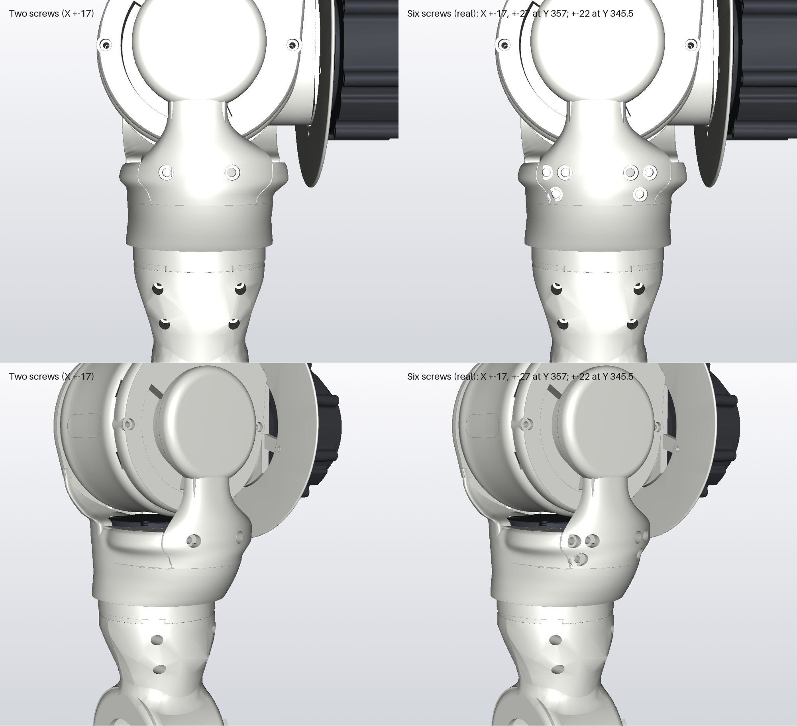

# Fork joint screws seen from behind (2026-11-12)

Rows: back, rear three-quarter. Columns: the earlier two-screw joint (X ±17), and the real six-screw joint, both on the
r 47 sleeve.

**Why six:** the roll stop's torque runs through this joint (checks/B_ROLL_STOPS.md).
- Six M4 bring the rated-torque layer SF at the joint from 1.32 to 1.64.
- They are X ±17 and ±27 at Y 356.9, and X ±22 at Y 345.5.
- Heads are recessed in counterbores. Nothing is proud.

**Seen from behind:** six round holes, four in a row and two lower, just above the Y 340 shut line.

**One untidy spot:** the outer ±27 counterbores sit right at the fork rear's side edge, by the split, so each reads as a
hole partly open at that edge. Moving them in to ±25 would clear the edge, at a small cost in joint margin. Say if Joey
would rather have that.
