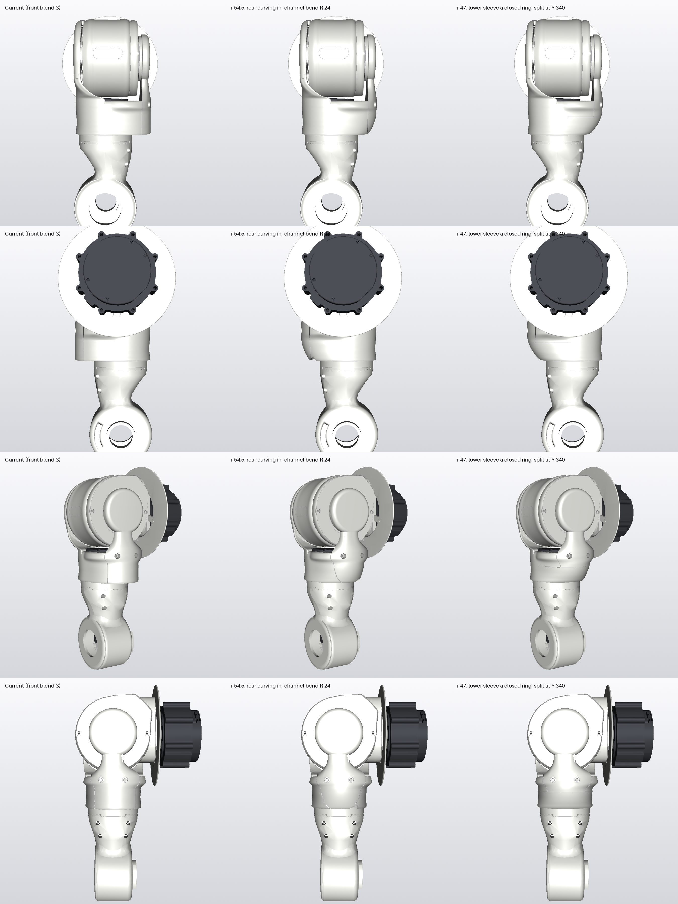

# Side centre: the sleeve's rear curving in toward the arm (2026-11-12, mock-up)

Joey (02:4xZ, side-view screenshot): *"why is the upper arm so off center?"* and (02:58Z): *"it feels like we could curve
that rear side and make that transition not so abrupt"*.

Rows: side from outboard, side from inboard, back three-quarter, back. Columns: current (front blend 3), mock-up.
Section through the power channel plane: [section_channel.png](section_channel.png). Mock-up parts are in
`cad/_wip/look/sc` (`LOOK=sc SIDE_CENTRE=1`); the real parts are unchanged.

## Measured (fore-aft Z, from the yaw axis at Z 5.99; + front)

| | Bottom edge (Y 315) | Y 322 | Mid height (Y 330) | Y 350 |
|---|---|---|---|---|
| Sleeve now: back / front, centre | -65.7 / +42.9, **-11.4** | -66.4 / +42.8, -11.8 | -66.4 / +42.1, -12.1 | -66.4 / +43.2, -11.6 |
| **Mock-up** | **-54.0 / +42.9, -5.5** | -58.9 / +42.8, -8.0 | -62.5 / +42.1, -10.2 | -66.3 / +43.2, -11.6 |

- **Arm neck** (the arm thread's part): top band at Y 300 is -38.9 / +38.6, centred.
  - Lower down it leans back on its own: centre -2.1 at Y 290, -5.5 at Y 280, -7.5 at Y 270.
- **Hub band** (Y 300-314): ±39.3.
- **Side to side (X)**, the sleeve is centred within 0.1 mm.
- **The bottom edge is level:** Y 314.5 at every yaw angle. It reads as sloped because the back ends in a wide flat ledge
  over a neck that leans back, while the front ends in a 4 mm step.

## Causes

- **Back:**
  - The sleeve's rear swell is r 66.5. It holds the 16 × 6 power channel at Z -54.3…-48.3 with its 2.4 mm wall.
  - The channel drops straight down from the fork rear arm (centre Z -51.3) to Y 316.6, then turns into the yaw exit
    through a square corner.
  - The 10 × 5 signal channel joins the power channel above Y 357, so it does not add depth lower down.
- **Front:** the fb3 wrap is all above Y 354 and does not change the bottom of the sleeve.
- **Below the hub:** the arm's own neck leans back.

## Mock-up

- **Rear swell:** below Y 350 it curves in toward the arm as it goes down, from r 66.5 to r 54.5 at the bottom edge.
  - The curve is vertical at the top, so it runs on from the wall above with no line.
  - At the bottom edge it is about 34° from vertical, so it prints upright without support.
- **Power channel:** it no longer runs straight down to a square corner. Its centreline turns into the yaw exit on a
  **24 mm radius** (`exit_bend`).
  - That is the same as the yaw loop's r 23.8, and the old corner had no radius at all.
  - The flat bundle bends about its 6 mm direction.
- **Unchanged:**
  - the 10 × 5 signal channel
  - the bore (cuff ↔ hub 2 mm)
  - the yaw exit, still hidden behind the skirt
  - the joint-plane split
- **Mass:** fork rear 67.6 g (was 70.4); fork front unchanged.
- **Shell:** the swell only gets smaller, so its shell clearance can only grow.

## What cannot be evened out, and why

- **The joint plane is the limit, not the channel.** The fork rear owns the sleeve behind the split plane at Z -45.9
  (51.9 mm behind the axis), and needs some depth behind it to exist at the bottom edge. At r 54.5 it is 2.6 mm deep there.
- **The channel alone would allow about r 47** at the bottom edge. Its bend comes in to about r 44 at the exit, plus the wall.
- **Getting to r 47** means the lower sleeve (below about Y 340) becomes all fork front, as a closed ring round the RS02,
  with the split stepping up above it. That is not modelled yet, because two things need checking first:
  - the RS02 is fitted into the cuff from below, and its socket bodies reach r 40.5, against the cuff bore's r 39.75
  - the fork rear would then end above the sleeve's bottom edge
- **The front step (4.3 mm) is set by the RS02 body (r 39.25)** inside the cuff, plus the 2 mm skin and the hub gap. It
  cannot come in further.
- With r 54.5 the back step to the arm's top band is about 15.6 mm (was 27). With r 47 it would be about 8 mm.

## r 47 version: the lower sleeve as a closed ring (2026-11-12, mock-up `LOOK=sc47 SIDE_CENTRE=47`)

The sheet now has three columns: current, r 54.5, r 47. The section shows all three.

### Can the RS02 go in through a closed ring? Yes, from below.

Measured on the vendor RS02 model:
- The body is a plain cylinder: r 39.25 from Y 322 to 350, and at most r 39.30 at Y 350-354.
- The socket bosses on the rear face are r 36.17 or less (Y 356-362). They sit in the seat-ring pockets.
- The "r 40.5" quoted earlier was the pocket cut, not the motor.

| Route | Result |
|---|---|
| From below through the closed ring (bore r 39.75) | Fits. 0.45-0.50 mm radial clearance all round, the same as today's front cuff (which already wraps about 300° of it). No relief or keyway needed. |
| From above | Blocked by the seat ring (bore r 33.5). The same today. |
| Tilted in | Not needed. |

**Order:**
1. The RS02 goes in bare from below.
2. The power bundle is already laid in the ring's back cavity. The RS02 slides up past it.
3. The socket plugs connect from behind, through the opening above the ring. The socket tap is at Y 353-359; the
   fork rear closes the opening afterwards.

The plug bodies are not in the vendor model, so they still need checking on the real leads.

### What the mock-up does

- **Fork front:** below Y 340 the sleeve is one closed lofted ring (`RING`, 2 mm skin, hollow inside, open at the bottom).
  Above Y 340 the cuff is the front half as before.
- **Fork rear:** starts on the ring's flat top at Y 340. Its bottom is its first print layer.
  - The bolted joint is unchanged: 2 x M4 at X ±17, Y 356.9, through the fork rear's back into the fork front's joint pad.
  - The fork rear's lowest section is now at Y 340, not Y 314.5.
- **Rear profile:** curves in from r 66.5 at Y 352 to r 48 at the bottom edge.
- **Power channel:**
  - The straight run stops at Y 343.6.
  - Below that, the 16 x 6 bundle follows the R 24 bend through the ring's back cavity into the yaw exit, between the
    RS02 body and the skin.
  - In the channel plane the bend's outer face stays inside the skin: at Y 330 it reaches r 56.7 against the skin's inner
    r 58; at Y 322 it reaches r 50 against 52.5.
  - The cavity is open to the bore, so there is no enclosed cavity, and it prints upright.
- **Unchanged:**
  - the 10 x 5 signal channel, which joins above Y 357
  - the yaw exit, hidden behind the skirt
  - the bore, so cuff ↔ hub stays 2 mm
- **Masses:** fork front 153.5 g, fork rear 62.7 g. Together 216.2 g, 4.7 g lighter than the current pair (150.5 + 70.4).

### Measured (Z from the yaw axis)

| | Bottom edge (Y 315) | Y 322 | Y 330 | Y 340 |
|---|---|---|---|---|
| Current | -65.7 / +42.9, centre -11.4 | -66.4 / +42.8 | -66.4 / +42.1 | -66.4 / +42.6 |
| r 54.5 | -54.0 / +42.9, -5.5 | -58.9 / +42.8 | -62.5 / +42.1 | -65.4 / +42.6 |
| **r 47** | **-47.6 / +42.9, -2.3** | -54.5 / +42.8, -5.8 | -60.0 / +42.1, -8.9 | -64.4 / +42.6, -10.9 |

The back step to the arm's top band (r 38.9) is **8.7 mm**, against 4.3 at the front. It was 27.

### Open points

- **Print:**
  - The ring's back skin leans out at 53° from vertical over its bottom 1.4 mm, then 46°, then under 40°.
  - That is printable upright, with slight droop possible on the bottom lip.
  - A 1 mm chamfer at the bottom edge would take it under 45°.
- **Shut line:** the split is now a horizontal line at Y 340 across the back, plus the joint plane above it.
- **Inherited from the current exit:** the yaw exit's top edge (Y 322.55) is 0.55 mm into the RS02 body's band
  (Y 322-324 at r 39.25). It is the same in all three versions.
- **Not run on the mock-ups:**
  - the clearance sweep. The bore and hub are unchanged and the outline only shrinks.
  - the shell sweep, for the same reason: smaller outline only.
