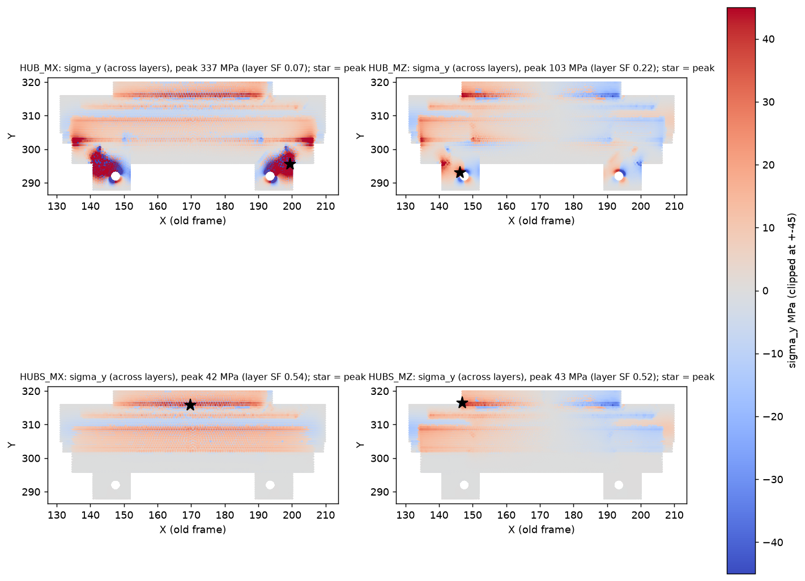
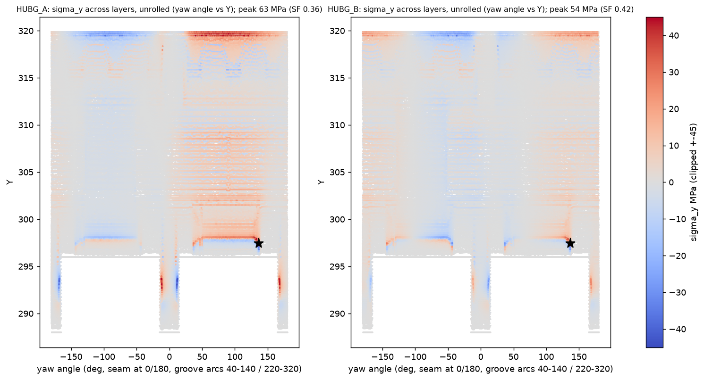

# Check (a): hub lugs and hub under the arm-horizontal load (2026-11-11)

**Model:** `shoulder_hub_left.SLDPRT` (the frozen hub with the dished top), linear static FEA in SolidWorks Simulation.
`cad/scripts/shoulder/fea_shoulder.py`, cases `HUB_*` and `HUBS_*`.

**Material and method:** as the arm thread (`left-arm-organic` `p3_fea.py`): PETG E 1.9 GPa, ν 0.38, yield 45 MPa, layer
strength 22.5 MPa. The hub prints with the yaw axis vertical, so the layers are normal to Y and the layer stress is σy.
Mesh 1.5 mm, 0.5 mm at the seam-bolt holes, 214,634 nodes. Peaks are reported with nothing excluded.

**Fixed:** the six hub-screw holes (Ø4.3, PCD 24) and the step-ring face on the RS02 output.

**Load:** a remote load at the arm's hub point (X 170.49, Y 292, Z 5.99), **rigidly connected**:

- 310 N down (155 N per lug)
- 23 N·m bending
- 17 N·m yaw torque (the RS02 peak, as the arm thread rates it)

## Results

| Case | Where the load goes in | Bending axis | Bulk SF | Layer SF (σy) | Where |
|---|---|---|---|---|---|
| HUB_MX | Lugs only (seam-bolt holes) | X (arm forward) | **0.14** | **0.07** (337 MPa) | Lug edges at the root, Z 11 |
| HUB_MZ | Lugs only | Z (arm sideways) | 0.45 | 0.22 (103 MPa) | Lug A at the bolt hole, Z 11 |
| HUBS_MX | Lugs and spigot, rigid: the whole r 35.8 cylinder tied in every direction, axial included (a bonded or fixed surface, not radial-only) | X | 1.01 | **0.54** (42 MPa) | Dish floor / step ring, Y 315.8, r 23-30 |
| HUBS_MZ | Lugs and spigot | Z | 0.83 | **0.52** (43 MPa) | Dish floor / step ring, Y 315.8-316.5 |

The two lines bound the real joint.

- **Through the lugs alone, they fail by a wide margin.**
  - They sit on the seam (yaw 0 / 180 deg).
  - A fore-aft moment (about X) bends them out of plane: SF 0.07 across the layers.
  - A sideways moment (about Z) is a couple between them: SF 0.22.
  - **A second lug pair at 90 deg to the seam** turns the fore-aft case into a couple as well. That is the case it helps.
  - With the two pairs together, each direction is carried as a couple at r 23. That is about 0.5 kN per lug at 23 N·m,
    still about twice what these lug sections take.
- **With the spigot clamped by the arm's hub seat, the lugs are nearly unloaded.** The weak point moves up into the hub:
  - it is the dished floor and step ring under the RS02 output (Y 312.8-319.9, r 19.5-38.6), which CONCEPT.md section 7
    already flagged as the new weakest section
  - layer SF about 0.5, bulk SF 0.8-1.0, at 23 N·m.

## What it means

- The hub-to-arm joint needs the spigot clamp to work, and the hub's dished top is too thin for 23 N·m bending across its
  layers.
- Options, for the arm thread and the next hub pass:
  1. Thicken the dish floor and step ring. The floor is 3 mm today (Y 312.8-315.8). The dish depth comes from the yaw cable
     loop (7.5 mm axial gap under the RS02), so it has to be re-balanced.
  2. A longer or conical spigot (the prepared `SPIGOT_EXT` feature) to spread the bending into the arm seat.
  3. A second lug pair at 90 deg (`LUG2`): it helps the lugs-only fore-aft case, but not the dish floor.
  4. Print the hub on its side, so the bending stress runs in the layer plane. That costs the RS02-face flatness.
- **Not modelled:**
  - contact and friction at the spigot seat (the real split between lugs and spigot)
  - bolt preload
  - the hub screws' own strength.

## Revision B (2026-11-11): thicker hub top, then the groove

### B1. Thicker top, spigot rigid as above

**Change:** the dish floor top is raised from Y 315.8 to Y 318.36, so the floor is 5.56 mm thick (was 3.0), with an R1.5
fillet into the step ring.

- **Yaw-loop gap:** under the RS02, 8.06 → 5.5 mm. The arm bundle (3.5 x 13 laid flat) keeps 2 mm over it.
- **Cuff:** follows the hub; its bottom moves to Y 320.36 to keep 2 mm over the higher rim.
- **Hub mass:** 60.2 → 69.9 g.

The arm thread's cases, with the spigot held rigidly as in case (2) above:

| Case | Load | Bulk SF | Layer SF (σy) away from the load faces | Layer SF, nothing excluded |
|---|---|---|---|---|
| A, arm horizontal, 5 kg payload | 372 N down, 22.9 N·m about X, 17 N·m yaw | 1.05 | 1.17 | 0.41 |
| B, elbow end stop 515 N | 62 N down, 7.0 / 8.6 / 14.7 N·m about X / Y / Z | 1.85 | 1.93 | 0.70 |

The thicker top lifts case A's layer SF from 0.54 to 1.17. That is still short of 1.5, even with the spigot rigidly held.

### B2. The groove (arm thread's section, roark 3d23f91 `r1c/ridge_groove_profile.png`)

**The groove in the hub**, as the arm thread drew it:

- opens Y 297.0-301.0 at r 35.8; bottom r 34.3 (1.5 deep) from Y 297.87 to 299.50
- load flank (low Y) 30 deg from the radial plane; the other flank 45 deg
- full depth over θ 50-130 and 230-310 (θ from +X toward +Z about the yaw axis; the seam and lugs at 0/180, as in the
  arm's model), with run-outs to full wall by 40/140 and 220/320

**Build notes:**

- **Run-outs:** in this pass they are 3 steps each (depth ×0.25 / 0.5 / 0.75 over 3.3 deg). That makes small notches,
  and their local peaks are on the high side.
- **Parameters:** the section, arcs and Y position are in `dims.py` (`HUB['groove']`); `GROOVE_ON` is a global variable.
- **Cable window and wall:**
  - The groove clears the cable window (7.9 deg, r ≤ 31) by 32 deg of arc.
  - It leaves **6.3 mm** of spigot wall (r 28-34.3).
  - Nothing else in the wall at Y 297-301: the hub screws and their counterbores are inside r 16.5.

**FEA model:**

- The spigot is held **radially only** on its r 35.8 cylinder.
- It is held **axially only** on the groove's two 30 deg load flanks (Y-only restraint).
- The lugs are bolted (fixed holes).
- The arm loads go in as their reaction at the RS02 side: hub screws and step-ring face, -F and -M about the same point.
- No contact on the shoulder above (Y 302 face). The groove carries the whole axial couple, which is conservative for the
  groove.
- Mesh 1.5 mm, 0.4 mm on the flanks, 290,285 nodes. Peaks are unexcluded. Layer stress σy, hub printed with the yaw axis
  vertical.

| Region | Case A bulk SF | Case A layer SF | Case B bulk SF | Case B layer SF |
|---|---|---|---|---|
| Load flank, θ 90 side | 1.76 | **0.73** (30.7 MPa) | 2.56 | 1.11 |
| Load flank, θ 270 side | 2.91 | 1.81 | 2.24 | 1.71 |
| 1 mm land below the groove (Y 296-297) | 1.54 | **0.96** | 1.79 | 1.19 |
| Spigot ring (r 28-35.8) | 0.96 | **0.36** (63 MPa) | 1.12 | 0.42 |
| Lug A root | 1.27 | 0.51 | 2.01 | 0.82 |
| Lug B root | 1.10 | 0.44 | 2.01 | 1.12 |
| Hub top (Y 311.5-320) | 1.02 | **0.40** (56 MPa) | 1.50 | 0.69 |

**Where the peaks sit:**

- **Spigot ring peak:** at θ ≈ 137 deg, Y 297.2. That is at the end of a run-out, where my stepped run-out leaves a notch.
  The real smooth run-out will be lower there.
- **Hub top peak:** at Y 319.5, next to where the load goes in at the step ring. It is partly the rigid load application.
- **Load flank and land:** the clean part of the model. There the layer stress is under 1.5 in case A:
  - flank 0.73: across the layers, the 30 deg flank's own bearing
  - land 0.96: the 1 mm land below the groove, loaded across the layers

**Answers for the arm thread:**

1. **Print orientation:**
   - **Their assumption is ours:** the RS02 side (Y 319.86) on the bed, with the spigot and lugs growing up (the layers
     normal to Y).
   - **The dished top:** that face is the bed side. The bed contact is the step ring and centre (r < 23.5). The dish
     annulus (floor at Y 318.36, 1.5 mm above the bed) needs support, which pulls out radially at the open rim.
   - **The groove:** the 30 deg load flank becomes a 60 deg overhang, 1.5 mm tall, over 1.5 mm of reach. That is
     printable with slight droop (about 0.2 mm) on a face that bears load.
   - **Recommendation:** keep the orientation. If the droop matters, either print the flank at 45 deg and accept a
     bigger radial push, or measure the printed flank and fit the ridge to it.
   - **On its side:** the spigot loses roundness (layer lines along the cylinder), so no.
2. **Clearance:** yes. 6.3 mm of wall is left, and the cable window and screw counterbores are clear (above).
3. **Hub stresses:** the table above.
   - The groove and land are below 1.5 across the layers in case A.
   - **What governs is layer shear and bending of the land and spigot ring, not flank bearing.** The flank's bulk SF is
     1.76, but its layer SF is 0.73.
   - So 1.5 mm depth is not the limit; the hub's layer direction is.

**What would fix it**, still to try:

- smooth run-outs instead of steps (removes the notch peak)
- a longer spigot land: move the groove up so the land below is 2 mm
- a shoulder contact at Y 302 to share the compression side
- a hub printed with the spigot's layers running along the load. That is the side-print, which costs roundness.

**Hub mass with the groove:** 69.3 g.

## Revision C+ (2026-11-11 evening): groove as settled with the arm side, rounds, wall fill

**Geometry** (`build_hub`, `HUB` in `dims.py`):

- **Groove:** opens Y 298-302 at r 35.8, bottom r 34.3, 30° load flank, 45° other flank. Full depth over θ 30-150 and
  210-330.
- **Groove corners:** load-side bottom corner R0.4, 45°-side bottom corner R1.0, flank tip rounded into r 35.8. The
  rounds are part of the section itself.
- **Run-outs:** each is one revolve of the full section about an axis parallel to the yaw axis, at r 55 on the radial
  plane where the full arc ends. The depth falls 1.48 / 1.28 / 0.90 / 0.34 / 0 mm at 1.3 / 3.9 / 6.5 / 8.9 / 10°, so it is
  0 at 20/160 and 200/340, tangent to the full arc at the start. These replaced the lofted run-outs, which would not mesh.
- **Spigot bottom outer edge (Y 296):** R0.4, cut exactly as a revolve; the fillet feature does not build on the imported
  edge.
- **Spigot-to-disc corner (r 35.8 / Y 302.0):** R0.3 concave. The arm breaks its bore-to-end-face edge by 0.5.
- **Lug roots:** R1.0 on the X-facing outer faces only (flat at r 29.5). Nothing on the Z-facing sides, where the arm's
  hub posts sit 0.1 under the spigot. Lug outline unchanged: r 18.8-29.9, ±15° about θ 0/180, Y 288-296.
- **Wall fill (lever a, agreed):** the spigot wall goes inward to r 25 over θ 25-155 and 205-335, Y 296-302.3, with
  rounded ends. The wall under the groove goes from 6.25 to 9.3 mm.
  - The cable window runs at r 15-19 at these heights and the bundle stays in the window sector (the hub turns with the
    arm), so the fill never meets it.
- **No undercut at the disc:** the 45° flank meets r 35.8 at Y 301.9 and the disc face is flat at Y 302.0 from r 35.8 to
  38.7. Checked on sections at θ 45, 90 and 135.
- **Mass:** 75.4 g (rev C 72.5).

**FEA:**

- **Mesh:** 1.5 mm, 0.5 mm at the seam-bolt holes, 0.7 mm on the load flanks; 498,423 nodes. The run-outs now mesh first
  time.
- **Supports:** the spigot is held radially on r 35.8 and axially on the 30° load flanks. The Y 302 end face is held
  axially both ways, which is the optimistic bound of the compression-only contact. The lugs are fixed.
- **Load:** the arm's loads go in as their reaction at the RS02 side (distributed coupling).
- **Layer stress:** σy, with the hub printed RS02 side on the bed. The averages cover the nodes within 0.5 and 1.0 mm of
  each peak, tensile part only.
- Script: `cad/scripts/shoulder/hub_post.py`; data in `cad/_sim/shoulder/hub_post_revCplus.json`.

Safety factors, as peak (0.5 mm average / 1 mm average):

| Region | A bulk | A layer | B bulk | B layer |
|---|---|---|---|---|
| 45° corner, θ 135 (the arm's stop-case spot) | 19.9 (19.9 / 19.9) | 25.7 (28.2 / 18.7) | 17.8 (17.8 / 17.2) | 336 (181 / 101) |
| 45° corner, θ 315 | 8.7 (8.7 / 7.8) | 30.3 (51.4 / 50.8) | 18.8 (21.7 / 22.7) | 20.2 (30.5 / 34.5) |
| Load flank, θ 90 side | 1.60 (2.99 / 4.35) | 0.82 (2.54 / 4.25) | 4.40 (8.42 / 11.6) | 2.36 (7.45 / 11.8) |
| Load flank, θ 270 side | 2.27 (4.66 / 6.66) | 1.17 (3.31 / 6.55) | 4.05 (8.27 / 11.6) | 2.53 (7.80 / 14.7) |
| Land below the groove | 1.32 (5.51 / 6.90) | 0.52 (4.08 / 6.03) | 2.50 (2.50 / 4.53) | 1.09 (11.3 / 21.1) |
| Spigot ring / disc corner, Y 301.7 | 0.21 (1.49 / 2.50) | 0.28 (2.24 / 4.44) | 0.70 (4.35 / 7.34) | 0.65 (11.0 / 20.2) |
| Lug A root | 1.60 (2.19 / 2.75) | 0.65 (1.14 / 1.75) | 2.72 (3.72 / 4.64) | 1.17 (2.04 / 3.14) |
| Lug B root | 0.96 (1.31 / 1.68) | 0.40 (0.71 / 1.12) | 2.01 (2.76 / 3.54) | 0.82 (1.46 / 2.30) |
| Hub top, Y 315.9 | 0.36 (0.64 / 1.16) | 0.47 (0.47 / 0.91) | 0.51 (0.91 / 1.58) | 0.57 (0.57 / 1.11) |

**Which peaks are artefacts:**

- **Land, spigot edge, ring and disc corner:** the peaks sit exactly where a support ends.
  - Land and spigot edge: at r 35.8, Y 296.4, the lower end of the radial support at the spigot round.
  - Ring and disc corner: at r 35.8, Y 301.7, where the radial support meets the bilateral Y 302 face at the R0.3
    corner.
  - They fall to 1.5-11 within 0.5 mm, so they come from the boundary conditions, not the geometry.
- **Lug roots:** the lug holes are fixed rigidly, so the lugs pull load the bolted joint does not give them. The arm side's
  bolted-contact model has about 3 N axial and 15 N shear per lug, with a layer SF of 6.2. The peaks here are at the
  fixed hole's edge.
- **Hub top (Y 315.9):** 3 mm from where the load goes in on the step face and hub screws, and with only one node within
  0.5 mm. The 1 mm average is 0.9 (A) and 1.1 (B). This is the same zone rev B flagged.
  - The arm side's model with real contact puts the hub's worst layer SF at 1.75 (A).
  - This model can't separate the joint's real load path from its own load application here. **Open:** it needs the
    arm-side contact model's numbers at Y 312-320.
- **The arm's stop-case corner (45° side, θ 135):** with the R1.0 corner and the r 25 fill it is no longer critical in
  this model, SF 17 or more in both cases. Compare like for like with the arm side's contact run on the same geometry.

**Print check:** the hub prints RS02 side on the bed, spigot up. None of the rounds is a problem.
- The spigot-edge R0.4 is a convex top edge.
- The lug-root R1.0 sits at the foot of the lugs.
- The groove rounds are two layers deep, inside a groove whose load flank is already a 60° overhang.
- The R0.3 disc corner sits on the disc's top face at the foot of the spigot.
- The wall fill is a plain inward step.

### Rev C+ fill deepened to r 23 (22:45Z, the arm side's deciding run)

**Why:** the arm side's bolted contact run, with this hub mirrored, passes everywhere except one spot at the stop. It is
the groove bottom on the 45° side, on the R1.0 round: r 34.38, Y 300.4, θ 139, near the ridge end. Layer 0.87 peak, 1.16
over 0.5 mm, against a target of 1.2: section tension across the layers.

**Change:** the inward wall fill now runs to **r 23** (was 25) over the same sectors, θ 25-155 and 205-335, Y 296-302.3,
with rounded ends.
- **Wall under the groove:** 11.3 mm (r 23-34.3); it was 9.3 at r 25 and 6.25 before any fill.
- **Clearances:** 3.7 mm to the inner core (r 19.3). The cable only uses the window sector, θ -10..26, which is outside
  the fill.
- **Mass:** 77.1 g (+1.7).
- The interface is unchanged: groove, arcs, rounds, r 35.8, lugs, R0.3 and run-outs as frozen.

**Check in this model (stop case B, face contact):** at that spot and its three mirrors (θ 41, 221, 319) the change
from r 25 to r 23 is within ±3%. This model can't resolve it. With idealised supports (radial on r 35.8, axial on the
load flanks) the groove bottom there carries almost nothing: about 2 MPa von Mises and no tension across the layers.
The arm side's contact model loads it through the ridge.

**Section estimate:** 9.3 → 11.3 mm is +21.5% of section, so about -18% section tension. The arm's 1.16 over 0.5 mm
goes to about 1.4, above its 1.2 target. The arm side's own run on this hub is the confirmation.

## Rev D candidate: full-ring groove (2026-11-12, for the arm thread's split-collar stop case; default off)

**Why:** the arm thread's print-tolerance stop case (515 N, 0.1 mm flank gap) fails at the ridge end near the -X lug
(θ 143). The stop load is mostly a sideways moment whose tie belongs at θ 0/180, where today's groove arcs stop. The arm
wants its ridge continuous through the seam, closing onto a full-ring groove in the hub. The interface is un-frozen only
for the groove's angular extent.

**The switch:** `dims.HUB_GROOVE_RING` (environment `HUB_GROOVE_RING=1`). Off by default; the released rev C+ is
unchanged.
- **Groove:** the same section revolved all the way round at full depth, no run-outs. Land Y 296-298; mouth Y 298-302 at
  r 35.8; bottom r 34.3; 30°/45° flanks; rounds R0.4 / R1.0 at the bottom corners, R1.2 into the disc.
- **Inward wall fill:** r 23-28.2, Y 296-302.3, a full ring (was 25-155° and 205-335°).
- Section, spigot, lugs and bolts are unchanged.

**Geometry, measured on the candidate mesh:**

| | Rev C+ (released) | Rev D candidate |
|---|---|---|
| Mass | 77.1 g | **78.1 g** |
| Wall behind the groove bottom (r 34.3), minimum over 360° at Y 298.9-300.5 | 6.3 (θ 0-26, 154-206, 334-360; no fill there) | **11.3** everywhere (full-ring fill) |
| Groove band at Y 299.5, r 34.45-35.7 | cut only over the arcs | cut all round (0 mm² left) |
| Outer ring above the groove (Y 302.6-307), thinnest | 2.71 at θ 180 | 2.70 at θ 180 (unchanged) |

**Cable window (θ 7.9):**
- At the groove's heights it runs at r 15.5-20, inside the spigot bore. Neither the groove nor the r 23 fill touches it.
- No skip at θ 0 or 180 is needed, and the window doesn't move.
- The thin "r 31-34.3" wall the arm thread read is in the window band higher up (Y 309-313), not in the groove's band.

**Exports for the arm thread** (candidate names; the released exports are untouched):
- `cad/exports/shoulder/shoulder_hub_left_revD_candidate.STEP` and `.STL`, recorded in `cad/manifests/exports.json`.

**If rev D is adopted, re-run on the rev D geometry:**
- hub-top bolted cases A (with the rim chamfer), B and Ah
- the hub-lug cases HUBL_I and HUBCF
- the clearance sweep: the hub's outer surfaces don't change, so expect no change there.

## Hub-top bolted contact, cases B and Ah (2026-11-12, rev C+)

Both cases are solved with FFEPlus, because the direct solver failed with code 24 even running alone. 577,952 nodes.
Post-processing is `hub_post.py`, with tensile-only layer averages. SF is peak / 1 mm average.

| Region | A (690 N preload, MX) | B (690 N, MZ) | Ah (345 N, relaxed, MX) |
|---|---|---|---|
| Hub top, layer | 0.41 / **1.41** | 0.66 / 2.24 | 0.48 / 1.64 |
| Lug B, layer | 0.41 / **1.16** | 0.87 / 2.42 | 0.42 / 1.19 |
| Lug A, layer | 0.68 / 1.65 | 1.12 / 3.01 | 0.62 / 1.68 |
| Window band, layer | 0.91 / 1.87 | 1.53 / 2.63 | 0.85 / 1.68 |
| Groove bottom, bulk (compressive) | 0.33 / 0.76 | 0.51 / 1.14 | 0.37 / 0.86 |
| Spigot ring / disc corner, bulk (compressive, p3 to about -107 MPa) | 0.31 / 2.54 | 0.47 / 0.72 | 0.31 / 2.52 |

- **Case A at full preload governs** the hub top (1.41 at the 1 mm average, under 1.5), so the cheap fix applies: a
  0.5 × 45° chamfer on the six screw-hole rims at the RS02 face (`HUB_CHAMFER=1`). Case A is being re-run on it.
- **Relaxing the preload to half** (creep) lifts the hub top to 1.64. Lug B stays the lowest layer average (about 1.2) in
  both A and Ah, as in earlier runs.
- **The bulk minima are compressive** contact and bearing peaks at the spigot ring, disc corner and groove bottom. They are
  not tensile failures.
- **If rev D (full-ring groove) is adopted,** A (with chamfer), B and Ah need re-running on rev D.

### The hole-rim chamfer makes it worse: not adopted (2026-11-12)

Case A re-run with a 0.5 × 45° chamfer on the six screw-hole rims at the RS02 face (`HUB_CHAMFER=1`, built in
`_wip/look/hubc`; FFEPlus, 577,829 nodes):

| Region (layer, peak / 1 mm average) | A, no chamfer | A, chamfered |
|---|---|---|
| Hub top | 0.41 / **1.41** (hole rim, 162.0 / 319.9 / -2.7) | 0.41 / **0.88** (chamfer's outer edge, 168.4 / 319.9 / 19.5) |
| Lug B | 0.41 / 1.16 | 0.42 / 1.18 |
| Lug A | 0.68 / 1.65 | 0.62 / 1.64 |
| Window band | 0.91 / 1.87 | 1.01 / 1.93 |

- **Why it got worse:** the chamfer takes away seat area right round each hole. The clamped contact pressure moves out
  onto the chamfer's edge and concentrates there.
- **What does help is preload.** Ah, at 345 N (half the 690 N of A), gives 1.64 at the hub top with no geometry change.
- **Recommendation:** keep the rev C+ hub top as it is, and specify the six hub M4 at **about 0.35 kN preload**: about
  0.28-0.3 N·m dry (see the paper check below). Not "tight". Low preload alone does not hold the yaw torque, though:
  see the fitted shoulder screws below.
- A counterbore relief would move contact away from the rims in the same way as the chamfer, so I expect the same
  result. Not tried.

### Paper check: does the RS02-to-hub joint hold at low preload? (2026-11-12)

**The joint:**
- Six M4 on PCD 24 (r 12), through a 21.8 mm PETG boss. Bearing under the head: 46.3 mm².
- The seat is the step ring on the RS02 output: r 19.5-23.4. Friction radius 21.5.
- **Loads from check (a):**
  - 310 N axial pull
  - 23 N·m bending (doubled, 46 N·m, as a stop/tip-over stand-in)
  - RS02 peak yaw torque: 17 N·m (RS02 manual 260713 §4.1.2, MIT T ±17)
- **Preload:**
  - 0.35 kN per screw installed (2.1 kN in total)
  - about 0.2 kN after PETG creep (the same "about half" relaxation assumed for case Ah)
- **Friction:** PETG on aluminium, μ 0.25 dry (0.2-0.35).

**Separation (prying):**
- **Rigid tip-over about the seat's outer edge:** the joint opens at (6 F_p − 310 N) × 23.4 mm.

| Preload per screw | Opens at | Margin at 23 N·m | Margin at 46 N·m |
|---|---|---|---|
| 0.35 kN | 41.9 N·m | 1.82 | 0.91 |
| 0.2 kN (relaxed) | 20.8 N·m | 0.91 | 0.45 |

- **This is conservative.** The steel screw (85 kN/mm) is about 20 times stiffer than the PETG boss it clamps (4.0 kN/mm).
  So external tension takes only about 5% of its value off the clamp, and the screws carry almost all of it: about
  0.65 kN extra per screw at 23 N·m, well within M4. The real opening moment is several times the rigid figure.
- **Verdict:** gapping is not the limit at 23 N·m. It is marginal only for a doubled stop moment on a fully crept joint.

**Slip (yaw torque): this is where low preload fails.**

| Preload per screw | Friction torque | Margin at 17 N·m |
|---|---|---|
| 0.35 kN | 11.3 N·m | **0.66** |
| 0.2 kN (relaxed) | 6.5 N·m | **0.38** |
| 0.69 kN | 22.3 N·m | 1.31, but only until it creeps |

- After slipping, the screws bear on the hub's hole walls: 236 N each, 2.7 MPa, which is fine. But that comes **after up
  to 0.72° of yaw backlash** (0.15 mm radial clearance in the Ø4.3 holes at r 12). That is unacceptable for the yaw
  joint's position control.
- **The spigot centres the hub radially but locates nothing in rotation.**

**What does hold it:**
1. **Fitted shoulder screws: recommended.**
   - ISO 7379, Ø5 shoulder, M4 thread, shoulder 20 mm (shorter than the 21.8 mm boss, so the head still clamps the hub).
   - In holes printed Ø4.8 and reamed to Ø5.0.
   - Zero backlash. Each shoulder carries the 236 N in bearing on a Ø5 × 20 wall: 2.4 MPa.
   - Preload then only has to resist prying, so the low 0.35 kN is fine.
   - Two of the six at 180° are enough; six gives margin.
   - Cost: about 1 each. **The hub screw holes are in the frozen interface,** so this needs the arm thread's agreement:
     Ø4.3 → Ø5.0 reamed.
2. **Dowel pins in the RS02's own locating holes: preferred if the arm thread keeps the screw holes frozen.**
   - The vendor RS02 output flange has, besides the six tapped M4 (Ø3.3 at -142, -82, -22, 38, 98, 158°), **three plain
     Ø4.0-4.1 holes at -172, -52 and 68° on the same r 12**, 120° apart, at least 2 mm deep from the face.
   - Ø4 m6 × 10 dowels there, engaging three new printed bosses in the hub's lightening pocket (tube r 2.0-4.4 like the
     screw bosses, Y about 312-319.86, holes printed Ø3.8 and reamed Ø4.0).
   - This locates the yaw torque with no backlash and leaves the six screw holes as they are.
   - Bearing: 17 N·m / (3 × 12 mm) = 472 N per dowel, on a Ø4 × 7 wall = 17 MPa. That is in the layer plane for a
     vertical boss, so acceptable, but the bosses should be at least 7 mm deep.
3. **Not enough on its own: larger washers to raise the allowable preload.** The boss OD (8.8 mm) limits the bearing
   area. Even at 0.69 kN the friction margin is only 1.31, and creep takes it away.

**Setting the torque in practice:**
- With K ≈ 0.2 (dry M4 in the RS02's aluminium threads), 0.35 kN ≈ **0.28 N·m**. My earlier "0.4-0.5 N·m" was too high:
  that would be about 0.5-0.6 kN.
- **Tool:** a hobby or precision torque screwdriver covering 0.1-0.6 N·m, for example the Wiha TorqueVario-S
  0.1-0.6 N·m, or a fixed 0.3 N·m preset driver.
- Set 0.3 N·m, with medium threadlocker. Re-torque once after 24 h; PETG creeps most in the first day.
- A turn-of-nut rule from snug is not reliable here: the PETG boss is soft and its stiffness varies with print settings.
- If a coupon is wanted: a printed boss and an M4 into an aluminium block on a kitchen scale under a lever. It only
  calibrates the screwdriver; it doesn't replace it.

