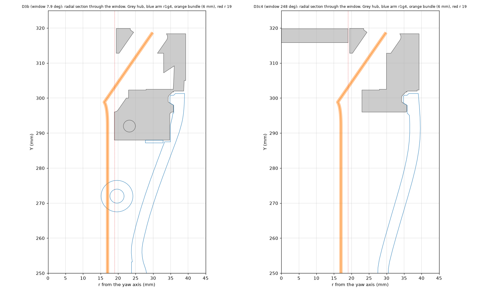
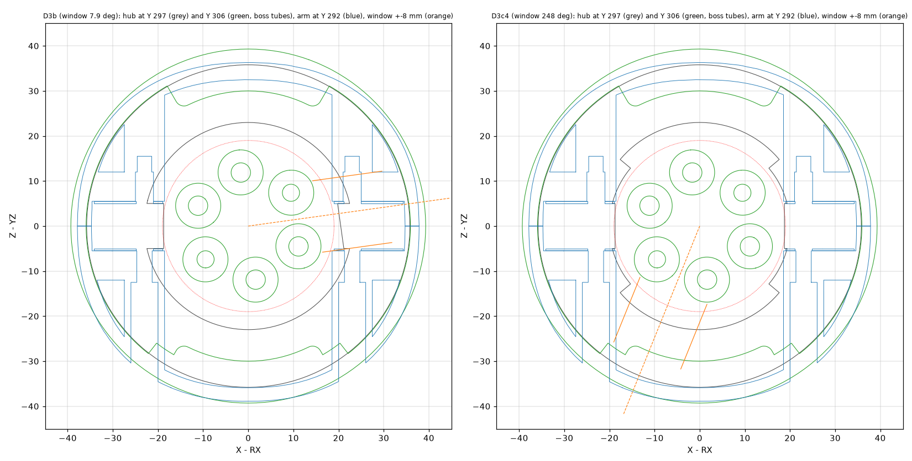

# Check (a): hub lugs and hub under the arm-horizontal load (2026-11-11)

**Model:** `shoulder_hub_left.SLDPRT` (the frozen hub with the dished top), linear static FEA in SolidWorks Simulation.
`cad/scripts/shoulder/fea_shoulder.py`, cases `HUB_*` and `HUBS_*`.

**Material and method:** as the arm thread (`left-arm-organic` `p3_fea.py`): PETG E 1.9 GPa, ν 0.38, yield 45 MPa, layer
strength 22.5 MPa. The hub prints with the yaw axis vertical, so the layers are normal to Y and the layer stress is σy.
Mesh 1.5 mm, 0.5 mm at the seam-bolt holes, 214,634 nodes. Peaks are reported with nothing excluded.

**Fixed:** the six hub-screw holes (Ø4.3, PCD 24) and the step-ring face on the RS02 output.

**Load:** a remote load at the arm's hub point (X 170.49, Y 292, Z 5.99), **rigidly connected**:

- 310 N down (155 N per lug)
- 23 N·m bending
- 17 N·m yaw torque (the RS02 peak, as the arm thread rates it)

## Results

| Case | Where the load goes in | Bending axis | Bulk SF | Layer SF (σy) | Where |
|---|---|---|---|---|---|
| HUB_MX | Lugs only (seam-bolt holes) | X (arm forward) | **0.14** | **0.07** (337 MPa) | Lug edges at the root, Z 11 |
| HUB_MZ | Lugs only | Z (arm sideways) | 0.45 | 0.22 (103 MPa) | Lug A at the bolt hole, Z 11 |
| HUBS_MX | Lugs and spigot, rigid: the whole r 35.8 cylinder tied in every direction, axial included (a bonded or fixed surface, not radial-only) | X | 1.01 | **0.54** (42 MPa) | Dish floor / step ring, Y 315.8, r 23-30 |
| HUBS_MZ | Lugs and spigot | Z | 0.83 | **0.52** (43 MPa) | Dish floor / step ring, Y 315.8-316.5 |


The two lines bound the real joint.

- **Through the lugs alone, they fail by a wide margin.**
  - They sit on the seam (yaw 0 / 180 deg).
  - A fore-aft moment (about X) bends them out of plane: SF 0.07 across the layers.
  - A sideways moment (about Z) is a couple between them: SF 0.22.
  - **A second lug pair at 90 deg to the seam** turns the fore-aft case into a couple as well. That is the case it helps.
  - With the two pairs together, each direction is carried as a couple at r 23. That is about 0.5 kN per lug at 23 N·m,
    still about twice what these lug sections take.
- **With the spigot clamped by the arm's hub seat, the lugs are nearly unloaded.** The weak point moves up into the hub:
  - it is the dished floor and step ring under the RS02 output (Y 312.8-319.9, r 19.5-38.6), which CONCEPT.md section 7
    already flagged as the new weakest section
  - layer SF about 0.5, bulk SF 0.8-1.0, at 23 N·m.

## What it means

- The hub-to-arm joint needs the spigot clamp to work, and the hub's dished top is too thin for 23 N·m bending across its
  layers.
- Options, for the arm thread and the next hub pass:
  1. Thicken the dish floor and step ring. The floor is 3 mm today (Y 312.8-315.8). The dish depth comes from the yaw cable
     loop (7.5 mm axial gap under the RS02), so it has to be re-balanced.
  2. A longer or conical spigot (the prepared `SPIGOT_EXT` feature) to spread the bending into the arm seat.
  3. A second lug pair at 90 deg (`LUG2`): it helps the lugs-only fore-aft case, but not the dish floor.
  4. Print the hub on its side, so the bending stress runs in the layer plane. That costs the RS02-face flatness.
- **Not modelled:**
  - contact and friction at the spigot seat (the real split between lugs and spigot)
  - bolt preload
  - the hub screws' own strength.


## Revision B (2026-11-11): thicker hub top, then the groove

### B1. Thicker top, spigot rigid as above

**Change:** the dish floor top is raised from Y 315.8 to Y 318.36, so the floor is 5.56 mm thick (was 3.0), with an R1.5
fillet into the step ring.

- **Yaw-loop gap:** under the RS02, 8.06 → 5.5 mm. The arm bundle (3.5 x 13 laid flat) keeps 2 mm over it.
- **Cuff:** follows the hub; its bottom moves to Y 320.36 to keep 2 mm over the higher rim.
- **Hub mass:** 60.2 → 69.9 g.

The arm thread's cases, with the spigot held rigidly as in case (2) above:

| Case | Load | Bulk SF | Layer SF (σy) away from the load faces | Layer SF, nothing excluded |
|---|---|---|---|---|
| A, arm horizontal, 5 kg payload | 372 N down, 22.9 N·m about X, 17 N·m yaw | 1.05 | 1.17 | 0.41 |
| B, elbow end stop 515 N | 62 N down, 7.0 / 8.6 / 14.7 N·m about X / Y / Z | 1.85 | 1.93 | 0.70 |

The thicker top lifts case A's layer SF from 0.54 to 1.17. That is still short of 1.5, even with the spigot rigidly held.

### B2. The groove (arm thread's section, roark 3d23f91 `r1c/ridge_groove_profile.png`)

**The groove in the hub**, as the arm thread drew it:

- opens Y 297.0-301.0 at r 35.8; bottom r 34.3 (1.5 deep) from Y 297.87 to 299.50
- load flank (low Y) 30 deg from the radial plane; the other flank 45 deg
- full depth over θ 50-130 and 230-310 (θ from +X toward +Z about the yaw axis; the seam and lugs at 0/180, as in the
  arm's model), with run-outs to full wall by 40/140 and 220/320

**Build notes:**

- **Run-outs:** in this pass they are 3 steps each (depth ×0.25 / 0.5 / 0.75 over 3.3 deg). That makes small notches,
  and their local peaks are on the high side.
- **Parameters:** the section, arcs and Y position are in `dims.py` (`HUB['groove']`); `GROOVE_ON` is a global variable.
- **Cable window and wall:**
  - The groove clears the cable window (7.9 deg, r ≤ 31) by 32 deg of arc.
  - It leaves **6.3 mm** of spigot wall (r 28-34.3).
  - Nothing else in the wall at Y 297-301: the hub screws and their counterbores are inside r 16.5.

**FEA model:**

- The spigot is held **radially only** on its r 35.8 cylinder.
- It is held **axially only** on the groove's two 30 deg load flanks (Y-only restraint).
- The lugs are bolted (fixed holes).
- The arm loads go in as their reaction at the RS02 side: hub screws and step-ring face, -F and -M about the same point.
- No contact on the shoulder above (Y 302 face). The groove carries the whole axial couple, which is conservative for the
  groove.
- Mesh 1.5 mm, 0.4 mm on the flanks, 290,285 nodes. Peaks are unexcluded. Layer stress σy, hub printed with the yaw axis
  vertical.

| Region | Case A bulk SF | Case A layer SF | Case B bulk SF | Case B layer SF |
|---|---|---|---|---|
| Load flank, θ 90 side | 1.76 | **0.73** (30.7 MPa) | 2.56 | 1.11 |
| Load flank, θ 270 side | 2.91 | 1.81 | 2.24 | 1.71 |
| 1 mm land below the groove (Y 296-297) | 1.54 | **0.96** | 1.79 | 1.19 |
| Spigot ring (r 28-35.8) | 0.96 | **0.36** (63 MPa) | 1.12 | 0.42 |
| Lug A root | 1.27 | 0.51 | 2.01 | 0.82 |
| Lug B root | 1.10 | 0.44 | 2.01 | 1.12 |
| Hub top (Y 311.5-320) | 1.02 | **0.40** (56 MPa) | 1.50 | 0.69 |


**Where the peaks sit:**

- **Spigot ring peak:** at θ ≈ 137 deg, Y 297.2. That is at the end of a run-out, where my stepped run-out leaves a notch.
  The real smooth run-out will be lower there.
- **Hub top peak:** at Y 319.5, next to where the load goes in at the step ring. It is partly the rigid load application.
- **Load flank and land:** the clean part of the model. There the layer stress is under 1.5 in case A:
  - flank 0.73: across the layers, the 30 deg flank's own bearing
  - land 0.96: the 1 mm land below the groove, loaded across the layers

**Answers for the arm thread:**

1. **Print orientation:**
   - **Their assumption is ours:** the RS02 side (Y 319.86) on the bed, with the spigot and lugs growing up (the layers
     normal to Y).
   - **The dished top:** that face is the bed side. The bed contact is the step ring and centre (r < 23.5). The dish
     annulus (floor at Y 318.36, 1.5 mm above the bed) needs support, which pulls out radially at the open rim.
   - **The groove:** the 30 deg load flank becomes a 60 deg overhang, 1.5 mm tall, over 1.5 mm of reach. That is
     printable with slight droop (about 0.2 mm) on a face that bears load.
   - **Recommendation:** keep the orientation. If the droop matters, either print the flank at 45 deg and accept a
     bigger radial push, or measure the printed flank and fit the ridge to it.
   - **On its side:** the spigot loses roundness (layer lines along the cylinder), so no.
2. **Clearance:** yes. 6.3 mm of wall is left, and the cable window and screw counterbores are clear (above).
3. **Hub stresses:** the table above.
   - The groove and land are below 1.5 across the layers in case A.
   - **What governs is layer shear and bending of the land and spigot ring, not flank bearing.** The flank's bulk SF is
     1.76, but its layer SF is 0.73.
   - So 1.5 mm depth is not the limit; the hub's layer direction is.

**What would fix it**, still to try:

- smooth run-outs instead of steps (removes the notch peak)
- a longer spigot land: move the groove up so the land below is 2 mm
- a shoulder contact at Y 302 to share the compression side
- a hub printed with the spigot's layers running along the load. That is the side-print, which costs roundness.

**Hub mass with the groove:** 69.3 g.

## Revision C+ (2026-11-11 evening): groove as settled with the arm side, rounds, wall fill

**Geometry** (`build_hub`, `HUB` in `dims.py`):

- **Groove:** opens Y 298-302 at r 35.8, bottom r 34.3, 30° load flank, 45° other flank. Full depth over θ 30-150 and
  210-330.
- **Groove corners:** load-side bottom corner R0.4, 45°-side bottom corner R1.0, flank tip rounded into r 35.8. The
  rounds are part of the section itself.
- **Run-outs:** each is one revolve of the full section about an axis parallel to the yaw axis, at r 55 on the radial
  plane where the full arc ends. The depth falls 1.48 / 1.28 / 0.90 / 0.34 / 0 mm at 1.3 / 3.9 / 6.5 / 8.9 / 10°, so it is
  0 at 20/160 and 200/340, tangent to the full arc at the start. These replaced the lofted run-outs, which would not mesh.
- **Spigot bottom outer edge (Y 296):** R0.4, cut exactly as a revolve; the fillet feature does not build on the imported
  edge.
- **Spigot-to-disc corner (r 35.8 / Y 302.0):** R0.3 concave. The arm breaks its bore-to-end-face edge by 0.5.
- **Lug roots:** R1.0 on the X-facing outer faces only (flat at r 29.5). Nothing on the Z-facing sides, where the arm's
  hub posts sit 0.1 under the spigot. Lug outline unchanged: r 18.8-29.9, ±15° about θ 0/180, Y 288-296.
- **Wall fill (lever a, agreed):** the spigot wall goes inward to r 25 over θ 25-155 and 205-335, Y 296-302.3, with
  rounded ends. The wall under the groove goes from 6.25 to 9.3 mm.
  - The cable window runs at r 15-19 at these heights and the bundle stays in the window sector (the hub turns with the
    arm), so the fill never meets it.
- **No undercut at the disc:** the 45° flank meets r 35.8 at Y 301.9 and the disc face is flat at Y 302.0 from r 35.8 to
  38.7. Checked on sections at θ 45, 90 and 135.
- **Mass:** 75.4 g (rev C 72.5).

**FEA:**

- **Mesh:** 1.5 mm, 0.5 mm at the seam-bolt holes, 0.7 mm on the load flanks; 498,423 nodes. The run-outs now mesh first
  time.
- **Supports:** the spigot is held radially on r 35.8 and axially on the 30° load flanks. The Y 302 end face is held
  axially both ways, which is the optimistic bound of the compression-only contact. The lugs are fixed.
- **Load:** the arm's loads go in as their reaction at the RS02 side (distributed coupling).
- **Layer stress:** σy, with the hub printed RS02 side on the bed. The averages cover the nodes within 0.5 and 1.0 mm of
  each peak, tensile part only.
- Script: `cad/scripts/shoulder/hub_post.py`; data in `cad/_sim/shoulder/hub_post_revCplus.json`.

Safety factors, as peak (0.5 mm average / 1 mm average):

| Region | A bulk | A layer | B bulk | B layer |
|---|---|---|---|---|
| 45° corner, θ 135 (the arm's stop-case spot) | 19.9 (19.9 / 19.9) | 25.7 (28.2 / 18.7) | 17.8 (17.8 / 17.2) | 336 (181 / 101) |
| 45° corner, θ 315 | 8.7 (8.7 / 7.8) | 30.3 (51.4 / 50.8) | 18.8 (21.7 / 22.7) | 20.2 (30.5 / 34.5) |
| Load flank, θ 90 side | 1.60 (2.99 / 4.35) | 0.82 (2.54 / 4.25) | 4.40 (8.42 / 11.6) | 2.36 (7.45 / 11.8) |
| Load flank, θ 270 side | 2.27 (4.66 / 6.66) | 1.17 (3.31 / 6.55) | 4.05 (8.27 / 11.6) | 2.53 (7.80 / 14.7) |
| Land below the groove | 1.32 (5.51 / 6.90) | 0.52 (4.08 / 6.03) | 2.50 (2.50 / 4.53) | 1.09 (11.3 / 21.1) |
| Spigot ring / disc corner, Y 301.7 | 0.21 (1.49 / 2.50) | 0.28 (2.24 / 4.44) | 0.70 (4.35 / 7.34) | 0.65 (11.0 / 20.2) |
| Lug A root | 1.60 (2.19 / 2.75) | 0.65 (1.14 / 1.75) | 2.72 (3.72 / 4.64) | 1.17 (2.04 / 3.14) |
| Lug B root | 0.96 (1.31 / 1.68) | 0.40 (0.71 / 1.12) | 2.01 (2.76 / 3.54) | 0.82 (1.46 / 2.30) |
| Hub top, Y 315.9 | 0.36 (0.64 / 1.16) | 0.47 (0.47 / 0.91) | 0.51 (0.91 / 1.58) | 0.57 (0.57 / 1.11) |

**Which peaks are artefacts:**

- **Land, spigot edge, ring and disc corner:** the peaks sit exactly where a support ends.
  - Land and spigot edge: at r 35.8, Y 296.4, the lower end of the radial support at the spigot round.
  - Ring and disc corner: at r 35.8, Y 301.7, where the radial support meets the bilateral Y 302 face at the R0.3
    corner.
  - They fall to 1.5-11 within 0.5 mm, so they come from the boundary conditions, not the geometry.
- **Lug roots:** the lug holes are fixed rigidly, so the lugs pull load the bolted joint does not give them. The arm side's
  bolted-contact model has about 3 N axial and 15 N shear per lug, with a layer SF of 6.2. The peaks here are at the
  fixed hole's edge.
- **Hub top (Y 315.9):** 3 mm from where the load goes in on the step face and hub screws, and with only one node within
  0.5 mm. The 1 mm average is 0.9 (A) and 1.1 (B). This is the same zone rev B flagged.
  - The arm side's model with real contact puts the hub's worst layer SF at 1.75 (A).
  - This model can't separate the joint's real load path from its own load application here. **Open:** it needs the
    arm-side contact model's numbers at Y 312-320.
- **The arm's stop-case corner (45° side, θ 135):** with the R1.0 corner and the r 25 fill it is no longer critical in
  this model, SF 17 or more in both cases. Compare like for like with the arm side's contact run on the same geometry.

**Print check:** the hub prints RS02 side on the bed, spigot up. None of the rounds is a problem.
- The spigot-edge R0.4 is a convex top edge.
- The lug-root R1.0 sits at the foot of the lugs.
- The groove rounds are two layers deep, inside a groove whose load flank is already a 60° overhang.
- The R0.3 disc corner sits on the disc's top face at the foot of the spigot.
- The wall fill is a plain inward step.

### Rev C+ fill deepened to r 23 (22:45Z, the arm side's deciding run)

**Why:** the arm side's bolted contact run, with this hub mirrored, passes everywhere except one spot at the stop. It is
the groove bottom on the 45° side, on the R1.0 round: r 34.38, Y 300.4, θ 139, near the ridge end. Layer 0.87 peak, 1.16
over 0.5 mm, against a target of 1.2: section tension across the layers.

**Change:** the inward wall fill now runs to **r 23** (was 25) over the same sectors, θ 25-155 and 205-335, Y 296-302.3,
with rounded ends.
- **Wall under the groove:** 11.3 mm (r 23-34.3); it was 9.3 at r 25 and 6.25 before any fill.
- **Clearances:** 3.7 mm to the inner core (r 19.3). The cable only uses the window sector, θ -10..26, which is outside
  the fill.
- **Mass:** 77.1 g (+1.7).
- The interface is unchanged: groove, arcs, rounds, r 35.8, lugs, R0.3 and run-outs as frozen.

**Check in this model (stop case B, face contact):** at that spot and its three mirrors (θ 41, 221, 319) the change
from r 25 to r 23 is within ±3%. This model can't resolve it. With idealised supports (radial on r 35.8, axial on the
load flanks) the groove bottom there carries almost nothing: about 2 MPa von Mises and no tension across the layers.
The arm side's contact model loads it through the ridge.

**Section estimate:** 9.3 → 11.3 mm is +21.5% of section, so about -18% section tension. The arm's 1.16 over 0.5 mm
goes to about 1.4, above its 1.2 target. The arm side's own run on this hub is the confirmation.

## Rev D candidate: full-ring groove (2026-11-12, for the arm thread's split-collar stop case; default off)

**Why:** the arm thread's print-tolerance stop case (515 N, 0.1 mm flank gap) fails at the ridge end near the -X lug
(θ 143). The stop load is mostly a sideways moment whose tie belongs at θ 0/180, where today's groove arcs stop. The arm
wants its ridge continuous through the seam, closing onto a full-ring groove in the hub. The interface is un-frozen only
for the groove's angular extent.

**The switch:** `dims.HUB_GROOVE_RING` (environment `HUB_GROOVE_RING=1`). Off by default; the released rev C+ is
unchanged.
- **Groove:** the same section revolved all the way round at full depth, no run-outs. Land Y 296-298; mouth Y 298-302 at
  r 35.8; bottom r 34.3; 30°/45° flanks; rounds R0.4 / R1.0 at the bottom corners, R1.2 into the disc.
- **Inward wall fill:** r 23-28.2, Y 296-302.3, a full ring (was 25-155° and 205-335°).
- Section, spigot, lugs and bolts are unchanged.

**Geometry, measured on the candidate mesh:**

| | Rev C+ (released) | Rev D candidate |
|---|---|---|
| Mass | 77.1 g | **78.1 g** |
| Wall behind the groove bottom (r 34.3), minimum over 360° at Y 298.9-300.5 | 6.3 (θ 0-26, 154-206, 334-360; no fill there) | **11.3** everywhere (full-ring fill) |
| Groove band at Y 299.5, r 34.45-35.7 | cut only over the arcs | cut all round (0 mm² left) |
| Outer ring above the groove (Y 302.6-307), thinnest | 2.71 at θ 180 | 2.70 at θ 180 (unchanged) |

**Cable window (θ 7.9):**
- At the groove's heights it runs at r 15.5-20, inside the spigot bore. Neither the groove nor the r 23 fill touches it.
- No skip at θ 0 or 180 is needed, and the window doesn't move.
- The thin "r 31-34.3" wall the arm thread read is in the window band higher up (Y 309-313), not in the groove's band.

**Exports for the arm thread** (candidate names; the released exports are untouched):
- `cad/exports/shoulder/shoulder_hub_left_revD_candidate.STEP` and `.STL`, recorded in `cad/manifests/exports.json`.

**If rev D is adopted, re-run on the rev D geometry:**
- hub-top bolted cases A (with the rim chamfer), B and Ah
- the hub-lug cases HUBL_I and HUBCF
- the clearance sweep: the hub's outer surfaces don't change, so expect no change there.
- **Done 2026-11-12 on the candidate** (all but the clearance sweep): see "Rev D: re-run on the rev D geometry" below.

## Hub-top bolted contact, cases B and Ah (2026-11-12, rev C+)

Both cases are solved with FFEPlus, because the direct solver failed with code 24 even running alone. 577,952 nodes.
Post-processing is `hub_post.py`, with tensile-only layer averages. SF is peak / 1 mm average.

| Region | A (690 N preload, MX) | B (690 N, MZ) | Ah (345 N, relaxed, MX) |
|---|---|---|---|
| Hub top, layer | 0.41 / **1.41** | 0.66 / 2.24 | 0.48 / 1.64 |
| Lug B, layer | 0.41 / **1.16** | 0.87 / 2.42 | 0.42 / 1.19 |
| Lug A, layer | 0.68 / 1.65 | 1.12 / 3.01 | 0.62 / 1.68 |
| Window band, layer | 0.91 / 1.87 | 1.53 / 2.63 | 0.85 / 1.68 |
| Groove bottom, bulk (compressive) | 0.33 / 0.76 | 0.51 / 1.14 | 0.37 / 0.86 |
| Spigot ring / disc corner, bulk (compressive, p3 to about -107 MPa) | 0.31 / 2.54 | 0.47 / 0.72 | 0.31 / 2.52 |

- **Case A at full preload governs** the hub top (1.41 at the 1 mm average, under 1.5), so the cheap fix applies: a
  0.5 × 45° chamfer on the six screw-hole rims at the RS02 face (`HUB_CHAMFER=1`). Case A is being re-run on it.
- **Relaxing the preload to half** (creep) lifts the hub top to 1.64. Lug B stays the lowest layer average (about 1.2) in
  both A and Ah, as in earlier runs.
- **The bulk minima are compressive** contact and bearing peaks at the spigot ring, disc corner and groove bottom. They are
  not tensile failures.
- **If rev D (full-ring groove) is adopted,** A (with chamfer), B and Ah need re-running on rev D.

### The hole-rim chamfer makes it worse: not adopted (2026-11-12)

Case A re-run with a 0.5 × 45° chamfer on the six screw-hole rims at the RS02 face (`HUB_CHAMFER=1`, built in
`_wip/look/hubc`; FFEPlus, 577,829 nodes):

| Region (layer, peak / 1 mm average) | A, no chamfer | A, chamfered |
|---|---|---|
| Hub top | 0.41 / **1.41** (hole rim, 162.0 / 319.9 / -2.7) | 0.41 / **0.88** (chamfer's outer edge, 168.4 / 319.9 / 19.5) |
| Lug B | 0.41 / 1.16 | 0.42 / 1.18 |
| Lug A | 0.68 / 1.65 | 0.62 / 1.64 |
| Window band | 0.91 / 1.87 | 1.01 / 1.93 |

- **Why it got worse:** the chamfer takes away seat area right round each hole. The clamped contact pressure moves out
  onto the chamfer's edge and concentrates there.
- **What does help is preload.** Ah, at 345 N (half the 690 N of A), gives 1.64 at the hub top with no geometry change.
- **Recommendation:** keep the rev C+ hub top as it is, and specify the six hub M4 at **about 0.35 kN preload**: about
  0.28-0.3 N·m dry (see the paper check below). Not "tight". Low preload alone does not hold the yaw torque, though:
  see the fitted shoulder screws below.
- A counterbore relief would move contact away from the rims in the same way as the chamfer, so I expect the same
  result. Not tried.

### Paper check: does the RS02-to-hub joint hold at low preload? (2026-11-12)

**The joint:**
- Six M4 on PCD 24 (r 12), through a 21.8 mm PETG boss. Bearing under the head: 46.3 mm².
- The seat is the step ring on the RS02 output: r 19.5-23.4. Friction radius 21.5.
- **Loads from check (a):**
  - 310 N axial pull
  - 23 N·m bending (doubled, 46 N·m, as a stop/tip-over stand-in)
  - RS02 peak yaw torque: 17 N·m (RS02 manual 260713 §4.1.2, MIT T ±17)
- **Preload:**
  - 0.35 kN per screw installed (2.1 kN in total)
  - about 0.2 kN after PETG creep (the same "about half" relaxation assumed for case Ah)
- **Friction:** PETG on aluminium, μ 0.25 dry (0.2-0.35).

**Separation (prying):**
- **Rigid tip-over about the seat's outer edge:** the joint opens at (6 F_p − 310 N) × 23.4 mm.

| Preload per screw | Opens at | Margin at 23 N·m | Margin at 46 N·m |
|---|---|---|---|
| 0.35 kN | 41.9 N·m | 1.82 | 0.91 |
| 0.2 kN (relaxed) | 20.8 N·m | 0.91 | 0.45 |

- **This is conservative.** The steel screw (85 kN/mm) is about 20 times stiffer than the PETG boss it clamps (4.0 kN/mm).
  So external tension takes only about 5% of its value off the clamp, and the screws carry almost all of it: about
  0.65 kN extra per screw at 23 N·m, well within M4. The real opening moment is several times the rigid figure.
- **Verdict:** gapping is not the limit at 23 N·m. It is marginal only for a doubled stop moment on a fully crept joint.

**Slip (yaw torque): this is where low preload fails.**

| Preload per screw | Friction torque | Margin at 17 N·m |
|---|---|---|
| 0.35 kN | 11.3 N·m | **0.66** |
| 0.2 kN (relaxed) | 6.5 N·m | **0.38** |
| 0.69 kN | 22.3 N·m | 1.31, but only until it creeps |

- After slipping, the screws bear on the hub's hole walls: 236 N each, 2.7 MPa, which is fine. But that comes **after up
  to 0.72° of yaw backlash** (0.15 mm radial clearance in the Ø4.3 holes at r 12). That is unacceptable for the yaw
  joint's position control.
- **The spigot centres the hub radially but locates nothing in rotation.**

**What does hold it:**
1. **Fitted shoulder screws: recommended.**
   - ISO 7379, Ø5 shoulder, M4 thread, shoulder 20 mm (shorter than the 21.8 mm boss, so the head still clamps the hub).
   - In holes printed Ø4.8 and reamed to Ø5.0.
   - Zero backlash. Each shoulder carries the 236 N in bearing on a Ø5 × 20 wall: 2.4 MPa.
   - Preload then only has to resist prying, so the low 0.35 kN is fine.
   - Two of the six at 180° are enough; six gives margin.
   - Cost: about 1 each. **The hub screw holes are in the frozen interface,** so this needs the arm thread's agreement:
     Ø4.3 → Ø5.0 reamed.
2. **Dowel pins in the RS02's own locating holes: preferred if the arm thread keeps the screw holes frozen.**
   - The vendor RS02 output flange has, besides the six tapped M4 (Ø3.3 at -142, -82, -22, 38, 98, 158°), **three plain
     Ø4.0-4.1 holes at -172, -52 and 68° on the same r 12**, 120° apart, at least 2 mm deep from the face.
   - Ø4 m6 × 10 dowels there, engaging three new printed bosses in the hub's lightening pocket (tube r 2.0-4.4 like the
     screw bosses, Y about 312-319.86, holes printed Ø3.8 and reamed Ø4.0).
   - This locates the yaw torque with no backlash and leaves the six screw holes as they are.
   - Bearing: 17 N·m / (3 × 12 mm) = 472 N per dowel, on a Ø4 × 7 wall = 17 MPa. That is in the layer plane for a
     vertical boss, so acceptable, but the bosses should be at least 7 mm deep.
3. **Not enough on its own: larger washers to raise the allowable preload.** The boss OD (8.8 mm) limits the bearing
   area. Even at 0.69 kN the friction margin is only 1.31, and creep takes it away.

**Setting the torque in practice:**
- With K ≈ 0.2 (dry M4 in the RS02's aluminium threads), 0.35 kN ≈ **0.28 N·m**. My earlier "0.4-0.5 N·m" was too high:
  that would be about 0.5-0.6 kN.
- **Tool:** see "Cheapest fix" below. A hex key and a hook scale at a measured lever does it for $0.
- Set 0.3 N·m. **No threadlocker in testing.** Re-torque after 24 h and after the first bench session; PETG creeps most
  in the first day.
- A turn-of-nut rule from snug is not reliable here: the PETG boss is soft and its stiffness varies with print settings.
- If a coupon is wanted: a printed boss and an M4 into an aluminium block on a kitchen scale under a lever. It only
  calibrates the screwdriver; it doesn't replace it.

### Cheapest fix: close-fit screw holes (recommended) (2026-11-12; Joey's rules: cheapest that works, print everything, no threadlocker in testing)

- **Two locating holes at 180°, four clearance holes.**
  - At -142° and 38° (180° apart): print the hub hole Ø3.8 and hand-ream to **Ø4.00** with a 4 mm H7 hand reamer or a
    sharp 4.0 drill turned by hand.
  - The other four stay Ø4.3 clearance, so the joint still assembles against the RS02 pattern's own position tolerance.
    Six close-fit holes would fight the pattern tolerance.
- **Screws:** ISO 4762 / DIN 912 **M4 × 30, partially threaded**.
  - Thread b = 20, so 10 mm of plain Ø4 shank sits under the head. The shank fills the reamed hole in the bottom 10 mm of
    the 21.8 mm boss (Y 298-308).
  - About 8 mm of thread engages the RS02's tapped hole. **Check its depth with a probe** before choosing 30 rather than 28.
- **Backlash:**
  - The plain shank of a real M4 is 3.96-3.99 against a Ø4.00-4.02 reamed hole: radial clearance 0.005-0.03 mm at r 12,
    so **0.02-0.14° of yaw**.
  - Choosing screws whose shank measures ≥ 3.98 (calipers; reject the rest) holds it to **≤ 0.1°**.
- **Bearing at 17 N·m** (two locating screws, no help from friction):
  - 17 / (2 × 0.012) = 708 N each, on a Ø4 × 10 shank: **17.7 MPa**.
  - The hub prints with the yaw axis vertical, so this load lies in the layer plane: bulk SF 2.5.
  - With friction carrying its 6.5-11 N·m share, about 9 MPa.
- **Friction now only has to resist prying,** which the low preload does (see above).
- **Upgrades if the bench shows slip or wear:**
  1. ISO 7379 shoulder screws (Ø5 h8) in reamed Ø5.0 holes. About 1 each, so it needs Joey's OK on the parts list.
  2. Ø4 dowels in the RS02's own three plain locating holes (-172, -52, 68°), with three printed bosses in the hub.
- **Arm interface:** this does not touch anything the arm thread uses.
  - No arm part comes within r 19.2 of the yaw axis between Y 285 and 322. The screws (heads r 8.2-15.8 at Y 298) go in
    before the arm halves (MEASUREMENTS.md assembly order: hub onto RS02 (E), then the arm (F)).
  - The arm's interface is groove, spigot, lugs and lug bolts. The six hub-top screws are ours.
- **Torque tool, cheapest adequate:**
  - **$0:** a hex key plus a luggage or kitchen hook scale. Pull the key's long arm at a measured lever L from the screw
    axis: F = 0.3 N·m / L. At L = 60 mm that is 5.0 N, a 0.51 kg reading. Repeatable to about ±15%, which is enough
    here.
  - **Bought, if wanted:** the cheapest 0.05-0.6 N·m adjustable found is $84.99 (Digital Zakka, generic copy of the
    Bernstein 4-563). Others: a generic 0.1-0.6 N·m preset at $139 CAD (Fruugo), Tohnichi RNTD60CN $140, Bernstein 4-563
    €107-125. Joey decides; nothing is on a list.

### For the whole robot: printed-to-RobStride joints

- **Every joint where a printed part clamps a RobStride output has the same question.** At the 0.2-0.4 kN per screw a
  printed boss can hold, μ ≈ 0.25 friction on a small bolt circle usually carries less than the motor's peak torque.
  - RS02 peak 17 N·m against about 6-11 N·m here.
  - RS03 is 60 N·m.
- **So each such joint needs positive rotational location:**
  - close-fit or reamed screw holes (2 at 180°)
  - shoulder screws
  - or dowels in the motor's own locating holes (the RS02 output has three plain Ø4 holes; check each RobStride model)
- **For the arm thread and the whole-robot view:** please run the same check on every printed-to-RobStride joint (fork
  front on the RS03 roll output, the arm's hub seat, and the others).

**Locating holes, built (2026-11-12):**
- The two Ø3.8 locating holes (-142° and 38°) are in the build script for every hub.
- Look builds:
  - `_wip/look/hubCloc`: rev C+ with the holes, 77.3 g
  - `_wip/look/hubD`: rev D with the holes, 78.3 g
- The rev D candidate export is refreshed with the holes: `shoulder_hub_left_revD_candidate`.
- The released rev C+ hub part and its exports are unchanged until the rev D decision.


## Rev D: re-run on the rev D geometry (2026-11-12)

**Geometry run:** the rev D candidate with the two Ø3.8 locating holes and the R1.2 Z-facing lug roots
(`LOOK=hubD HUB_GROOVE_RING=1 build_parts.py port_cap hub`; export `shoulder_hub_left_revD_candidate`, STL SHA-256
`18db5676…f61e`, 78.3 g). Ah ran before the fillet was added; every other case ran on the filleted part.
- **Solver:** FFEPlus, set explicitly and read back as 2 on B, HUBCF_A, HUBCF_B and HUBL_STOP.
  - On HUBL_I the readback failed, though the set raised no error. The set and readback are now one options object,
    retried.
- **Mesh:** 1.5 mm, 0.5 mm at the seam-bolt holes, 536,000-609,000 nodes. All solves returned 0.
- **Post-processing:** `hub_post.py`, tensile-only layer averages. Data in `cad/_sim/shoulder/hub_post_revD.json`. The
  rev C+ figures were regenerated from the saved rev C+ results into `hub_post_revCplus.json`.
- **Memory:** none of these solves overlapped the 15:47-15:51Z low-memory window. Ah finished before it and the rest
  ran after 16:40Z.

### The R1.2 Z-facing lug roots, as built (read from the STEP faces)

Z is measured from the yaw axis (Z 5.99). All four corners are the same.

| | Extent |
|---|---|
| Y | 294.80-296.00. Tangent to the lug's Z face at Y 294.80 |
| Z | 5.00-6.20 on each side of each lug. Tangent to the spigot underside at 6.20 |
| Radius from the yaw axis | 23.00-31.1 (-X lug: X 140.00-148.34; +X lug: X 192.64-201.00) |
| Inner end (r 23.0) | runs out onto the bore wall. That side of the lug has no root corner |
| Outer end (X 140.0 / 201.0) | meets the R1.0 outer root. The R1.0 is still R1.0 over Y 295-296, now spanning Z ±6.2; it is not cut |
| Bolt hole (Ø3.4 along Z, Y 292, top at Y 293.7) | 1.1 mm of flat lug face below the fillet |
| Land (spigot underside beyond Z ±6.2) | untouched |
| Print | unchanged. The spigot underside faces up in print (RS02 side on the bed), so the fillet is a concave corner on a floor: no overhang, no support |

- **Arm clearance:** the arm's 1.2 × 1.6 chamfer on its posts (along each lug's X span + 0.5) keeps its 0.28 to this
  R1.2.
- **Mass:** +13 mm³ for the lug-root fillets.

### Results against rev C+

Layer SF, peak / 0.5 mm average / 1 mm average. **Pass** means rev D is at least rev C+ at the 1 mm average, or at
least the 1.5 hub target. For the lug cases, pass means at least the arm side's 1.2 over 0.5 mm and 1.5 over 1 mm.

| Case | Region | Rev C+ | Rev D | |
|---|---|---|---|---|
| Ah (345 N, MX), no fillet | Hub top | 0.48 / 0.87 / 1.64 | 0.50 / 0.87 / **1.79** | pass |
| | Lug A | 0.62 / 1.09 / 1.68 | 0.65 / 1.17 / 1.80 | pass |
| | Lug B | 0.42 / 0.79 / 1.19 | 0.41 / 0.72 / 1.10 | -8%, bolt-hole edge (below) |
| | Window band | 0.85 / 0.85 / 1.68 | 0.95 / 0.95 / 2.09 | pass |
| B (690 N, MZ) | Hub top | 0.66 / 1.18 / 2.24 | 0.66 / 1.30 / **2.75** | pass |
| | Lug A | 1.12 / 1.96 / 3.01 | 1.10 / 2.10 / 3.28 | pass |
| | Lug B | 0.87 / 1.62 / 2.42 | 0.81 / 1.52 / 2.35 | pass (≥ 1.5) |
| | Window band | 1.53 / 1.53 / 2.63 | 1.56 / 1.56 / 2.87 | pass |
| HUBCF_A (spigot side, arm case A) | Hub top | 0.47 / 0.47 / 0.91 | 0.49 / 0.49 / 0.81 | load-application artefact, 1 node (below) |
| | Lug A | 0.65 / 1.14 / 1.75 | 0.66 / 1.23 / 1.89 | pass |
| | Lug B | 0.40 / 0.71 / 1.12 | 0.38 / 0.73 / 1.12 | equal, bolt-hole edge |
| | Land below the groove | 0.52 / 4.08 / 6.03 | 0.61 / 5.23 / 9.02 | pass |
| | Disc corner | 0.28 / 2.24 / 4.44 | 0.67 / 3.65 / 5.09 | pass |
| | Window band | 0.92 / 0.92 / 1.59 | 0.92 / 1.17 / 1.92 | pass |
| HUBCF_B (spigot side, arm case B) | Hub top | 0.58 / 0.58 / 1.06 | 0.56 / 0.56 / 1.11 | pass |
| | Lug A | 1.18 / 1.97 / 3.06 | 1.13 / 2.14 / 3.36 | pass |
| | Lug B | 0.82 / 1.37 / 2.11 | 0.80 / 1.53 / 2.27 | pass |
| | Disc corner | 0.90 / 10.1 / 16.2 | 1.47 / 9.55 / 12.5 | pass |
| HUBL_STOP (the arm's stop case) | Lug A (-X), Z- root | not run on rev C+ | **1.22 / 1.85 / 3.22** | pass (1.2 / 1.5) |
| | Lug B (+X), Z+ root | | 2.27 / 3.58 / 6.20 | pass |
| | Spigot edge / land | | 1.64 / 1.59 / 2.92 | pass |
| | Hub top | | 2.15 / 3.35 / 5.31 | pass |
| HUBL_I (interim upper bound) | Lug A, Z+ root | not finished on rev C+ | 0.66 / 0.97 / 1.68 | upper bound only (below) |
| | Lug B, Z- root | | 0.61 / 0.83 / 1.41 | upper bound only |

**HUBL_STOP, the stop case on the full-ring joint:**
- **Loads:** -X lug Fz +169 N, Fx +40 N and a 55 N pull along -Y; +X lug Fz -112 N. Each goes in as a distributed
  remote load on its seam-bolt hole.
- **Governing spot:** the -X lug's Z- root, at r 23.0, Y 295.3. That is the fillet's inner end, where it runs out onto
  the bore wall, on the tension side of the Fz bending. Layer stress there is 18.4 MPa peak, 12.2 over 0.5 mm, 7.0 over
  1 mm.
- **The other roots:** the -X lug's Z+ root and the +X lug's Z- root are in compression (under 0.2 MPa tension). The
  +X lug's Z+ root peaks at 9.9 MPa.
- **Bulk:** 1.35 / 1.61 / 2.55 at the same spot.
- **Pass** against both the arm's 1.2 over 0.5 mm and the hub's 1.5 over 1 mm. The peak alone is also above 1.2.

**Notes:**
- **Ah needs no re-run for the fillet.** The fillet sits at Y 294.8-296, about 20 mm from the hub-top region that
  governs Ah (Y 311.5-320). Ah's lug figures above are from before the fillet, which can only raise them.
- **Lug B in Ah and HUBCF_A** (1.10 and 1.12 at 1 mm, both about rev C+'s) peaks at Y 293.4, Z 1.0. That is the edge of
  the rigidly fixed seam-bolt hole, a fixture artefact as described under rev C+. It is not on the fillet, and the fillet
  doesn't change it.
- **The hub top in HUBCF_A** (0.81 at 1 mm against 0.91) is the known spot at Y 315.9, 3 mm from where the load goes in,
  with one node within 0.5 mm. The bolted-contact cases (Ah, B) are the hub-top numbers that count, and both improve on
  rev D.
- **HUBL_I** is the old interim bound: 230 N pull and 170 N shear per lug, from the arm's earlier run with no ridge. It
  loads the roots far beyond the arm side's bolted-contact model, which gives about 3 N axial and 15 N shear per lug.
  - Its layer tension runs along the whole fillet: 29-37 MPa from r 23 to 26.5, falling to 2 MPa by r 30.
  - That is real section bending, not a point peak.
  - It is kept as a bound only. HUBL_STOP is the lug case that matters.

**Verdict:** rev D with the R1.2 Z-facing roots is at least as strong as rev C+ wherever the comparison is clean (hub top
in Ah and B, lugs, land, disc corner and window band). It also passes the arm's stop case at the lug roots. Adoption
stays the arm thread's call: `cad/scripts/shoulder/adopt_hub_revD.sh` is prepared and not run.

## Rev D2: bolster on the hub alone (2026-11-12, in progress)

**Why:** the arm's combined pass on the filleted rev D showed three spots just under its 1.2 target (0.5 mm average) at a
0.2 mm print gap. The arm's fit has since changed to 0 gap with a selective shim on the disc face, so that case no longer
applies, but the lug loads grew: -X lug Fz up to 228 N (STOP_124 nominal), Fx 40 N, 56 N axial; +X lug Fz -134 N.

**Rule:** no interface surface changes: groove section, spigot r 35.8, lug faces and holes, the R1.2 fillets, land. All
variants sit behind the switch `dims.HUB_D2` (default off, needs `HUB_GROOVE_RING`).

**Limits inside the hub** (measured on the rev D mesh and the arm's envelope):
- Bore above Y 296: the arm has nothing there (its parts reach r 34.5 above Y 296).
- Cable sector, -22..38 deg (the HUB_WIN slot at 7.9 deg, ±8 mm, and the bundle's way up the bore at r 15.5-20): the
  bore can go to **r 21** (bundle + 1 mm). The +X lug sits in this sector.
- Elsewhere: the hub-screw boss tubes (r 12, outer r 16.5, Y 298.5-319.5; heads seat at Y 298.5, driver from below).
  So **r 17.5** in principle.
- **r 20 used:** the lugs' flat inner faces (18.76 off the axis) meet their Z faces at r 19.4. A bore at r 19.4 lands
  exactly on those corners and the R1.2 Z-root fillets will not build. At r 20 they run out on the bore, as on rev D at r 23.
- **Below Y 296** (arm envelope): free inside r 18.7 at every angle; nothing may grow in Z beside the lugs.

**Variants** (masses from the build):

| | What | Mass |
|---|---|---|
| Rev D | the candidate (bc16e97) | 78.3 g |
| D2 (`HUB_D2=1`) | bore r 20 all round outside the cable sector, Y 296-302.3, then a 45 deg cone into the floor at Y 313; cable sector r 21 | 95.9 g (+17.6) |
| D2b (`2`) | D2 + backing behind the -X lug below Y 296 (r 14.5-19.4, 166-194 deg, carried up at 45 deg, driver columns R 5 cut out) | 96.3 g (+18.0) |
| D2c (`c`) | trimmed: bore r 20 only behind the -X lug (140-220 deg, Y 296-302.3, 45 deg top); cable sector r 21 | 79.0 g (+0.7) |
| D2d (`d`) | D2c + the backing | 80.3 g (+2.0) |
| D2e (`e`) | D2's full profile (bore + cone) over 140-220 deg only; cable sector r 21 | queued |

**Print:**
- D2's cone replaces rev D's flat 13 mm ceiling at Y 302.3 (an overhang in the RS02-side-down orientation) with a 45 deg
  slope. Only the cable sector keeps the old ceiling.
- D2c and D2e use 45 deg tops, so they add no new overhang.
- The backing prints on its own 45 deg band.

**Like-for-like FEA, `HUBL_STOP3`:**
- **Loads:** -X lug Fz 228 N, Fx 40, 56 N axial; +X lug Fz -134 N.
- **Mesh:** 1.5 mm, plus 0.35 mm on the -X lug's two R1.2 roots, 0.4 mm on the small faces round the -X lug root, and
  0.5 mm in the lug holes. 590-690k nodes.
- **Solver and post:** FFEPlus, read back as 2. Post-processing is `hub_stop2_post.py`.
- **Not resolved by this case:** the groove bottom and bore are single full-ring faces, so they are not refined, and this
  lug-only case barely loads the groove.

Layer SF (σy, tensile part) as peak / 0.5 mm / 1 mm average at the -X lug's Z root (the tension side). The root's inner end
is r 20-23, its outer end r 29.9:

| | Mass | Inner end | Outer end | Governing | Across-layer shear (τxy, τyz), peak / 0.5 mm | Spigot core |
|---|---|---|---|---|---|---|
| Rev D | 78.3 | 0.79 / 1.57 / 2.54 | 0.99 / 1.59 / 2.32 | **0.79 / 1.57 / 2.54** | 21.7 / 10.6 MPa | 0.98 / 2.68 / 3.70 |
| D2 | +17.6 | 1.37 / 2.66 / 3.79 | 1.50 / 2.43 / 3.64 | **1.37 / 2.43 / 3.64** | 9.9 / 7.2 | 2.60 / 4.79 / 5.50 |
| D2c | +0.7 | 1.23 / 2.62 / 3.96 | 1.11 / 1.77 / 2.61 | **1.11 / 1.77 / 2.61** | 12.7 / 8.7 | 1.74 / 5.06 / 6.33 |
| D2d | +2.0 | 1.43 / 3.35 / 4.39 | 1.36 / 2.15 / 3.31 | **1.36 / 2.15 / 3.31** | 10.6 / 5.8 | 2.16 / 4.74 / 5.79 |

(Corrected 2026-11-13: the shear column first carried σz and τxz by a column slip; these are τxy and τyz. The layer SFs were
right.)

**Where the gain comes from:**
- **The root's inner end** (rev D's peak, where the R1.2 runs out on the r 23 bore) is fixed by the local r 20 bore
  alone. D2c gets nearly all of D2's gain there, for 0.7 g.
- **The outer end** then governs. D2 lifts it as well, through the cone tying the spigot ring to the floor, but D2c does
  not. D2e tests that cone over the -X lug sector only.
- **Gain on the governing value, per gram:**
  - D2c: +41% peak, +13% over 0.5 mm, +3% over 1 mm, for 0.7 g.
  - D2: +73% / +55% / +43% for 17.6 g.

## Yaw torque through the lugs, and the yaw torque key (2026-11-13)

### Why the lugs carry the yaw torque now

Rev D's full-ring groove and ridge are axisymmetric, so they carry no torque about the yaw axis; rev C+'s groove arcs did,
at their run-out ends. So **all** RS02 torque between the hub and the upper arm now goes through the two lugs as a Z-force
couple. That is a routine load, in both directions.
- Lever arm 46.0 mm (our lug bolt axes, X 147.5 / 193.5; the arm thread uses lug centres, 48.2 mm).
- Peak 17 N.m (RS02 manual 260713 §4.1.2): **370 N per lug**. Rated about 6 N.m: 130 N.

### HUBL_YAW on D2d (FEA)

- Mesh 1.5 mm, with 0.35 mm on all four R1.2 Z roots and 0.4 mm round both lug roots: 722k nodes. FFEPlus, run under the
  6 GB cap.
- The couple goes in on the lug bolt holes. One solve gives both directions (linear).

Layer SF (σy), worst over both directions, as peak / 0.5 mm / 1 mm average at 17 N.m:

| Spot | 17 N.m | 6 N.m rated (0.5 / 1 mm) |
|---|---|---|
| -X lug Z roots | 0.93 / 1.74 / 2.58 | 4.9 / 7.3 |
| +X lug Z roots (cable sector, r 21 bore, no backing) | 0.77 / **1.33** / **1.98** | 3.8 / 5.6 |
| Lug section at the bolt hole (Y 290-294) | 2.25 / 2.27 / 2.31 | 6.4 |
| Spigot core | 1.14 / 2.58 / 3.25 | 7.3 / 9.2 |

- **Against the routine target** (1.2 at 0.5 mm, 1.5 at 1 mm): D2d passes. The +X lug's outer end has only an 11% margin
  at 0.5 mm.
- **+X backing:** none fits. The bundle (16 × 6 + 10 × 5) climbs from the arm's Ø43 opening, inside r 18.7, to the cable
  slot's entry at r 15.5, Y 298, θ 7.9. That route runs straight past the +X lug's inner face, and the slot already cuts
  the lug block above Y 296.
- **Bolt hole:** the yaw force is along Z, parallel to the M3 bolt, so the Ø3.4 hole carries no bearing from it.
  - The lug's Z face bears on the arm's post: about 80 mm², 4.6 MPa.
  - The bolt only clamps: 370 N against an M3 8.8 proof load of 2.9 kN.

### Key options (with the arm thread's measurements, R1D_NOTES.md "Torque key at the spigot", left-arm-organic b76c707)

- **Mid-half keys at θ 90 / 270, parallel-sided:** the faces lie parallel to the halves' closing direction (Z), so the play
  equals the print error, up to 0.3 mm at r about 31, about 0.56°. Crush ribs only hide it until they creep.
  - Also, the arm can give only 1.2-1.9 mm of pocket there. And above Y 296 a tooth sliding in from r 35.8 can only pass
    through our 2 mm land band (Y 296-298): the hub wall inside the groove bottom (r 34.3) blocks it above Y 298. So a
    flank is about 1.9 × 10 mm, about 15 MPa at 17 N.m.
  - **Rejected.**
- **Tapered (wedge) keys at θ 90 / 270:** these would seat by their flanks if the arm's bore had at least 0.45 mm of Z
  clearance there. The arm thread finds they do not work with its bore and ridge fit. **Rejected.**
- **A seam-clocked element pinched by the halves along Z (θ 0 / 180):** the only zero-play form. The halves close along Z,
  which is the torque direction at the seam, so they squeeze it. A shim picked in 0.05 mm steps takes up the print error.
  Our lugs are already this element; what they lack is lever, root section and zero gap. The arm thread's preferred form,
  below, gives them all three.

### Rev D3: the lugs extended into the arm's collar (the arm thread's preferred form)

**Geometry** (`HUB_D3=1` on top of `HUB_D2=d`, default off; build `_wip/look/hubD3`). Each lug gets a block on its flat
outer face (29.5 off the axis):
- **Block:** from 29.5 to **37.0** off the axis, **Y 293.0-296.3**, at the lug's own thickness, **Z - YZ ±5.0**.
- **Column:** up the outside of the land band, 35.8-37.0 off the axis, to **Y 297.8**.

```
  side view at theta 180 (the -X lug), looking along +Z; X offsets from the yaw axis
                     groove (unchanged, Y 298-302, opens at r 35.8)
  Y 298.0 ...........................  ----------- r 35.8 spigot outer
  Y 297.8                            |....|           <- column, 35.8-37.0, top 0.2 below the groove mouth
  Y 296.0 ===== spigot underside ====|    |
          lug    |R1.2 Z roots run   |    |
          (r 18.8|on to r 35.8)      |    |
          -29.5) |                   |    |
  Y 293.0        |__R1.0_____________|____|  <- block underside, R1.0 into the lug's outer face
                 |  lug   |                 
  Y 288.0        |________|
               29.5                35.8  37.0   (offset from the yaw axis)
  Thickness in Z: +-5.0 (the lug's own). Shim contact: the Z faces, Y 293-297.8, r 29.5-37
```

**(1) Does it suit the hub?**
- **The land and the groove:** the block passes the land band (Y 296-298) only as the 1.2 mm column outside r 35.8. It
  stops at Y 297.8, 0.2 below the groove's mouth (Y 298 at r 35.8), so the full-ring groove section is intact. The R0.4
  spigot-edge round is filled locally at θ 0 / 180 (inside the arm's pocket).
- **R1.2 Z roots:** the lug's Z-root edge at Y 296 now runs on from r 31 to the land band (r 35.8). The build lets the
  same R1.2 follow it (tangent Y 294.8 / ±6.2, unchanged). The arm's pocket chamfer must run the same longer length.
- **R1.0 outward roots:** buried (the lug's outer face above Y 293 is now inside the block). A new R1.0 sits where the
  block's underside meets the lug's outer face, at Y 293.
- **Lug Z thickness:** unchanged at ±5.0.
- **+X lug and the cable slot:** the slot exists only above Y 298 (from r 15.5 at Y 298, out and up to r 31 near the dish),
  so the extension at Y ≤ 297.8 is clear of it. The bundle runs inside r 18.7, also clear.

**(2) Print (RS02 side down, spigot up):**
- The block grows on the spigot underside and the land band, so nothing new needs support. Its Y 293 underside is an
  upward-facing top surface in print (the lug tops at Y 288 are still the last layers).
- One small overhang: the column's top (Y 297.8, 1.2 mm wide, 10 long) sits over the groove's open mouth in print. It
  prints as a 1.2 mm ledge, or with a 45° chamfer if the arm's pocket allows.

**(3) Strength at 17 N.m:**
- **Force:** the shim contact on the Z faces (Y 293-297.8, 29.5-37 off the axis) has its centroid at about r 33.9, so
  F = 17,000 / (2 × 33.9) = **251 N per lug**.
- **Moment:** the force centroid is at about Y 295.4, so the root moment is about 251 × 0.6 = 151 N.mm, against
  370 × 4 = 1,480 N.mm today (load at the bolt, Y 292).
- **Root section:** 17 mm long (18.8-35.8 off the axis), against 11 before, so the section modulus is ×1.55.
- **Scaling from HUBL_YAW:** the root bending stress falls to about 0.10 / 1.55, about 0.07 of today's. Even taking the
  new corners at 2-3× that, the layer SF at 0.5 mm stays at 3 or more on both lugs, with no backing needed.
- **Shear across the root:** 251 / (17 × 10) = 1.5 MPa.
- **Bearing on the shim faces:** about 17 mm² (the R1.2 fillet takes Y 294.8-296 off the inner part), so 15 MPa, in the
  layer plane (bulk SF 3).
- **To confirm:** HUBL_YAW3 is queued. The couple goes on the extensions' end faces at the shim centroid height, under the
  same light mesh.

**(4) Assembly:**
- The hub still enters as the halves close along Z. The extensions sit in seam-split pockets (half in each half), and their
  faces are normal to Z, so there is no undercut.
- **Shims:** one printed PETG U-clip per lug, two legs (one per Z face) joined by a 1 mm web over the extension's outer end.
  - Leg thickness picked in 0.05 steps, 0.35-0.65 for a 0.5 nominal gap per side, covering ±0.15 print error.
  - Slipped onto the extension before the halves close; held by the pinch afterwards.
  - The lug bolts (M3, Y 292) clamp the halves right beside it.

**(5) Our own parts near r 37, Y 293-298, at any yaw:** none.
- The fork front's yaw-exit skirt ends at Y 314.5, 16.7 above the column top.
- The cover's lowest point is Y 300, but at r 96.6 or more.
- Everything else is 30 mm or more away (sweep over 360°).

**(6) Preference: D3 (the arm thread's form) over separate keys.**
- It is one feature where the torque already goes.
- It is the only play-free form (seam pinch plus picked shims).
- It moves the force up to the root plane, so lug-root bending, the weak link, almost disappears.
- It needs no new cuts in the land or the groove's load path, and stays clear of the cable slot.
- It moves the bearing from the arm's cantilevered posts to its collar.
- Mass about +0.7 g (two blocks of about 270 mm³).

**Next:** HUBL_YAW3 on D3 (queued). If it confirms the paper numbers, D3 becomes the export candidate in place of D2d. Its
local bore and backing then matter less, and whether to keep them is a mass question.

### Rev D3 as built (2026-11-13, to the arm thread's limits, left-arm-organic 45b2e71 and its seam clash check)

The paper sketch above (block Y 293-296.3 plus a column) is superseded by this.

**Geometry** (`HUB_D3=1`, default off; built `_wip/look/hubD3` on rev D, and `hubD3d` on D2d for comparison):
- **The lug Z faces are the planes Z 1.000 and 11.000.** The lug is centred on Z 6.00, not on the yaw axis at 5.99 (the
  0.01 the arm thread measured). The extension uses exactly these planes, so each Z face stays one flat face.
- **Lug grown outward over its full height,** Y 288-294.5, to a straight outer face at X offset 34.4 from the yaw axis
  (r 34.9 measured at Z ±5.5).
- **Step:** out to X 36.35 (r 36.8 at Z 5.5) over Y 294.5-297.6. Above Y 296 only the strip outside the land band
  (r 35.8) is new.
- **Top:** a 45° chamfer from X 36.35 at Y 296.7 to the land at Y 297.6. No ledge over the groove mouth (Y 298); the groove
  section is untouched.
- **Built after the spigot-edge R0.4 revolve cut,** so that cut does not notch it.
- **Mass:** 79.4 g, against rev D's 78.3 g. Added about 430 mm³ per lug (plane-section difference against rev D):
  - below Y 296: r 23.0-36.7, Y 288-296, Z - YZ ±5.9 (the lug plus the longer R1.2 fillets)
  - above Y 296: the strip, r 35.6-36.7, Y 296-297.5. Up to Z - YZ ±6.9 only where the fillets blend into the
    spigot-edge R0.4 round.

**Fillets as built** (read from the STEP):

| Fillet | X offset | Y | Z - YZ | r |
|---|---|---|---|---|
| R1.2 Z roots (4) | 22.15-34.85 | 294.80-296.00 | ±(4.99-6.21) | 23.0-35.4 |
| R0.5 under each step (2) | 34.40-34.90 | 294.0-294.5 | -4.99..+5.01 (full width) | 34.8-35.3 |

- **R1.2 Z roots:** they run out into the spigot-edge R0.4 round at r 35.4, inside the arm's relief (Y 294.3-296.4,
  Z 5.5-6.8, r ≤ 36.3).
- **No fillet up the strip's short vertical edges:** an R1.2 there would need a tangent outside the strip and would reach
  r 37.0.
- **The old R1.0 outward roots are gone,** with the old outer face.

**Flat shim area per Z face** (STL, below Y 294.8, net of the Ø3.4 bolt hole): -X lug 95.0 / 107.6 mm², +X lug
100.9 / 101.3 mm². The step and strip add 5-25 mm² above that. The faces are flat and parallel, exactly 10.000 apart.

**Print** (spigot up): the lug underside (Y 288) and the step's underside (Y 294.5) are upward-facing top surfaces. The
chamfer replaces the ledge. Nothing needs support.

**FEA** (capped):
- **Load:** the couple as a distributed load on each lug's pushing Z face (-X lug: the Z 1.0 face, pushed +Z; +X lug: the
  Z 11.0 face, pushed -Z), located at r 28, Y 291.2 (the arm's mating-face centroid).
- **Mesh:** 0.35 mm on the R1.2 roots and the R0.5, 0.4 mm on the small faces round both lugs; 770k nodes. FFEPlus.
- **HUBL_YAW3:** 17 N.m / (2 × 28 mm) = 304 N per lug. The conservative 370 N is the same result × 304/370.
- **HUBL_STOP4:** the stop-case loads (-X Fz 228, Fx 40, 56 N along -Y; +X Fz -134) on the same faces.

Layer SF (σy), worst over both lugs and both directions, as peak / 0.5 mm / 1 mm average:

| Spot | HUBL_YAW3 (304 N) | Same at 370 N | HUBL_STOP4 | Rev D, bolt-loaded yaw (370 N), for reference |
|---|---|---|---|---|
| Lug Z root, inner end (r 23) | 1.21 / 2.31 / 3.64 | 0.99 / 1.90 / 2.99 | 1.17 / 2.30 / 3.69 | 0.59 / 1.08 / 1.73 |
| Lug Z root, outer end (r 27-30) | 1.26 / **1.78** / **2.40** | 1.04 / 1.46 / 1.97 | 1.29 / **1.77** / **2.33** | 0.77 / 1.21 / 1.80 |
| R0.5 step corner | 1.98 / 3.06 / 4.42 | 1.63 / 2.52 / 3.63 | 1.75 / 2.56 / 3.59 | - |
| Lug section at the bolt hole | 3.35 / 3.25 / 3.24 | 2.75 / 2.67 / 2.66 | 2.86 / 2.89 / 3.00 | 1.95 / 1.97 / 2.02 |
| Strip | 6.3 or more | | | - |
| Spigot core | 1.71 / 3.87 / 4.86 | 1.41 / 3.18 / 4.0 | 1.59 / 3.82 / 4.89 | 0.74 / 1.85 / 2.41 |

- **Margins:**
  - At 304 N: +48% at 0.5 mm (1.78 against 1.2) and +60% at 1 mm (2.40 against 1.5).
  - Stop loads: +48% / +55%.
  - At the conservative 370 N: +22% / +31%.
  - Rated 6 N.m: 5.0 or more everywhere.
- **Across-layer shear:** 13.8 MPa peak / 6.8 over 0.5 mm at the inner root (304 N).
- **Shim-face bearing:** 5.0 MPa peak (bulk SF 9) at 304 N; 4.5 MPa in the stop case.
- **D2d is dropped:** D3 alone meets the target with at least 30% margin in both cases at the arm's figure, so the 2 g of
  D2d's local bore and backing are not carried. The D3 + D2d run (`hubD3d`) is recorded below when it lands.
- **Export:** `cad/exports/shoulder/shoulder_hub_left_revD3_candidate.STEP/.STL`, recorded. The rev D candidate files are
  unchanged. `adopt_hub_revD.sh` now adopts rev D3, still not run.

**D3 with D2d's extras (`hubD3d`, 81.5 g, +2.1 g on D3), HUBL_YAW3 at 304 N:** worst root 1.35 / 1.95 / 2.73 (+X lug Z+
outer end), against D3 alone at 1.26 / 1.78 / 2.40. That is about +10% at 0.5 mm and +14% at 1 mm for 2.1 g. The inner end
improves more (1.43 / 2.45 / 4.11, against 1.21 / 2.31 / 3.64), but it does not govern. D3 alone already has at least 30%
margin, so D2d stays out of the candidate.

### Rev D3b, the exported candidate (2026-11-13)

- **Export:** `shoulder_hub_left_revD3b_candidate.STEP/.STL`, commit 6b2fd93. STL SHA-256 `b221df3d…3ec80e`, 79.3 g.
- **Mesh:** watertight, no non-manifold edge, no zero-area face (`mesh_check.integrity`, now run on every STL a build
  exports and by `record_export.py`).
- **Lugs:** one straight outer face at X offset 34.4, Y 288-296, on the Z faces Z 1.0 / 11.0.
- **Fillets:**
  - R0.8 outward roots: X offset 34.40-35.20, Y 295.20-296.00, r up to 35.74.
  - R1.2 Z roots: X offset 22.15-35.20, Y 294.80-296.00, Z - YZ ±(5.0-6.2). They run out into the R0.8.
  - The spigot edge is left square over ±10.9° at each lug, so the R0.8 clears the R0.4 round.
- **The D3 sliver (+X front root end) and the zero-area triangles (θ 135 / -45 on the R0.4) are fixed in the model:**
  - The imported spigot skin carried patch seams and a 0.01 mm step. It is remade: cut past the surface to r 36.0 for
    Y 296-301.6, refilled to r 35.8, the groove re-cut, all before the R0.3 disc corner.
  - Remaking only the land band left non-manifold edges where the groove's old seams met it.
- **Difference from D3 (e0eae404):** at the lugs the intended changes (up to 1.73 mm, inside the arm's pocket). Elsewhere at
  most 0.023 mm, on the land band only (tessellation plus the removed 0.01 mm step).

**HUBL_YAW3P on D3b** (17 N.m couple, 304 N per lug):
- **Load:** distributed on each lug's pushing Z face, inside the arm's shim-plate outline only (X offset 18.96-34.2,
  Y 288.2-294.6, less a Ø4.4 circle at the bolt), by split lines on the FEA copy.
- **Mesh:** 739k nodes. FFEPlus.
- SF worst over both lugs and both directions, as peak / 0.5 / 1 / 2 mm. 370 N is × 0.822.

| Spot | Layer (σy) | Across-layer shear (vs 13.0 MPa, assumed) | von Mises |
|---|---|---|---|
| Plate edge (outer face X 34.4, Y 294.9) | 2.12 / 3.05 / 4.56 / 7.30 | 3.45 / 4.17 / 5.62 / 7.89 | 4.24 / 5.85 / 7.48 / 9.79 |
| R0.8 outward root | 3.20 / 4.23 / 5.91 / 8.28 | 3.90 / 4.84 / 6.40 / 8.29 | 5.46 / 6.84 / 8.64 / 10.48 |
| R1.2 run-out (Z root outer end) | **1.70 / 2.39 / 3.44 / 5.59** | **1.68 / 2.46 / 3.95 / 6.26** | 3.15 / 4.21 / 5.73 / 7.82 |
| Bolt-hole rim (Z faces, r 1.7-2.6) | 3.87 / 5.03 / 8.00 / 14.47 | 3.20 / 3.36 / 3.61 / 3.88 | 4.98 / 5.26 / 5.43 / 5.43 |

- **Correction (2026-11-13, after HUBL_YAW3P6): the table above misses the governing spot.** The governing spot is the
  R1.2 Z root's **inner** end (X offset 21.5-24.5), where the fillet runs out onto rev D's r 23 bore wall, not its outer end.
  It is in the table below.
- **Verdict:** passes the routine target (1.2 at 0.5 mm, 1.5 at 1 mm), but at 370 N the shear margin at the inner root is
  only 6%. That rests on the assumed 13 MPa allowable.


### Dia 6.0 shim plate hole (HUBL_YAW3P6), and the inner R1.2 root (2026-11-13)

- **Run:** the same as HUBL_YAW3P on the exported D3b, except that a Ø6.0 circle (the arm's larger plate hole) is kept out
  of the load. The circle reaches Y 295, past the plate outline's top (294.6).
- **Mesh and solver:** 739k nodes, FFEPlus. Solved in 1,812 s, slow because it shared holly-pc with the arm's solve.
- **Values:** SF as peak / 0.5 / 1 / 2 mm at 304 N; at 370 N, × 0.822. MPa at 304 N as peak / 0.5 mm.

| Spot | Ø4.4 hole: layer / shear | Ø6.0 hole: layer / shear | At 370 N, 0.5 mm (Ø4.4 → Ø6.0) |
|---|---|---|---|
| **R1.2 root, inner end (X 21.5-24.5; r 23)** | 1.01 / 2.18 / 3.11 / 5.23 · 0.76 / 1.54 / 2.17 / 3.62 | 0.97 / 1.85 / 3.00 / 5.08 · 0.79 / 1.66 / 2.22 / 3.75 | layer 1.79 → 1.52; **shear 1.27 → 1.36** |
| R1.2 root, outer end (X 32.5-34.7) | 1.70 / 2.39 / 3.44 / 5.59 · 1.68 / 2.46 / 3.95 / 6.26 | 1.74 / 2.41 / 3.45 / 5.67 · 1.68 / 2.45 / 3.98 / 6.24 | about 2.0 / 2.0 |
| Plate edge (outer face X 34.4, Y 294.9) | 2.12 / 3.05 / 4.56 / 7.30 · 3.45 / 4.17 / 5.62 / 7.89 | 2.15 / 3.15 / 4.66 / 7.58 · 3.44 / 4.12 / 5.81 / 8.07 | 2.6 / 3.4 |
| R0.8 outward root | 3.20 / 4.23 · 3.90 / 4.84 | 3.31 / 3.96 · 3.99 / 4.97 | 3.3 / 4.1 |
| Lug Z face beside the bolt (flat, Y 292.6-294.8, r 1.7-3.4 of the bolt axis) | 2.67 / 2.89 / 3.27 / 4.37 · 2.79 / 2.91 / 3.16 / 3.95 | 2.80 / 2.89 / 3.21 / 4.34 · 2.58 / 2.74 / 2.95 / 3.76 | 2.4 / 2.3 |

- **MPa, inner R1.2 root at 304 N:**
  - Ø4.4: shear 17.1 peak / 8.4 over 0.5 mm; layer 22.3 / 10.3.
  - Ø6.0: shear 16.5 / 7.8; layer 23.2 / 12.2.
- **Ø6.0 against Ø4.4:**
  - The inner root is slightly better in shear (1.66 against 1.54 at 0.5 mm) and worse in layer (1.85 against 2.18).
  - The flat face beside the bolt is unchanged (about 2.9).
  - The Ø6.0 edge on the flat face is not a low spot. The band r 2.6-3.4 that reaches above Y 294.8 is the inner R1.2
    root above.
- **Correction (2026-11-13, whole-lug readout):** the Ø6.0 numbers above are the +X lug only. The **-X lug's inner root
  governs: shear 1.48 at 0.5 mm, 1.22 at 370 N**. So Ø6.0 is slightly worse than Ø4.4 (1.54), not better.
- **Under the centred reading, both pass** 1.2 at 0.5 mm and 1.5 at 1 mm at 370 N, with 2-6% margin in shear. Under the
  stricter reading below, neither does.
- **If more margin is wanted:** D2c's local r 20 bore behind the lug (+0.7 g, tested under the stop loads) moves exactly
  this inner end, where the fillet runs out on the r 23 bore.


### HUBL_YAW3P38, the case of record: the arm's fixed shim plate (2026-11-13)

**The case:**
- **Plate:** the arm's fixed shim plate, Ø3.8 hole, top edge Y 294.7. The outline is otherwise X offset 18.96-34.2 from
  Y 288.2.
- **Load:** the couple is applied only inside the plate outline, less the Ø3.8 circle, on each lug's pushing Z face. 304 N
  per lug at the same point as HUBL_YAW3P. The 370 N values are × 304/370.
- **Hub:** the exported D3b.
- **Mesh and solver:** 731k nodes, FFEPlus. Solved in 235 s.
- **Post-processing:** `hub_d3b_post38.py` (full table in `_wip/shoulder-pass1/post_YAW3P38_revD3b.txt`). It covers the
  whole lug, both lugs and both load directions, plus the global minimum over every hub node.

**Two readings of each average:**
- **Centred, as in every earlier case:** the nodes within 0.5 / 1 / 2 mm of the peak node.
- **Worst-ball, the reading of record from now on (coordinator, 12:02Z):** of the 300 highest nodes, the one whose 0.5 mm
  ball averages highest, then the 0.5 / 1 / 2 mm averages about it.
- **Targets:** 1.2 at 0.5 mm and 1.5 at 1 mm, read here as worst-ball 0.5 mm ≥ 1.5 at 304 N and ≥ 1.2 at 370 N.

SF at 304 N: peak, then centred 0.5 / 1 / 2 mm, then worst-ball 0.5 / 1 / 2 mm. The worse lug is shown; the two lugs agree
within 0.05.

| Spot | Layer (σy, 22.5 MPa) | Shear across layers (13.0 MPa, assumed) | von Mises (45 MPa) |
|---|---|---|---|
| **Inner R1.2 root** (X 21.5-24.5; r 23 bore run-out) | 0.97 · 1.95 / 3.09 / 5.15 · **1.64** / 2.80 / 5.08 | 0.76 · 1.57 / 2.19 / 3.64 · **1.11** / 1.91 / 3.39 | 1.26 · 2.57 / 3.46 / 4.81 · 1.61 / 2.48 / 4.31 |
| Outer R1.2 root (X 32.5-34.7) | 1.70 · 2.42 / 3.41 / 5.43 · 2.42 / 3.40 / 5.43 | 1.68 · 2.48 / 3.93 / 6.37 · 2.48 / 3.93 / 6.37 | 3.12 · 4.27 / 5.63 / 7.86 |
| Plate edge (outer face, Y 294.7) | 2.11 · 3.11 / 4.54 / 7.25 | 3.40 · 4.13 / 5.68 / 8.03 | 4.24 · 5.68 |
| R0.8 outward root | 3.24 · 4.28 / 5.92 · worst-ball 3.88 | 4.01 · 5.50 · worst-ball 4.93 | 5.63 · 7.01 |
| Bolt-hole rim (Z faces, r 1.7-2.6) | 4.74 · 5.74 · worst-ball 4.96 | 3.26 · 3.25 / 3.42 / 3.75 | 4.90 · 5.11 |
| **Whole lug / whole hub (global)** | same as the inner root | **0.76 peak; worst-ball 1.11 at X off ±22.4, Y 295.4, Z-6 ±5.0** | same as the inner root |

- **The global minimum is on the inner R1.2 root of both lugs:** the fillet's run-out onto rev D's r 23 bore wall, just
  above the lug's Z face. Nothing else on the hub comes close.
- **MPa at 304 N, inner root:**
  - Shear: 17.0 peak, 8.2 centred over 0.5 mm, 11.7 worst-ball.
  - Layer: 23.2 peak, 13.7 worst-ball.
- **At 370 N:**
  - Centred: shear 1.29, layer 1.60. Passes.
  - **Worst-ball: shear 0.91, layer 1.35. Fails** the 1.2 target in shear on both lugs.
- **Re-read of the earlier cases with the same script:**
  - HUBL_YAW3P (Ø4.4): worst-ball shear 1.12 (0.92 at 370 N).
  - HUBL_YAW3P6 (Ø6.0): 1.12 (0.92).
  - The plate hole size hardly matters. The inner root's run-out does.
- **Lug-bolt preload is not modelled in any hub case.** The bolt is taken as clamping only. The 0.28-0.3 N·m above is for
  the six M4 hub-top screws, not the lug bolts. The arm caps the lug M3 at 0.3 N·m.
- **Next: D3c,** bolstering the inner end from the bore side only (below).

### D3c: bolstering the inner end of the R1.2 Z roots (2026-11-13)

**Brief (coordinator, 12:02Z):**
- Bring the worst-ball reading to at least 1.5 at 304 N and at least 1.2 at 370 N, on both lugs.
- Change only the bore side; nothing the arm touches may change.

**Variants**, HUBL_YAW3P38 in each case. Worst-ball shear at 0.5 mm, at 304 N, with 370 N in brackets:

| Variant | What | Mass | -X lug | +X lug |
|---|---|---|---|---|
| D3b | exported candidate | 79.3 g | 1.11 (0.91) | 1.11 (0.91) |
| D3c1 | + D2c: r 20 bore behind -X; cable-sector fill r 21 at +X | 80.0 | 1.65 (1.35) | 1.34 (1.10) |
| D3c2 | D3c1 + D2d backing behind -X | 81.4 | 1.71 (1.41) | 1.33 (1.09) |
| D3c3 | D3c1 + a web on each lug's top, inside its Z planes | 80.0 | 1.66 (1.36) | 1.33 (1.09) |
| **D3c4** | **cable window moved 7.9 → 248°; r 20 bore behind both lugs; no cable-sector fill** | **80.2** | **1.63 (1.34)** | **1.64 (1.35)** |

**Why the window moved:**
- **The window sat on the +X lug's root.** HUB_WIN at 7.9°, ±8 mm, starts at the +X lug's inner corner as a 45° chamfer, from about (r 19.2, Y 296.2) to (22.5, 300). The +X lug's +Z R1.2 root (θ about +14°) runs out on that chamfer.
- **No fill could fix it in place.** Any fill there narrows the window.
- **D2c's cable-sector fill already narrowed it.** HUB_WIN is cut before the D2 fill, so the r 21 fill took up to 1.1 mm out of the window's lower corner, at the bundle's inner bend.
- **D3c3's web did nothing,** because its sides are flush with the lug's Z planes.

**Why 248°:**
- **Hub:** the window has to sit midway between two of the six M4 boss tubes (38 / 98 / 158 / -142 / -82 / -22°, r 12, outer r 17).
  - 270° would cut the -82° tube.
  - 60° would nick the 38° tube.
- **Arm thread:** 248° is clear in its back half from Y 298 down to Y 240. Its back -X fin ends at 224°, 0.46 mm from the ±8 mm footprint, so the slot must not widen or move toward 224°. 68° is out on the arm side.
- **Cable:** a straight drop at r 15.5-19 into the arm's back half, which suits the elbow's back loop.

**D3c4 (`LOOK=hubD3c4 HUB_GROOVE_RING=1 HUB_D3=1 HUB_D2=f HUB_WIN_A=248`):**
- **Geometry:**
  - **Window:** the same slot as before, turned to 248°.
    - Centre line from (r 15.5, Y 298) to (r 31, Y 320.4).
    - 9 mm wide in the radial plane, ±8 mm across it, corners R1.5.
    - The bundle enters it at r 15.5-19.
  - **Bore fill:** D2_LOCAL, r 20, Y 296-302.3 with a 45° top, behind both lugs (140-220° and -40..40°).
  - **No D2_FILL_CS.**
- **Old window closed:** at 7.9° the wall (r 20-29) and floor (Y 312.8-318.4) are restored and match a plain-wall section (128°).
- **Locating holes** (-142 / 38°): the same as D3b.
- **Boss tubes:**
  - The -22° and 38° tubes are round again.
  - The -82° and -142° tubes now take the same small side shave the window gave -22° / 38° in D3b: centroid shifted 0.3-0.6 mm, outer r 7-17 unchanged.
- **Mass:** 80.2 g (+0.9 g on D3b).
- **Integrity:** PASS.

**Results** (SF at 304 N; 370 N in brackets):

| Case | Reading | -X lug | +X lug |
|---|---|---|---|
| HUBL_YAW3P38, 742k nodes | worst-ball shear | 1.63 / 2.81 / 5.02 (1.34) | 1.64 / 2.97 / 5.12 (1.35) |
| | worst-ball layer | 2.04 (1.68) | 2.03 (1.67) |
| | centred shear | 1.64 / 2.95 / 5.11 (1.35) | 1.64 / 2.97 / 5.12 (1.35) |
| | peak shear / layer | 11.5 / 17.5 MPa | 11.3 / 17.9 MPa |
| **HUBL_YAW3P38F**: 0.2 mm on the R1.2 roots, 0.3 mm around them; 1.01 M nodes | worst-ball shear | **1.60** / 2.81 / 4.42 (**1.31**) | **1.60** / 2.75 / 4.38 (**1.32**) |
| | worst-ball layer | 2.04 (1.67) | 2.02 (1.66) |
| HUBL_STOP4 (stop loads) | worst-ball layer / shear | 1.79 / 1.83 (outer root, X off -30.2) | 4.38 / 3.96 |

- **Where the minimum is now:** the R1.2 roots' run-out on the r 20 fill, at X off ±19.3-19.6, Y 295.3-295.7.
- **Fine mesh against the standard mesh:** -2% (1.60 against 1.63). The result has converged; it is not mesh luck.
- **Targets met on both lugs:** at least 1.5 at 304 N and at least 1.2 at 370 N, on the reading of record.

**Arm-facing differences against D3b:** [hub_window/surface_diff_D3b_vs_D3c4.txt](hub_window/surface_diff_D3b_vs_D3c4.txt)
- **Below Y 296 (the arm's side), one change:** the R1.2 Z roots now run about 2.5-3 mm further inboard. They reach X off about 19.4, where they stopped at about 22.4. That is at Y 294.9-296, r 20-23, on both lugs, along the same section.
  - Nearest arm part (r1g4 front / back / plates, `cad/scripts/shoulder/arm_clear_hub.py`): 0.22 mm, beside the plate top. Nothing is inside the arm.
- **Everything else is at Y 296 or above, inside the bore:** the window move, the fill, and the boss-tube shave.
- **Unchanged:** the lug faces, lug holes, plate area, outer faces, R0.8, groove, land and disc face.

**Cable-route sections:**



**Export:** `cad/exports/shoulder/shoulder_hub_left_revD3c4_candidate.STEP/.STL`, recorded.
- `adopt_hub_revD.sh` now adopts D3c4. It is not run.
- The released hub and the earlier candidates are unchanged.

### D3c5 to D3c7: window at 68°, tubes kept whole, Ø3.8 lug holes (2026-11-13)

**Why D3c4 was withdrawn:** with the cable window at 248° the fork's exit (261.7°) is almost over it, so the bundle has
no length in the dish to give or take as the yaw turns (CABLE_TRAVEL.md). At 68° the bundle runs half way round the
dish, on the +X side, and can lie as a spiral or an arc.

| Rev | Change against the one before | Mass | STL SHA-256 |
|---|---|---|---|
| D3c5 | Cable window moved 248° → 68° (`HUB_WIN_A=68`). Lugs, roots and fills as D3c4 | 80.2 g | not exported |
| D3c6 | The window's slot clipped at 15.7 mm along its own line (`HUB_WIN_CLIP=15.7`), because the slot cut into the two boss tubes beside it (38° and 98°): CAD_NOTES.md, "Hub cable window against the boss tubes" | 80.3 g | 4a3e4fa7…6b24cbe3 (look build) |
| **D3c7** | **Lug bolt holes opened from Ø3.4 to Ø3.8** (`HUB_LUG_D=3.8`), asked by the arm's reviewer so the bolt is free in the hub and the plates carry the load. Nothing else: the surface differs from D3c6 only at the two holes | **80.3 g** (63,202 mm³) | a73103ad…0c10259b (look build) |

- **Boss tubes, D3c6 and D3c7** (`hub_tube_check.py`): all six whole. Walls 2.19-2.47 mm; head seats 100%.
- **Build:** `LOOK=hubD3c7 HUB_GROOVE_RING=1 HUB_D3=1 HUB_D2=f HUB_WIN_A=68 HUB_WIN_CLIP=15.7 HUB_LUG_D=3.8`. Integrity PASS.

**The lug case of record from here on** (agreed 2026-11-13):

| | Load | Target |
|---|---|---|
| **Design** | The arm's own contact solution at the RS02's 17 N·m peak: about 245 N on each lug's Z face, at its centre of pressure (X offset 31.2-31.5, Y 292.4). Alone and together with the arm-horizontal case (G90), both yaw signs. Loads from the arm thread's `r1g4_lug_loads.txt` (roark 924c423) | 1.5 |
| **Bound** | All 17 N·m through the two lugs with no help from the ring: 272 N at the same centres of pressure. Alone and with G90 | 1.2 |

- **Why 272 N, and not 304 or 370:** the lever is the distance between the two centres of pressure, 62.6 mm
  (17 N·m / 0.0626 m = 272 N). 304 N put the same torque on the plate's centroid (lever 56 mm) and 370 N on the bolt
  axes (46 mm); the arm's contact run shows the plates bear further out than either. In that run the lugs carry 88-89%
  of the torque and the ring the rest, which is the 245 N.
- **The uniform 304 N and 370 N cases stay below as history,** and as the like-for-like figure across hub revisions.
- **The 13 MPa allowable for shear across the layers is still an assumption.** It waits for the coupon test.

**Results** (worst 0.5 mm ball over the whole lug; -X lug / +X lug; FFEPlus):

| Case | Hub | Nodes | Shear across layers | Layer (tension) |
|---|---|---|---|---|
| Uniform plate load, 304 N (370 N) | D3c5 | 921 k | 1.62 / 1.60 (1.33 / 1.32) | |
| Uniform plate load, 304 N (370 N) | D3c6 | 741 k | 1.65 / 1.63 (1.36 / 1.34) | 2.02 / 2.04 (1.66 / 1.67) |
| The same, finer mesh | D3c6 | 1,009 k | 1.59 / 1.58 (1.31 / 1.30) | 2.04 / 2.04 (1.67 / 1.67) |
| Stop case (HUBL_STOP4) | D3c6 | 745 k | 1.81 (-X, outer R1.2 root) | 1.77 |
| Uniform plate load, 304 N (370 N) | **D3c7** | 746 k | 1.62 / 1.58 (1.33 / 1.30) | 2.01 / 1.95 (1.65 / 1.60) |
| **Design: yaw alone, 245 N at the centres of pressure, either sign** | **D3c7** | 1,002 k | **1.93 / 1.92** | 2.22 / 2.18 |
| **Bound: yaw alone, 272 N** | **D3c7** | (scaled) | **1.74 / 1.73** | 2.00 / 1.97 |
| G90 alone | D3c7 | 1,002 k | 7.20 / 6.68 | 7.68 / 7.13 |
| **Design: G90 + yaw -17,** solved from the arm's combined loads | **D3c7** | 1,002 k | **2.03 / 1.61** | 2.43 / 1.78 |
| The same by superposition (G90 + yaw case) | D3c7 | | 2.13 / 1.62 | 2.56 / 1.77 |
| **Design: G90 + yaw +17,** solved from the arm's combined loads | **D3c7** | 1,002 k | **1.63 / 2.07** | 1.78 / 2.44 |
| **Bound: G90 + yaw at 272 N, sign -17** (the solved -17 cases, scaled in their own sign) | **D3c7** | | 1.90 / **1.49** | 2.27 / 1.63 |
| Yaw alone in the +17 sign, 245 N (the other Z face of each lug), solved | D3c7 | 1,002 k | 1.93 / 1.91 | 2.20 / 2.18 |
| **Bound: G90 + yaw at 272 N, sign +17** (the solved +17 cases, scaled in their own sign) | **D3c7** | | **1.49** / 1.85 | 1.64 / 2.18 |

- **D3c7 passes:** 1.61 (yaw -17, +X lug) and 1.63 (yaw +17, -X lug) at the design load from the arm's r1g4 loads, **1.58
  and 1.59 restated for its r1g6 loads** (below); 1.49 at the bound in either sign (1.73 for yaw alone).
- **The arm's r1g6 loads** (hub holes Ø3.8, plate holes Ø3.4; `r1g6_lug_loads.txt`, roark 2f0b241) against r1g4, on which
  the solves above were run:

  | Case | Lug | Section force r1g4 → r1g6 | Centre of pressure r1g4 → r1g6 (X offset / Y) | Moved |
  |---|---|---|---|---|
  | G90 + yaw -17 | -X, front face | -212.6 → -213.9 N | 31.72 / 291.88 → 31.66 / 291.87 | 0.06 mm |
  | G90 + yaw -17 | +X, back face (governs) | +266.6 → +270.9 N (+1.6%) | 31.47 / 292.57 → 31.67 / 292.48 | 0.22 mm |
  | G90 + yaw +17 | -X, back face (governs) | +265.7 → +272.2 N (+2.4%) | 31.39 / 292.40 → 31.66 / 292.40 | 0.27 mm |
  | G90 + yaw +17 | +X, front face | -222.3 → -219.6 N | 31.42 / 291.85 → 31.53 / 291.78 | 0.13 mm |

  Forces within 2.4% and centres of pressure within 0.3 mm, so the cases are not re-run. Scaled by the force ratio on the
  governing lug, the design figures for r1g6 are **shear 1.58 and layer 1.75 (yaw -17), shear 1.59 and layer 1.74
  (yaw +17).** Sideways loads are under 6 N, the outer faces carry about 2 N and do not land, and the bolts are free. The
  272 N bound does not depend on the arm's split and is unchanged.
- **Plain yaw on r1g6:** lug sections 247 / 242 N (yaw -17) and 243 / 247 N (yaw +17), was 245 / 241; bolts free, no wall
  landing. The design yaw load is therefore **247 N**, and the yaw-alone design row restated by that ratio is **shear
  1.89, layer 2.16** (1.91 and 2.18 at 245 N).
- **Where:** the outer R1.2 root, hub X offset 32.6, Y 295.65, at the lug's Z face. The same place on either lug in every
  yaw case.
- **The Ø3.8 holes cost 2-3%** in shear and up to 4% in layer against D3c6 (uniform case, same mesh).
- **Mesh:** one refinement step (741 k → 1,009 k nodes) lowered the shear figure by 3.6% on D3c6 and left the layer
  figure unchanged.
- **Superposition holds only within one yaw sign.** Scaling a case in its own sign matches the solved case within 1% on
  the governing lug. Making the +17 case as "G90 minus the -17 yaw case" does not: with +17 the arm presses the other Z
  face of each lug, and the subtraction pulls on the faces the -17 case pushed on. It read 1.74 in shear where the solve
  gives 1.63, so each sign has its own solved yaw case (`HUBL_YAW_COP`, `HUBL_YAW_COPP`).
- **The hole rim is not the weak place.** On the lug's Z faces from the hole edge to 0.7 mm out (r 1.9-2.6), worst
  0.5 mm ball: 304 N uniform, layer 4.69 and shear 5.51; yaw at the centres of pressure scaled to 304 N, 5.80 and 4.07;
  G90 + yaw -17, 6.27 and 4.00. The load is on the whole plate outline, nothing left out: the arm's plate hole is Ø3.4,
  so the plate bears flat across the rim of the hub's Ø3.8 hole.
- **Stop case:** see "Stop case from the arm's r1g6 loads" below.

**The hub top is not judged by these cases.** They hold the six screw holes and the top face rigidly, and the combined
cases carry the 23 N·m bending into that fixed edge: read over the whole hub, G90 + yaw -17 shows 0.57 in layer stress at
Y 318.4-319.5, about 24 mm from the axis. A rigid edge over-reads. The hub top's check is the bolted-contact case
("Hub-top bolted contact" above), which was last run before the window moved; **it is being re-run on D3c7 and is part
of the release gate.**

### Stop case from the arm's r1g6 loads (HUBL_STOP6, 2026-11-13)

**Load:** the arm's STOP_0 (515 N on the elbow stop pad) with the hub's lug holes at Ø3.8 and the plate holes at Ø3.4
(`r1g6_lug_loads.txt`, roark 7f824d3). The bolt is free in the hub.

| On the -X lug | Force on the hub | Where |
|---|---|---|
| Front Z face | 184 N toward -Z | Centre of pressure X offset 30.0, Y 291.6 |
| Outer face, from the arm's pocket wall | At most about 9 N inward (+X) | A patch near Y 293.2, Z 9.7; nodal peak 9.75 MPa |
| Net sideways load | About 26 N outward (-X) | In the real joint through plate friction under the bolt clamp or, failing that, the bolt in the hole |

The +X lug carries 81 N net on its Z faces (back +92, front -11.5) and under 2 N on its outer face.

**Two variants,** for the two ways the 26 N can be carried:
- **(a) friction:** as shear on the lug's two Z faces, 13 N on each plate outline. Unit cases on one mesh, combined.
- **(b) bolt:** on the outboard strip of the hole wall (63° of it, about a bolt's bearing arc). One complete solve; the
  hole wall is split for it.

Both with the 9 N inward on a 2.7 mm² patch. FFEPlus, 1.00 million nodes, stop target 1.2.

| Place on the -X lug (worst 0.5 mm ball) | (a) shear / layer / von Mises | (b) shear / layer / von Mises |
|---|---|---|
| **Whole lug** | **2.51** / 2.92 / 4.40 | **2.49** / 2.92 / 4.38 |
| Outer R1.2 root | 2.84 / 3.12 / 4.84 | 2.81 / 3.11 / 4.80 |
| Inner R1.2 root | 3.08 / 3.88 / 5.32 | 3.11 / 3.85 / 5.38 |
| Outward R0.8 root | 4.30 / 4.18 / 6.30 | 4.32 / 4.11 / 6.33 |
| Hole rim | 6.26 / 8.25 / 9.31 | 6.60 / 8.24 / 9.52 |
| Ligament between the hole and the root above it | 4.64 / 3.56 / 6.40 | 4.88 / 3.59 / 6.52 |
| Ligament between the hole and the outer face | 4.48 / 8.08 / 8.07 | 4.54 / 8.01 / 8.18 |

- **Passes with a wide margin either way.** Governing: the R1.2 root at hub X offset 30.4-30.8, Y 295.65, at the lug's Z
  face, shear 2.49.
- **The sideways loads matter little:** the Z-face loads alone give 2.58 in shear; adding the sideways loads costs under
  4%, and the two ways of carrying them differ by under 1% at the governing place.
- **The patch size does not matter:** 9 N on 2.7 mm² or spread over 22.5 mm² gives the same whole-lug figure.
- The arm's own reading at that root, on its coarse hub, was 1.16 in shear at the peak node and 1.76 at 0.5 mm.
- **Cases:** `HUBL_STOP6_Z`, `_P`, `_S`, `_F` (unit cases) and `HUBL_STOP6_ZB` in `fea_shoulder.py`; ligament read by a
  box round the hole (X offset 20-26, Y 293.85-295.0, and X offset 24.85-34.45, Y 290-294).
