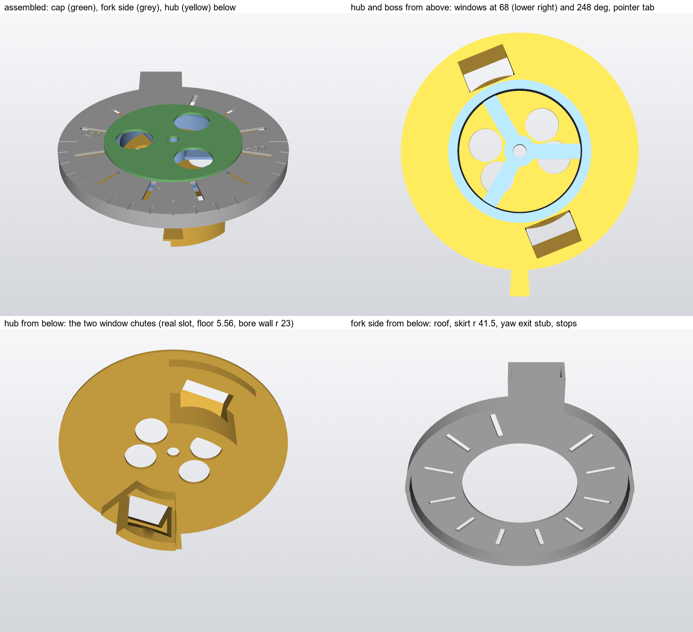

# Yaw dish loop: test rig (2026-11-13)

**Question:** the arm bundle crosses the yaw joint in the dish under the RS02, between the fork rear's yaw exit and the
hub's cable window. Over yaw -90…+90 the distance between the two changes by up to 97 mm, and the dish has no room to
store slack (see [OPEN_ASSUMPTIONS.md](OPEN_ASSUMPTIONS.md) and A_HUB_LUGS.md, "Dish loop"). Does the bundle run, and where
does the slack go? Analysis can't settle it. This rig can, in an hour.

## What it reproduces

| Real part | In the rig |
|---|---|
| RS02 underside (Y 323.86), r 21.8-39.3 | Roof of the fork part, 5.5 mm above the dish floor |
| Fork skirt bore, r 41.5 (2.2 mm off the hub rim) | Skirt of the fork part |
| Yaw exit: 16 × 6 channel, centre X - RX -5.4, heading for the axis, ending at Z - YZ -37 (261.7°), Y 316.55-322.55 | Stub on the fork part, same section and height |
| Hub dish floor (Y 318.36) to the rim r 39.3 | Floor of the hub part |
| Hub step ring r 23.5 × 1.5 and the RS02 rotor r 21.8 | Boss; turns with the hub |
| Cable window: slot 9 mm in the radial plane × 16 across, from (r 31, dish) down to (r 15.5, Y 298); floor 5.56 thick; bore wall r 23 | Two chutes on the hub part, at **68°** and **248°**, 22 mm deep |

Not reproduced:
- the channel's R 24 bend up into the fork rear (the stub is straight; clamp the bundle to it)
- the skirt below the floor
- the lugs and the boss tubes
- PETG (PLA slides slightly more easily)

## Print

Script: `cad/scripts/shoulder/cable_loop_rig.py`. Files in `cad/exports/fixtures/`, already turned to print flat.

| Part | File | Mass (PLA) | On the bed |
|---|---|---|---|
| Fork side | `fixtures_yaw_loop_rig_fork.STL` | 9.2 g | roof down (the scale prints on the bed face) |
| Hub | `fixtures_yaw_loop_rig_hub.STL` | 10.7 g | dish floor down, chutes up |
| Boss | `fixtures_yaw_loop_rig_boss.STL` | 3.3 g | as modelled |
| Cap | `fixtures_yaw_loop_rig_cap.STL` | 2.0 g | flat |

- **Total 25.9 g, about 1 h 15 min on one plate** (sliced: 25 + 34 + 9 + 5 min of printing for the four parts, at
  0.20 mm with the arm's PETG settings; PLA will be close). Turn supports off.
- No support needed. The exit stub's floor is a 16 mm bridge; the chutes lean 35° from vertical.
- Also needed: one M4 × 16 screw and nut, tape, a cable tie, a ruler, a marker.
- Mesh: all four pass the integrity scan (watertight, no non-manifold edge, no zero-area face).

## Bundle to test

The wires that cross the upper-arm yaw joint (trunk segment S3, RS02 splice to elbow splice):

| Wire | Count | Size | Source |
|---|---|---|---|
| 48 V and GND | 2 | 16 AWG high-strand silicone, OD 3.0 | [left-arm-trunk README](https://github.com/jaylamping/marengo/blob/main/hardware/electrical/wiring/left-arm-trunk/README.md), Conductors and cut list S3; OD from `hardware/power-board/layout/HARNESS_INTERFACE.md` |
| CAN pair, arm bus | 1 pair | 26 AWG, twisted about 1 turn per 25 mm, OD about 1.0 each | same |
| Hand CAN pair and a third thin pair (reserve) | up to 2 more pairs | 26 AWG | Joey 2026-11-11, upper-arm README "Cable passages" |

- **Sleeve:** none. The trunk plan says to run the wires loose through flex sections, not as a tight bundle.
- **Laid flat:** 3.0 high × about 8 wide with one pair, about 12 wide with three. The 3.5 × 13 reserve covers it.
- **Test both:** two power wires and one pair, then two power wires and three pairs.
- **Two things in the sources disagree:**
  - Gauge: the trunk plan has 16 AWG as far as the elbow splice; the upper-arm README sizes its passage for 18 AWG
    (3.5 × 5.6). Test with 16 AWG, the larger.
  - Mechanism: the trunk plan crosses yaw as a ±90° twist over about 185 mm of free length. The shoulder has no straight
    run on the yaw axis; it uses the dish loop.

## Test

1. **Assemble.** Boss on the hub, fork part over the boss, cap on top, M4 through all three from the cap; tighten so cap,
   boss and hub turn together and the fork part turns freely. Tape over the window not in use, flush with the floor.
2. **Thread the bundle** through the exit stub into the dish and down the window under test. Tie it to the stub. Set the
   pointer to 0 and leave the bundle in the dish neither tight nor bunched. Mark each wire where it leaves the bottom of
   the chute, and hang about 20 g on the lower end.
3. **Turn slowly to +90 and back to -90,** holding the hub and turning the fork part, roof up. At every 30° note through
   the roof slots where the bundle lies, and measure how far each mark has moved at the chute (feed, in mm).
4. **Repeat 20 times** end to end. Note any angle where it binds or where the roof lifts.
5. **Look for return:** after the cycles, at 0, are the marks back where they started, or has slack collected in the
   dish or below the chute?
6. **Repeat** with the other window, and with the three-pair bundle. Then look at the wires and the printed edges for
   scuffing: the chute's upper edge, the exit's mouth, the boss.

**What to report:**
- binds or not, and at what yaw
- feed at ±90 and at the tightest point, per window
- whether the feed returns
- wear points
- for 248: whether the bundle crosses the exit cleanly near yaw -14

**What decides:**
- **68° (one-way loop):** expected feed about 97 mm over the travel. It works only if that length slides freely through
  the window and comes back.
- **248° (swings both ways past the exit):** expected feed about 55 mm.
- If neither runs, the dish loop needs more room or a different crossing, and that is a design change to the fork and
  hub, not a window angle.
