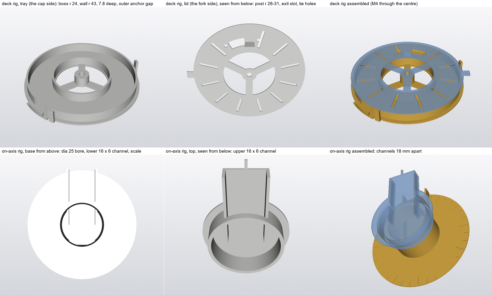
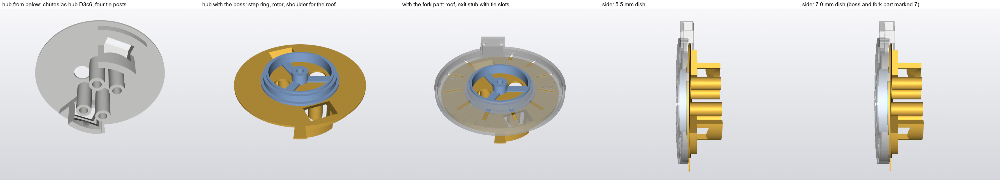
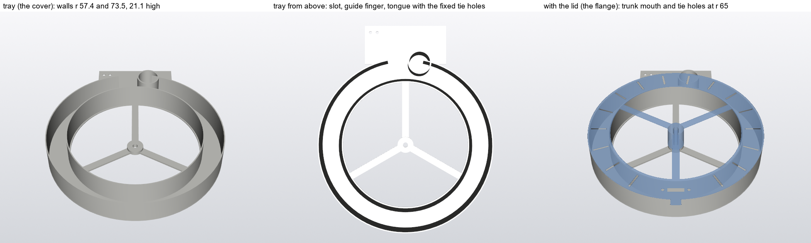

# Cable crossing rigs (2026-11-13)

Small printed rigs that settle, by hand and with the real wires, what [CABLE_TRAVEL.md](CABLE_TRAVEL.md) could only
work out on paper. PLA, flat, no support. Script: `cad/scripts/shoulder/cable_rigs.py`. Files:
`cad/exports/fixtures/fixtures_cable_rig_*.STL`, already turned to print flat.

**Order:** roll first, then yaw, then pitch. Sliced plates (Bambu Studio 3MF, P2S, PLA Basic, 0.20 mm, 3 walls, 15%
infill, no support, no brim) are on holly-pc in `C:\joe\prints\cable-rigs\`. They are not in the repo: a 3MF under
`cad/prints/` needs a pre-print gate report, and these fixtures have no spec. The STLs here print the same way.

**Wires for every test:** the real ones, loose, not sleeved. By the robot's wiring scheme (Joey, 2026-11-11):

| Crossing | Power | Signal |
|---|---|---|
| Pitch and roll | 2 × 16 AWG silicone (OD 3.0) | 2 twisted pairs of 28 AWG (each wire 1.2 mm); a third pair is reserved |
| Yaw | 2 × 18 AWG (OD 2.3), 10 A fuse at the step. **The gauge is to be decided from the yaw rig:** test 18 AWG and 16 AWG | the same |

Test with two pairs, and once with three.

## Roll rig

**Start here: [HOWTO_roll.png](cable_rigs/HOWTO_roll.png)**, one page of pictures: where the rig comes from on the robot,
the parts, how they go together, where the wires go, and the test. The shoulder on the torso, for orientation:
[shoulder_on_torso.png](cable_rigs/shoulder_on_torso.png).

**Why first:** if today's route through the stub bore survives with real silicone wire, the roll joint needs no rework.
If it fails, the same print shows whether a spiral deck works.

Every part from all sides: [SHEET_roll.png](cable_rigs/SHEET_roll.png)

| Part | File | Mass (sliced) | Print time |
|---|---|---|---|
| On-axis rig, base | `fixtures_cable_rig_roll_axis_base.STL` | 8.5 g | 27 min |
| On-axis rig, top | `fixtures_cable_rig_roll_axis_top.STL` | 4.2 g | 14 min |
| Deck rig, tray | `fixtures_cable_rig_roll_deck_tray.STL` | 16.4 g | 28 min |
| Deck rig, lid | `fixtures_cable_rig_roll_deck_lid.STL` | 6.8 g | 17 min |
| **All four** | | **35.9 g** | **about 1 h 35 min on one plate** |

- Sliced at 0.20 mm with the arm's PETG settings; PLA will be close. Turn supports off (the slicer adds a little under
  the on-axis parts that they don't need).
- All four pass the integrity scan.
- Also needed: one M4 × 16 screw and nut (deck rig), two small cable ties, tape, a marker.

**What each reproduces:**

| Rig | Real geometry | In the rig |
|---|---|---|
| On-axis | Rear cap's radial channel, 16 × 6 | Channel on the base, running into the bore |
| | Stub bore Ø25 | The base's tube |
| | 18 mm between the two channels' centres | Lower channel centre 3 mm up, upper 21 mm up |
| | Fork rear's radial channel, 16 × 6 | Channel in the top, which turns on the tube |
| Deck | Cap cavity: boss r 24, 7.8 deep | Tray: boss wall r 24, floor to lid 7.8 |
| | Spiral band r 28 to 41.6 | Tray's outer wall at r 43 (wire centre at 41.5) |
| | Outer anchor where the trunk's spoke comes in | Gap in the outer wall with a tie bar |
| | Post on the fork rear's housing face, r 28-31 | Post under the lid, with the exit slot and tie holes beside it |

Not reproduced: the bends above and below each rig, PETG, the weight of the arm on the wires (none).

### Test A: today's route (on-axis rig)

1. **Thread** the three wires along the base's channel, up the bore, and out along the top's channel. Fit the top on the
   tube.
2. **Tape the wires down** in each channel about 25 mm from the middle of the tube (12 mm out from the tube's wall), with
   the top at 85° from the base's channel (mid travel)
   and the wires neither tight nor slack in the bore.
3. **Mark** each wire with a line where it enters the bore at the bottom and where it leaves at the top.
4. **Turn the top from 25° to 146° and back** (that is roll +110° to -11°: the two channels are 135° apart at roll 0).
   Use the marks on the base (one every 10°, a longer one every 30°). Do it slowly five times. The top's roof covers the
   tube, so the wires in the bore cannot be seen from above while it is on: look in along the open channel, and lift the
   top off between sets to look.
5. **Then 200 cycles by hand.**
6. **Look:** kinks, a wire climbing over another, a mark that has moved (the wire is being pulled through the tape),
   white stress marks or a flattened spot in the insulation, a wire that has taken a set.

**Pass:** no kink, no mark moved by more than 1 mm, insulation unmarked after 200 cycles, and it turns by a light touch
at both ends of travel.
**Fail:** any kink, or it needs force near either end, or the wires spring the top back.

### Test A2: the same route with the wires free in the channels

This is option (f) of [ROLL_OPTIONS.md](ROLL_OPTIONS.md): in the real parts the wires could be held only at the far ends
of the two channels, 45 mm from the bore on the cap's side and 80 mm on the fork's.

1. Take the tape off. Leave the wires loose in both channels.
2. **Base side:** tape the wires to the bench 45 mm from the bore, in line with the base's channel (the base lies on the
   bench).
3. **Top side:** tape a 100 mm strip of card or a ruler along the top's channel so it sticks out, and tape the wires to
   it 80 mm from the bore.
4. Repeat steps 3 to 6 of test A.

**Pass and fail:** as test A. **Also report:** whether the wires turn freely in the channels, and what the two bends at
the bore's ends look like after 200 cycles. If A fails and A2 passes, the route stays and only the clamps move.

### Test B: spiral deck (deck rig)

1. **Lay the spiral.** With the lid off, clamp the wires at the outer anchor with a tie (power wires stacked one on the
   other, the pair beside them). Lay them clockwise round the tray, about 1.2 turns, against the outer wall.
2. **Fit the lid** with its pointer at mid travel, lead the inner end up through the slot beside the post, and tie it to
   the two tie holes with the wires lying against the post's trailing side. Fit the M4 and nut so the lid turns freely.
3. **Turn the lid stop to stop** (the tray's two stops are roll -11° and +110°). In one direction the spiral winds onto
   the boss; in the other it opens against the wall. If it runs the wrong way (the wires go slack then tight), re-lay it
   the other way round.
4. **Five slow cycles,** watching through the lid's slots: does the band stay one wire thick, do the wires stay stacked,
   does anything bunch or cross?
5. **Then 200 cycles by hand.**
6. **Look,** as in test A, and at the tie points: has either end pulled?

**Pass:** the wires stay in their band, nothing bunches or lifts the lid, no kink at the post or the anchor, light and
even feel over the whole travel, wires unmarked after 200 cycles.
**Fail:** bunching, a wire trapped under another, the lid lifting, or a tight spot.

**What to send back:** for each test, pass or fail, at what angle anything happened, and a photo of the wires afterwards.
If test A passes cleanly, say so plainly: it decides whether the cap and fork rear are redesigned.

## Yaw rig (second version)

**Start here: [HOWTO_yaw.png](cable_rigs/HOWTO_yaw.png)**, one page of pictures: where the rig comes from on the robot, the
six parts, the stack, where the wires go, and the test.

**What it is:** the dish under the RS02 with both ends of the bundle clamped. It comes with **two dish depths**, so
18 AWG and 16 AWG can be tried in one sitting:

| Dish | Parts | What it stands for |
|---|---|---|
| **5.5 mm** | fork part marked 5.5, boss without a bar | The shoulder as built |
| **7.0 mm** | fork part marked 7, boss with a raised bar on one spoke | The dish made 1.5 mm deeper (a change to the hub's top) |

The hub and the cap are the same for both. The boss sets the depth: the fork part's roof rests on the boss's shoulder.
The hub's chutes are the slot of hub D3c6, at 68° and 248°; four hollow posts stand where the boss tubes beside the
windows are (tie points); the exit stub's roof has two tie slots.

Every part from all sides: [SHEET_yaw.png](cable_rigs/SHEET_yaw.png)

| Part | File | Mass (PLA) |
|---|---|---|
| Hub | `fixtures_cable_rig_yaw2_hub.STL` | 15.4 g |
| Fork part, 5.5 | `fixtures_cable_rig_yaw2_fork.STL` | 9.5 g |
| Fork part, 7.0 | `fixtures_cable_rig_yaw2_fork_7.STL` | 10.9 g |
| Boss, 5.5 | `fixtures_cable_rig_yaw2_boss.STL` | 4.3 g |
| Boss, 7.0 | `fixtures_cable_rig_yaw2_boss_7.STL` | 5.2 g |
| Cap | `fixtures_cable_rig_yaw2_cap.STL` | 2.0 g |
| **Plate, all six** | `fixtures_cable_rig_yaw.3mf` | **45.2 g sliced, 1 h 28 min** |

- No support. All parts pass the integrity scan.
- Also needed: one M4 × 16 screw and nut, four small cable ties, tape.
- The first yaw rig ([CABLE_LOOP_RIG.md](CABLE_LOOP_RIG.md)) is superseded: its bundle slid through the window, and its
  roof had nothing to rest on. Its files are removed.

### How to set up any yaw test

1. **Clamp at the exit:** thread the wires in through the exit stub and tie them down through the two slots in its roof.
2. **Lay the bundle** on the hub's floor with the fork part off.
3. **Clamp at the window:** lead the end down the 68° chute (the hole in the floor next to the hub's pointer tab; the hub
   is not marked) and tie it to the post beside the chute, below the floor. Tape over the other, 248° window.
4. **Assemble:** boss on the hub, fork part over the boss (it rests on the boss's shoulder), cap, M4. Pointer at 0.
5. **Five slow cycles** between the stops (-90 and +90), watching through the roof slots. **Then 200 by hand.**

### The four tests, side by side

| Test | Wires | Dish | Laid as | Expected on paper |
|---|---|---|---|---|
| **C1** | 2 × 18 AWG + 2 pairs | 5.5 | Spiral, about 2.5 turns at yaw 0 (the exit and the window are half a turn apart there: 2.25 turns at one end of travel, 2.75 at the other), power wires stacked one on the other, pairs beside them | **Fits only with the pairs untwisted in the dish** (four singles stacked: band 3.5 mm of the 4.0 available). Twisted: band 4.7 mm, about ±72° |
| **C2** | 2 × 16 AWG + 2 pairs | 5.5 | The same | **Does not fit:** two stacked are 6.0 mm in a 5.5 mm dish, so they lie side by side and the band is too wide |
| **C3** | 2 × 16 AWG + 2 pairs | 7.0 | The same | **Close:** pairs untwisted, band 4.2 mm, about ±85°. Twisted: 5.4 mm, about ±56° |
| **D** | 2 × 16 AWG + 2 pairs | 5.5 | One plain arc from the exit round to the window, flat; turn only between -37 and +37, then try ±45 and ±50 once | Free to ±37 |

- If the spiral runs the wrong way (slack, then tight), re-lay it the other way round.
- **Run C1 and C3 twice:** once with the pairs twisted as they come, once with the last half metre untwisted and the four
  wires stacked. Note the angle where the spiral runs out.
- Repeat the best one with the third pair added. On paper it does not fit in one column in either dish.

**Pass, for C1 to C3:** the wires stay in one band, stacked; nothing bunches, crosses or lifts the roof; nothing enters the
gap between the hub's rim and the skirt; even, light feel over the whole ±90; wires unmarked after 200 cycles.
**Fail:** bunching, a wire trapped under another, a tight spot, the roof lifting, or a pair in the rim gap.

**What to send back, for each of C1, C2, C3 and D:**
- pass or fail, and the yaw angle where anything happened
- does it wind evenly, or bunch
- the feel: light and even, or a tight end
- a photo of the bundle in the dish at -90, 0 and +90 with the fork part lifted off
- which gauge you would choose

## Pitch rig

**Start here: [HOWTO_pitch.png](cable_rigs/HOWTO_pitch.png)**, one page of pictures: where the rig comes from on the robot
(and where the spare wire would hang inside the body), the two parts, how they go together, the wires in both tests, and
the tests.

**What it reproduces:** the loop channel round the pitch motor (inner wall r 57.4, outer wall r 73.5, 21.1 high) as a
fixed tray with a 30 mm slot at the bottom, a round guide finger (R 10) at the slot, and a tongue below the slot with
two tie holes for the fixed clamp. The lid is the drum's flange: it turns on an M4 at the centre and carries the trunk
mouth (13 × 4) with two tie holes at r 65.

Every part from all sides: [SHEET_pitch.png](cable_rigs/SHEET_pitch.png)

| Part | File | Mass (sliced) | Print time |
|---|---|---|---|
| Tray | `fixtures_cable_rig_pitch_tray.STL` | 31.3 g | 53 min |
| Lid | `fixtures_cable_rig_pitch_lid.STL` | 11.6 g | 40 min |
| **Both** | | **42.9 g** | **about 1 h 40 min on one plate** |

- 149 × 180 mm on the bed, so the two parts are two plates: `fixtures_cable_rig_pitch_tray.3mf` (31.3 g, 48 min) and
  `fixtures_cable_rig_pitch_lid.3mf` (10.2 g, 31 min). No support. Both pass the integrity scan.
- **A second, narrower pair for the 150 mm shell opening what-if** ([PITCH_OPENING_150.md](PITCH_OPENING_150.md)): the
  outer wall at r 68.5, so the channel is 11.1 mm instead of 16.1; the lid's mouth is at mid channel. Everything else
  is the same (inner wall, depth, finger, slot, tongue, clamp holes). Plates `fixtures_cable_rig_pitch_tray_r75.3mf`
  (28.8 g, 46 min) and `fixtures_cable_rig_pitch_lid_r75.3mf` (8.2 g, 28 min), 139 × 175 mm; STLs of the same names.
  Use them as a pair, and run tests E and F on both pairs with the same wires. Expect about 45-60° from test E on
  the narrow tray against about 90-115° on the first.
- Also needed: one M4 × 30 screw and nut, three small cable ties, about 30 g to hang (six M8 nuts on a paper clip) or a
  thin elastic, a pen to mark angles on the tray's rim (the lid has a pointer).

### Test E: spiral, about 115°

**Wires:** two 16 AWG and two pairs, about 1.2 m.

1. Lay the tray flat. Tie the wires to the tongue's tie holes, lead them over the finger into the channel and lay 2 turns
   against the outer wall, the wires side by side across the channel's height (power wires, then the two pairs).
2. Bring the end up through the lid's mouth and tie it to the lid's two holes. Fit the lid and the M4.
3. Mark the lid's start on the tray's rim. Turn the lid in the winding direction until the wires are snug on the inner
   wall; mark that. Measure the angle between the marks.
4. Five slow cycles between the marks, then 200.

**Pass:** at least 110° between the marks, the wires staying side by side in one layer, light even feel.
**Report** the angle.

### Test F: wrap and bight, 230°

> **Note, 2026-11-14.** On the bench the loop can be as deep as it likes. In the robot the room under the frame's step
> is 117 mm, which a bight alone turns into about 140° (PITCH_BIGHT.md, corrected). So run the test twice: as written
> (230°, loop to 140 mm), which shows whether the mechanism works at all, and with the loop never deeper than 117 mm,
> turning until it has risen to 45 mm: report that angle.

**Wires:** as test E, about 900 mm.

1. **Hold the tray upright,** slot at the bottom (clamp the tongue's lower edge in a vice, or tape the tray to a shelf's
   edge with the tongue hanging over).
2. Tie the wires to the lid's mouth with the lid's pointer 20° past the slot. Lead them round the inner wall, over the
   finger, down through the slot.
3. **Hang the weight** on the wires as a loop below the slot, and tie the free end to the tongue's tie holes so that the
   loop is about 140 mm deep.
4. **Turn the lid through 230°** in the direction that wraps the wires onto the inner wall. The loop should rise to
   about 15 mm. Turn back: the loop should fall to 140 mm again, on its own.
5. Five slow cycles, then 200. Try 270° once.
6. Repeat with the elastic in place of the weight (anchored about 300 mm below the slot, just taut at the loop's
   deepest), and with no pull at all.

**Pass:** the loop follows both ways on its own with the weight, the wires stay on the inner wall and leave it at the
finger, nothing bunches in the channel, wires unmarked after 200 cycles.
**Report:** the smallest pull that still makes the loop follow (weight in grams), whether the elastic does it, the loop
depth at each end, and whether 270° also works.
