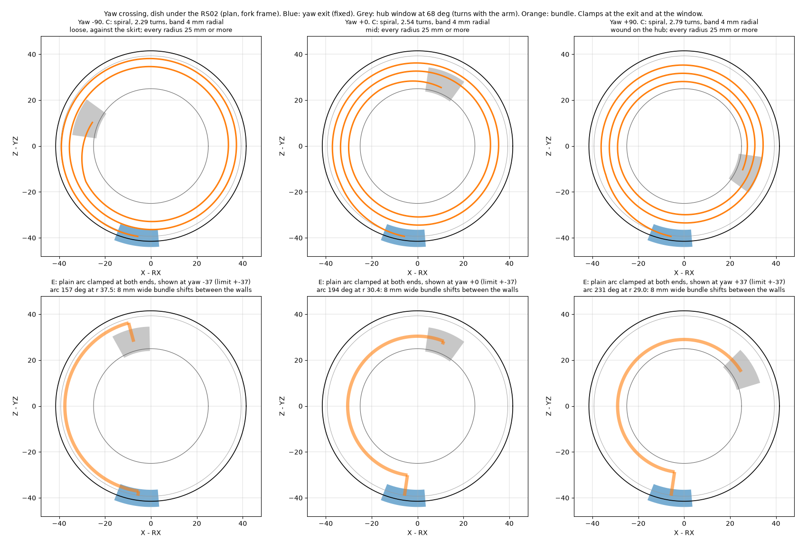
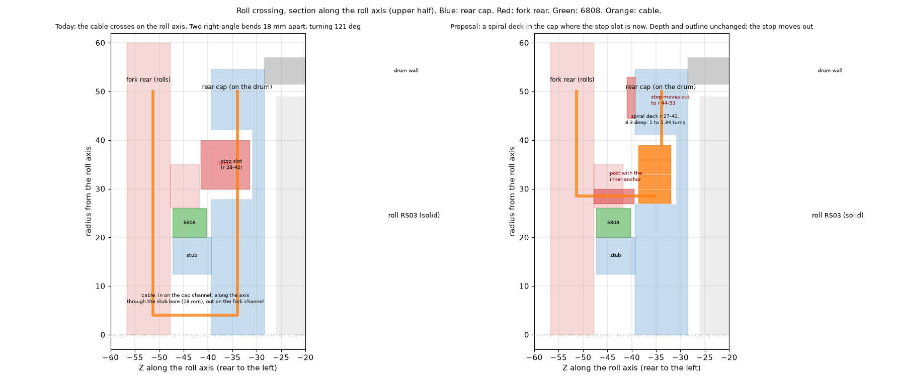
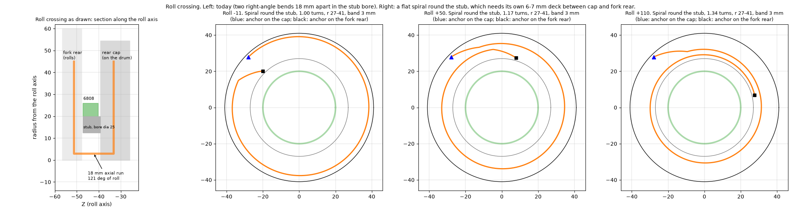
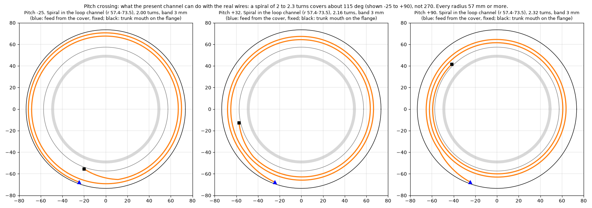
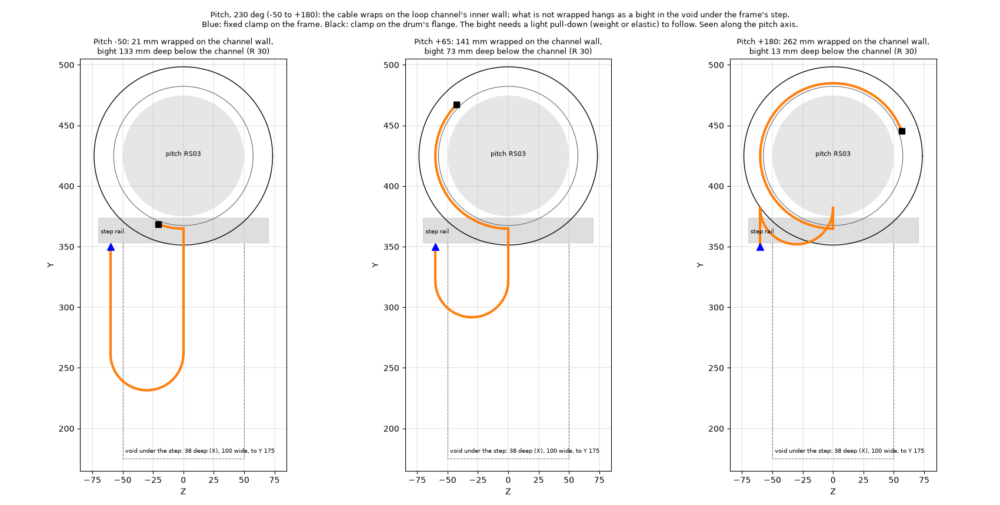

# Where the cable travel goes at the three shoulder crossings (2026-11-13)

**Status:** paper study from the model's dimensions. No real part is changed. Nothing here is proven until a rig runs.
The pictures are schematic.

## Short answer

| Joint | Travel wanted | Works today, as drawn | Best with no part redesign | What buys the full travel |
|---|---|---|---|---|
| **Yaw** | ±90° (not fixed) | No: 97 mm of slack with nowhere to go | **±90° as a spiral in the present dish, if this segment is 18 AWG.** With 16 AWG: about ±37° as a plain arc | Nothing more needed with 18 AWG. For 16 AWG: the dish 1.5 mm deeper (hub top) |
| **Roll** | -11° to +110° (the stops) | No: good for about ±11° | None | A spiral deck in the rear cap where the stop slot is; the stop moves out. Cap, fork rear, stop |
| **Pitch** | 230-270° (not fixed) | No | **About 115°** as a spiral in the present channel | A bight in the void under the frame's step: no outline change, needs a pull-down, **marginal at 230° and not enough for 270°** ([PITCH_BIGHT.md](PITCH_BIGHT.md)). Or the channel 9.5 mm deeper (outline grows) |

- **Outer outline:** every option marked alive below keeps it, except the deeper pitch channel.
- **The cheapest fix everywhere is less travel.** What each joint really needs is a question for Joey (facts at the end).

## The wires and the rules

**Trunk through the shoulder** (marengo `hardware/electrical/wiring/left-arm-trunk/README.md`):

| Wire | Size |
|---|---|
| 48 V and GND | 2 × 16 AWG high-strand silicone (252 × 0.08 mm), OD 3.0 mm |
| CAN | 1 twisted pair, 26 AWG, about 2.0 mm across; up to 2 more pairs past the yaw joint |

**Rule of record** (marengo `left-arm-trunk-plan.md`, section 5, and the bench harness doc):

| Rule | Value | 16 AWG (OD 3.0) | 18 AWG (OD 2.3) |
|---|---|---|---|
| Static bend | at least 5 × OD | 15 mm | 11.5 mm |
| Flexing bend | at least 10 × OD | **30 mm** | **23 mm** |
| Twist | 150 mm of free length per ±90° | | |
| Joint jumpers | flex-rated wire, PTFE or TPE jacket, not silicone; loose singles | | |

- The arm thread works to R 24 (8 × OD). Where an option meets 24 but not 30, it says so.
- **A bend that is clamped and never moves** only has to meet the static rule. Every option needs that at its two ends,
  because the wires enter and leave each crossing across the direction they run in it.

## Yaw (upper-arm yaw, RS02)

**The space:** the dish under the RS02. Inner wall r 25 (the hub's step ring), outer wall r 41.5 (the fork skirt), 5.5 mm
high. The fork's exit enters at 261.7°, fixed. The hub's window is at 68° and turns with the arm. **The arm cannot take
any slack** (arm thread, CABLE_SLACK.md), so the bundle is clamped at the window.

| Option | What | Numbers | Outline | Verdict |
|---|---|---|---|---|
| A | Take-up loop behind the fork's exit | An R 30 take-up for 100 mm needs a clear pocket about 63 × 90 × 5 mm. The fork rear's leg is 73 × 28 in section and carries the 6808 and the roll stop. The cavity behind the RS02 is 8-27 mm deep, 30 mm high | kept | **No room** |
| B | Rolling U loop of the wires in the dish | The fold spans the radial gap: radius about 7.5 mm. At R 30 the dish would have to be 63 mm wide or 63 mm high | - | **No** |
| C | Spiral: 2 turns loose on the skirt, 2.5 turns wound on the hub | Radii 26.5-40. The two states balance only if the band is **4.0 mm or less radially**. **18 AWG:** band about 3.3 mm, and its 23 mm rule is met everywhere: **fits.** **16 AWG:** two stacked are 6.0 mm against the 5.5 mm height, so the band is about 4.7 mm: does not fit; with the dish 1.5 mm deeper about 3.6 mm: fits, but the inner turn (r 26.5) is under the 30 mm rule. About 470 mm of bundle in the dish | kept | **Alive.** Unknown: whether loose wires wind evenly or bunch |
| D | Centre the exit on the window (the 248° idea), both ends clamped | Length change halves to 48-55 mm, but at mid travel the spare length stands as a loop of about R 9-10 | kept | **No** |
| E | Plain arc, both ends clamped, less travel | The slack is taken by the arc moving between the walls. Bundle flat, 8 mm wide: **±37°**. 12 mm wide: ±21°. 18 AWG on edge: ±51°. Radii 29-37.5 | kept | **Alive as the fallback** |
| F | High-flex flat ribbon as a rolling loop in the dish | On edge in 5.5 mm a ribbon is 4 conductors wide; three ribbons fold at about R 7. 3M 3319 (28 AWG) is rated for a 22 mm bend radius over 100 M cycles, so R 7 is outside its rating | kept | **No**, on the datasheet found |

**For every dish option:**
- **Both ends turn 90° in the dish plane within 8-10 mm:** the exit enters radially and the window leaves radially,
  while the loop runs round. That is under the static rule (15 mm for 16 AWG, 11.5 for 18). It needs a clamp at each
  turn, and it is a reason to turn the exit's last 10 mm toward the tangent when the fork rear is next rebuilt.
- **The 2.2 mm gap** between the hub rim (r 39.3) and the skirt (r 41.5) cannot take a power wire, but a 2.0 mm CAN pair
  can wedge in it.

**Anchors:**
- **Hub side:** a cable tie round the bundle and the 98° boss tube, inside the bore at Y 300-304. In hub D3c6 that tube
  stands 0.3 mm from the slot's inner wall with a whole 2.2 mm wall. Nothing is cut, so the lug roots and the wall under
  the groove are untouched. Fitted from below before the arm halves go on. Alternative: a printed wedge pressed into the
  slot above the bundle.
- **Fork side:** none exists. The exit channel needs a tie slot or a clip at its mouth.

**Recommendation:** C with 18 AWG between the RS02 splice and the elbow splice, proven on the rig first; E with a ±37°
limit if the spiral bunches.

**Rig:** the yaw loop rig as designed assumed the bundle slides through the window. To test C it needs a tie post beside
the chute (standing in for the boss tube) and a tie slot on the exit stub. Then: lay 2.25 turns at yaw 0, clamp both
ends, cycle. Not rebuilt until the option is chosen.

## Roll (RS03, fork on the drum)

**The route as drawn:** radial channel in the rear cap (on the drum) → along the roll axis through the Ø25 stub bore →
radial channel in the fork rear. The axial run between the two channels is 18 mm.

| Option | What | Numbers | Outline | Verdict |
|---|---|---|---|---|
| As drawn | Two right-angle bends 18 mm apart, turning 121° against each other | By the twist rule 18 mm is good for about ±11°. A 3 mm wire on the axis sees about 18% surface shear; off the axis the wires also swing 5-9 mm sideways | kept | **No** |
| Twist along the axis | A straight free run on the roll axis | Needs about 100 mm. The roll RS03 is solid in front; behind the fork rear is the outline | grows | **No room** |
| **Spiral deck in the rear cap** | 1.0 to 1.34 turns round the stub, in the ring where the stop slot is now (r 27-41, Z -31 to -39.3, 8.3 deep) | Radii 27-41: meets R 24, 3 mm under the 30 mm rule on the inner turn (9 × OD). The two wires stack across the 8.3 mm depth, so the band is 3 mm | **kept; depth unchanged** | **Alive, as a redesign** |
| Free loop off the axis | A short loop from the drum to the fork, clamped both ends | The only gap the 121° sweep leaves between drum and fork is outside the drum's skin. The gaps inside (cap to fork cheek) are 2.5 mm | **breaks it** | **No** |
| Less travel on the present route | | About ±11° | kept | **No** |

**The spiral deck, far enough to judge** (section below):
- **Rear cap:** the stop slot ring becomes the spiral deck. The cap's radial channel ends at the deck's outer anchor
  (r 41) and no longer runs to the axis. The stub no longer carries cable. Thickness unchanged (10.8 mm).
- **Fork rear:** a post at r 27-30 stands forward from the cheek into the deck and carries the inner anchor; the fork's
  channel starts there and not at the axis. It passes the 6808 housing wall on the leg's side (270°), where the wall
  runs into the leg.
- **6808 seat:** unchanged (Ø52.2, same depth).
- **Roll stop: does not survive unchanged.** Its tooth (r 30-40) and slot are where the deck goes. It moves out to
  r 44-53, on the cap's rim. A larger radius lowers the stop force (1,250 N against 1,710 N at a 60 N·m stall), but the
  whole of B_ROLL_STOPS.md has to be re-run.
- **Mass:** about the same. **Look:** nothing visible changes.
- **Not modelled.** The sketch is from the stack dimensions only.

**Anchors:** none designed on either side today.

**Rig:** two printed discs on a pin (the cap's deck with an outer anchor; the cheek with the post), the real wires, 121°.
About 20 g.

## Pitch (RS03, drum on the torso)

**The space:** the loop channel round the pitch housing, r 57.4-73.5 (16.1 radial) × 21.1 axial. The feed enters from the
fixed cover; the trunk leaves through the mouth on the moving flange. The wires lie side by side across the 21 mm, so the
band is one wire thick: 3.0 mm.

| Option | What | Numbers | Outline | Verdict |
|---|---|---|---|---|
| Spiral, 16 AWG | 2 to 2.3 turns | **About 115°** (for example -25° to +90°). Radii 57 or more | kept | **Alive for reduced travel** |
| Spiral, full 270° | | Needs a band of 1.3 mm or less, or the outer wall at about r 83 (shell opening r 80, flange ring r 77.5) | grows 9.5 mm | No, without growing |
| Folded (rolling) loop | | The fold is 6.5 mm radius across the radial gap, 9 mm across the axial gap | kept | **No** |
| **Wrap and bight** | The cable wraps on the channel's inner wall; what is not wrapped hangs as a bight in the void under the frame's step | 230°: 241 mm to store, bight 133 mm deep. 270°: 283 mm, bight 154 mm deep. The void is 38 mm deep (X), 140 mm wide between the gussets, and open down to Y 175: **180 mm.** Bight 60 mm wide at R 30, 12 mm thick: it fits for both | kept | **Alive on paper.** Needs a pull-down |
| Spiral and bight together | The spiral takes 115°, the bight the rest | Bight 73-90 mm deep | kept | Alive; two mechanisms |
| Free loop inside the torso | A dress-pack loop from the drum to the frame | **Not connectable.** The pitch RS03 (Ø99) fills the frame's window (100 × 101), and the drum never enters the torso. The only way from the torso to anything that turns with the drum is the ring round the motor outboard of the frame: the loop channel | - | **No** |

**Wrap and bight, what it needs:**
- **A pull-down on the bight** (a 20-30 g weight or an elastic to the frame). A cable cannot be pushed: when the wrap
  shortens, something has to draw the freed length down. Friction round the wall multiplies the pull needed by up to 4
  at 270° of wrap.
- **A guide finger** at the channel's bottom, so the cable leaves the wall at one place.
- **Room:** the void under the step (old-frame X 37-75, Y 175-353, between the gussets at Z ±70) also holds the two feed
  risers. Hardpoint H5 (Y 245-265) reaches in to Z ±45, so the bight stays within Z ±33. The power board, pack and
  Jetson are inboard of X 37 and not in it. The other arm's bight is on the other side.
- It is clear of the pitch RS03 (it hangs below it), the frame rails (it passes inboard of the step rail through the
  feed's opening), and the shell opening.

**Checked against the frame and shell models afterwards** ([PITCH_BIGHT.md](PITCH_BIGHT.md)): the loop cannot hang
straight down (the shell's wall closes in after 55 mm, and the cable feed stands in the void), so it jogs 38 mm inboard
first and has 117 mm of depth, down to hardpoint H6. **230° is marginal and 270° does not fit.** An elastic pull-down
does not work in that height; a weight or a small spring retractor does.

**Recommendation:** decide the pitch travel first. For a first build, the spiral alone at about 115° needs only two
clamps. For more, the spiral with a short loop (fits), or the full wrap and bight (marginal at 230°), on a rig first.

**Rig:** two printed rings 21 mm apart (inner wall r 57.4, outer r 73.5) with a slot at the bottom, the real wires, a
weight. About 40 g.

## Across all three

| Idea | Result |
|---|---|
| Separate singles instead of a bundle | Needed anyway (the plan asks for it). It lets a spiral band be one wire thick. It does not rescue a fold or a short twist |
| Twist along the axis | No joint has the axial room: all three motors are solid and sit on the axis |
| Less travel | Yaw ±37° works today with a plain arc. Pitch about 115° works today as a spiral. Roll does not work at any useful travel on the present route |

## Wire

| Wire | OD | Flexing bend | Price | Use here |
|---|---|---|---|---|
| 16 AWG silicone, 252 × 0.08 (BNTECHGO type) | 3.0 mm | None stated by the sellers; by the 10 × OD rule, 30 mm | hobby wire | The trunk today |
| 18 AWG silicone | 2.3 mm | None stated; 23 mm by the rule | hobby wire | The yaw segment, if the wiring plan agrees |
| igus chainflex CF9.15.02 (2 × 1.5 mm², TPE) | 6.5 mm | 5 × OD in a chain: 32.5 mm | about USD 6.8/m | No gain: the jacket makes it thicker |
| Cicoil flat silicone, 16 AWG | 3.6-3.8 mm thick | 7-10 × thickness: 25-38 mm | not found | No gain |
| Lapp ÖLFLEX ROBOT 900 P | multicore only | 15 × OD; torsion ±360°/m | not found | Torsion-rated, but no joint has the length |
| 3M 3319 high-flex ribbon, 28 AWG | 0.9 mm thick | 22 mm radius, 100 M cycles | not found | Too little current for the trunk |

- **No datasheet found supports a tighter flexing radius at the same gauge.** A thinner-walled 16 AWG (PTFE or ETFE,
  about 2 mm OD) would give 20 mm by the same rule, but no flex rating for one was found. Unverified.
- Sources: sellers' listings for the silicone wire; igus CF9 data sheet; Cicoil "Flat Cable Bend Radius"; Lapp product
  page 0028170; 3M 3319 data sheet. Nothing is ordered.

## What other builds do

- **Robots with hollow-shaft joints run the cable through the axis** (Unitree G1, the original Berkeley Humanoid, parts of
  Menlo Asimov). Not open to us: the RobStride motors are solid.
- **With solid actuators, the documented practice is an external service loop at each joint:** short XT30(2+2) jumpers
  from one actuator to the next, sleeved and tied to the brackets, sized for full travel and checked by hand at both
  limits (Fully Open Humanoid, on RobStride RS02/RS03; Seeed's RobStride arm sells 200-320 mm jumpers).
- **No hobby or research humanoid was found using a slip ring or an engineered clock spring.** Limited travel and
  generous outside loops are the norm. One of them limits shoulder roll to -20° to +150°.
- **Nobody publishes a bend radius for these loops.**
- **Marengo's own trunk plan** proposed a spiral of 2 to 3 turns round the RS03 at r 55-75 for pitch and roll, dropped the
  rolling loop (its fold needs 60 mm), and kept the free service loop for the bench only ("snags, pinches or rubs over
  230°").
- So a hidden crossing through 230-270° is beyond what the builds found have done. They accept a visible loop.
- Web look, 2026-11-13; per-robot observations are from documents, not photographs.

## Facts for the three questions to Joey

**1. Pitch travel.**
- The concept takes about 270° (180° forward, under 90° back); the trunk plan -50° to +180°.
- The present channel gives about 115° with the real wires: for example -25° (arm slightly back) to +90° (arm straight
  forward). Reaching overhead (+180°) or well behind (-50°) needs the wrap and bight.

**2. 18 AWG for the arm segment (RS02 splice to elbow splice, about 0.5 m, plus about 0.5 m in the spiral).**
- **Loads past the yaw joint** (trunk plan's drop fuses): elbow RS02 5 A, forearm RS00 3 A, hand 3 A (its own load about
  1.3 A). Fuse-limited worst case 11 A. A realistic continuous figure is about 4 A (RS02 at its rated 6 N·m and 100 rpm
  is about 65 W, the RS00 less, the hand 60 W).
- **Resistance:** 16 AWG 13.2 mΩ/m, 18 AWG about 21 mΩ/m. Over 1 m out and 1 m back:

  | | 16 AWG | 18 AWG |
  |---|---|---|
  | Drop at 4 A | 0.11 V | 0.17 V |
  | Heat at 4 A | 0.42 W | 0.67 W |
  | Drop at 11 A | 0.29 V | 0.46 V |
  | Heat at 11 A | 3.2 W | 5.1 W |

- The trunk plan already uses 18 AWG from the elbow splice on, and 2 × 18 AWG per rail across the elbow.
- **One thing to add:** the board's port trips at 15-20 A, which is above what 18 AWG should carry for long. A 10 A fuse
  at the RS02 splice would protect the segment.

**3. Yaw travel.**
- ±90° needs the spiral (and 18 AWG, or a deeper dish).
- ±37° works with the present dish and 16 AWG as a plain arc.
- Whatever is chosen becomes the soft limit; nothing stops yaw mechanically.
