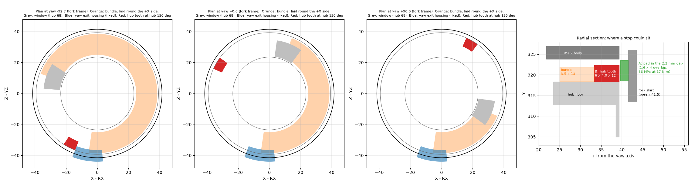

# Left shoulder: what was assumed and never checked (2026-11-13)

A first pass over CONCEPT.md, MEASUREMENTS.md, TORSO_INTERFACE.md, CAD_NOTES.md, PRINT_NOTES.md, the checks and the
look-option notes, plus a walk through the assembly: every cable through every joint, every screw with its neighbours in
place, every fit that rests on a bought part's dimension, heat, loads not run.

- **Ranked by risk to the first print and the first power-up.** 1 is worst.
- **Who settles it:** *here* = analysis in this thread; *run* = a job on holly-pc; *Joey* = a measurement or bench test;
  *other* = another thread.
- Results are filled in as items are settled.

## Ranked table

| # | Item | Where it is stated | What could go wrong | How bad | How to settle | Cost | Result so far |
|---|---|---|---|---|---|---|---|
| 1 | **Yaw dish loop has no slack storage** | CONCEPT.md "Wire passages" ("loop length for ±90 yaw is not checked") | The bundle fills the dish (13.5 mm radial, 5.5 mm axial). The exit-to-window distance changes by up to 97 mm over yaw ±90. The slack has nowhere to go but through the window or back up the exit | Stops the arm, or chafes the trunk through at 48 V | **Joey:** print and run the rig ([CABLE_LOOP_RIG.md](CABLE_LOOP_RIG.md)) | 26 g PLA, 1 h 15 min, 20 min test | Found 2026-11-13. Window at 248° passes under the exit at yaw -14°; moved to 68° (one-way loop). Slack still open |
| 2 | **Yaw has no stop and no limit** | MEASUREMENTS.md "Yaw: unlimited by geometry"; SOFTWARE_HANDOFF.md has no yaw position limit; ±90 appears only as a sweep range and in the trunk plan | A runaway or a wrong zero at first power-up winds the bundle round the dish until it tears | Trunk damage, short at 48 V | **Joey / coordinator:** fix the yaw travel. Then a soft limit in SOFTWARE_HANDOFF.md, and decide whether a printed hard stop is wanted | Decision; a stop is a hub and fork change | Soft limits -85…+85 (assumed) are in SOFTWARE_HANDOFF.md. Stop options below: no hidden stop for both ends fits |
| 3 | **Motor heat into PETG** | Not stated anywhere | The RobStride ratings assume an aluminium heat sink (RS02: 6 N·m on 260 × 280 mm; RS03: 20 N·m on 215 × 220 mm; manuals section 1.2). Our mounts are PETG. The drives only fault at a thermistor reading of 135 °C (RS02) and 145 °C (RS03). PETG seats creep from about 60 °C | Seats and bosses relax; the 0.3 N·m joints loosen; continuous torque is well under the rating | **Other (software):** a temperature limit from the drive's reported temperature, well under 60 °C at the housing. **Joey:** a bench run logging temperature at a held torque | A config value; a 30 min bench run | Provisional limits (reduce from 50 °C, stop at 60 °C reported) and the bench procedure are in SOFTWARE_HANDOFF.md |
| 4 | **Hub screws too long for the RS02's thread** | A_HUB_LUGS.md "close-fit screw holes": M4 × 30, "about 8 mm of thread engages" | The RS02 drawing gives **6 × M4, depth 7 min** (manual section 1.1), and warns not to exceed the thread depth. The head seats at Y 298.1 (boss 21.76), so M4 × 30 goes in 8.24 mm. It can bottom before it clamps | Hub loose at "tight", or a damaged output | **Here**, done. **Joey:** probe one hole | 5 min | **Settled on paper:** use M4 × 30 with 1.6-2 mm under the head (two washers) for 6.2-6.6 mm, or M4 × 28. Not M4 × 30 bare unless the probe shows 9 mm or more |
| 5 | **Fork front to RS03 output: screw and pin lengths** | PRINT_NOTES.md: "6 × M4 (existing counterbores)", pins "about 8 mm" | The RS03 drawing gives **6 × M4, depth 6, blind** and **3 × Ø4, depth 7, blind**. The boss is 12.36 thick (seat Z 43.0, face Z 30.64). M4 × 20 would bottom | Fork loose on the roll output, the joint that carries the whole arm | **Here**, done | - | **Settled on paper:** M4 × 18 (5.6 mm engaged). Pins: at most 7 mm in the motor. The three Ø3.8 pin holes are in the real fork front (0 / 120 / 240°) |
| 6 | **Roll limits must exist before the first enable** | SOFTWARE_HANDOFF.md; B_ROLL_STOPS.md (layer SF 0.55-0.66 at a 60 N·m stall) | The printed stops break at a stall if the controller's 17 N·m / 1 rad/s / -9…+108° limits are missing | Broken fork rear on day one | **Other (software):** confirm the limits are in the controller, and test them on `vcan` | Software thread | Open |
| 7 | **XT30(2+2) plug's real size** | PRINT_NOTES.md; plug_pocket README ("height assumed", fold read from photos) | The plug or its folded lead does not fit the channel (r 36-50, 16.5 wide, Y 353.9-361.1) | Fork front reprint, 155 g | **Joey:** measure a real plug with its lead; try it in a printed slot | 10 min | Open |
| 8 | **Across-layer shear allowable, 13 MPa** | A_HUB_LUGS.md ("assumed"); B_ROLL_STOPS.md uses 22.5 MPa for layers | The hub's 1.60 / 1.31 rests on it. If the real figure is lower, the lugs' inner roots fail in yaw | Hub lug cracks at peak yaw torque | **Joey / arm thread:** a printed shear coupon, or the arm thread's data | A coupon and a pull test | Open |
| 9 | **The committed hub export is two revisions old** | cad/exports/shoulder (rev C+, 2026-11-11) | Someone prints it: no locating holes, short lugs | Wasted print; wrong joint | **Here:** replaced when D3c5 is released | - | Flagged in PRINT_NOTES.md |
| 10 | **Nothing has been sliced** | CONCEPT.md section 10; CAD_NOTES.md "Still open" | Supports that can't be removed; the RS02 seat is a supported face; drum skin 0.97 mm at one spot, cuff 1.48 | Reprints | **Run:** slice each part with the Bambu CLI and read supports, thin walls, time | About 1 h | **Done, first look** (below): every part slices without warnings; times and support mass listed. Supports not yet inspected for removal |
| 11 | **Re-torque after 24 h against access** | PRINT_NOTES.md; CAD_NOTES.md "Driver reach" | Assembled, only the 104° RS02 screw can be reached; the hub screws are behind the arm halves. The re-torque needs a strip-down | The low-preload joints never get their re-torque | **Here:** list which screws are reachable assembled. Then a procedure | 1 h | **Settled as a procedure** (below, and in PRINT_NOTES.md): the 24 h re-torque is done on the bench before each joint is closed in. The second re-torque is not possible on two joints without a strip-down |
| 12 | **Bundles against the RS02 in the fork** | CAD_NOTES.md "Side centre r 47" lays the bundles first; "RS02 re-clocked" fits the RS02 first | The two orders conflict. With the RS02 in, the 16 × 6 bundle may not go into the back cavity | Assembly stalls; forced cable | **Here:** section the back cavity with the RS02 in place | 1 h | **Settled on paper** (below): the bundle is fed down from the ring's open top at Y 340 after the RS02 is in and before the fork rear goes on. Hand access not tried |
| 13 | **Plugs through the channels** | CONCEPT.md assembly steps | An XT30(2+2)-F body is 16 × 6.5 × 15. It does not pass a 16 × 6 channel or the 7 × 6 tap | Wires must be threaded before they are terminated | **Here / electrical plan:** write the order (thread, then solder) into the assembly notes | - | **Settled:** in PRINT_NOTES.md. No plug or joint break can sit inside a channel, the stub or the dish |
| 14 | **Pitch loop over 270°** | CONCEPT.md, TORSO_INTERFACE.md ("flex life not checked") | Length change of about 300 mm at r 65; bend radius of a 4 mm band in a 16 mm channel | Trunk fatigue at the first joint | **Here:** length and bend radius on paper. **Joey:** a loop rig if the paper says tight | 1 h; a second rig | **Paper says it does not work as drawn** (below): 306 mm of length change, no spiral fits, and a folded loop bends 16 AWG at 6.5-9 mm. **Rank it with item 1.** Needs a rig or a redesign |
| 15 | **Roll crossing as twist in the Ø25 stub bore** | CONCEPT.md ("125° as twist", bend radii not checked) | Power above the axis, signal below: off-axis, so twist plus a swing | Chafe in the stub bore | **Here:** free length and twist per mm | 1 h | **Paper says tight** (below): 121° of roll over 18 mm of axial run between two right-angle bends, inside Ø25. **Rank it with item 1.** Needs a rig |
| 16 | **RS03 connector bays** | CONCEPT.md, MEASUREMENTS.md ("vendor bays are empty") | The top-bay window and branch are sized from the bay, not a plug | Drum reprint, 227 g | **Joey:** photo and size of the plugs seated in an RS03 | 10 min | Open |
| 17 | **RS03 output bearing rating** | C_LOAD_SHARE.md ("not published"; up to 28.6 N·m of tilt) | The roll output bearing is overloaded | Motor damage over time | **Other / vendor:** ask RobStride; the 6808 already shares the load | An email | Open |
| 18 | **Preload, creep and friction values** | A_HUB_LUGS.md (0.35 kN per screw, half after creep, μ 0.25, hook scale ±15%) | The hub-top SF falls from 1.64 to 1.41 if over-tightened; slip if under | Loose or cracked hub top | **Joey:** bench: torque, wait 24 h, re-check | Part of the first bench session | Open |
| 19 | **Fork front to RS02 body, 5 × M3** | PRINT_NOTES.md (no torque, no slip check, no length) | Carries the 17 N·m yaw reaction. The RS02 drawing gives 9 × M3, depth 8 | Yaw backlash at the motor seat | **Here:** slip check and screw length | 1 h | Length settled: M3 × 12 (5.5 mm into the motor; depth 8). Thread from the rear side to confirm on the motor. Slip check open |
| 20 | **Stop impact estimates** | B_ROLL_STOPS.md (inertia about 0.06 kg·m², stiffness "a rough estimate") | The 1 rad/s cap rests on them | Stop damage on a fast arrival | **Joey:** first stop contacts at low speed, inspect | Bench | Open |
| 21 | **Clearances are nominal CAD** | CAD_NOTES.md (2.0 mm gaps, ±0.4 sampling; deflection about 0.45) | Print tolerance and deflection eat a 2.0 mm running gap | Rub marks; not a failure | **Joey:** measure the first prints | - | Open |
| 22 | **Press fits** | CAD_NOTES.md (plugs Ø6.9 in Ø7; port cap hooks 0.8; RS02 in its bore with 0.45-0.50) | Too tight or loose as printed | Small reprints | **Joey:** try on the first prints | - | Open |
| 23 | **Insert and joint screw lengths** | PRINT_NOTES.md (six ISO 7380 M4, recess "about 3.1", no lengths) | Wrong screws on the bench; a screw into the plug channel (1.5 mm from an insert bore) | Delay; a pierced channel | **Here:** a length for each screw from the CAD | 1 h | **Done** except the cap's ear screws (CAD_NOTES.md "Screw and pin lengths"). Two more that bottom: drum on the pitch output with M4 × 18 bare, and a standard 8.1 mm insert in the fork joint |
| 24 | **Loads never run** | CAD_NOTES.md "Not analysed"; C_LOAD_SHARE.md (the fork as two bodies fails to solve) | Pitch stall (60 N·m) into the drum's pitch pad; the flange ring carrying the trunk mouth | Unknown margins on the drum | **Run:** drum pitch-pad case; fork as bonded bodies | 2-3 h of solves | Open |
| 25 | **Wire gauge and crossing in the trunk plan** | Trunk plan (16 AWG to the elbow, yaw as a twist); upper-arm README (18 AWG) | The bundle tested is not the bundle built | Rig result doesn't transfer | **Other (electrical):** one definition | - | Flagged to the coordinator |
| 26 | **6808 seat changes built?** | D_6808_FITS.md says "not rebuilt yet"; CAD_NOTES.md mass table implies built | If not built, the lip preloads the RS03 bearing | Bearing drag | **Here:** read the Ø52.2 bore and lip off the built parts | 15 min | Git says built (f93957c, 2026-11-11). To confirm on the STL |
| 27 | **Pitch output hole clock** | MEASUREMENTS.md (pattern 7.83 mm off at the exported clock; left side unconfirmed) | The drum doesn't bolt on | Drum reprint | **Here:** check the drum's pad holes against the placed pitch RS03 | 30 min | Open |
| 28 | **Cover fixing and feed** | CAD_NOTES.md "Still open" (M5 pads are placeholders; T-nuts not checked; feed waits for the shell) | Cover can't be mounted | Cover reprint, 102 g | **Other (torso / shell)** | - | Open; the cover waits |
| 29 | **Shell and spine pads** | CAD_NOTES.md (arm 0.01 mm from the lower spine pad at -11) | Contact with the shell | Shell change | **Other (shell)** | - | On the shell change list |
| 30 | **Yaw zero offset** | SOFTWARE_HANDOFF.md (+40°, "the hardware has no other reference") | A wrong zero points the arm 40° or 60° off | Wrong pose; see 2 | **Other (software):** a zeroing step with a printed reference mark | - | Open |
| 31 | **FEA simplifications** | A_HUB_LUGS.md (lug bolt preload not modelled; peaks under 1.0 read as fixture artefacts) | A real peak is dismissed | Local cracking | **Run:** one case with bolt preload, if item 8 comes back low | 1 solve | Open |
| 32 | **Mass against the target** | CONCEPT.md (520 g target); CAD_NOTES.md (638.5 g, before hub D3c) | Heavier than planned. Static arm moments are 1-2.3 N·m, far under the RS03's 20 | Low | **Here:** note only | - | Shoulder is about 642 g with hub D3c |
| 33 | **Right shoulder** | CAD_NOTES.md ("a mirror, later") | Handed parts mirrored wrongly (motors, screws, socket, offset sign, window) | Low for now | **Here:** plan first | - | Plan in work |
| 34 | **The cable window cuts the two hub-screw tubes beside it** | Not stated (A_HUB_LUGS.md calls it a "small side shave") | Wall round the screw hole is 0.0-0.3 mm over the tube's lowest 4 mm, right above the head's seat ring (the ring itself is whole). Two of six hub screws, one of them a locating screw | A head that seats on half a ring at 0.3 N·m; a sliver that won't print | **Coordinator:** move the window's bore end out past the tubes (entry at r 17.2), or accept. Either needs the arm thread | A rebuild and two solves | Found 2026-11-13; in CAD_NOTES.md. Rank it about 6 |
| 35 | **The lug load was taken as uniform over the plate** | A_HUB_LUGS.md, HUBL_YAW3P38 (304 N per lug, centroid X offset 26.6) | The arm thread's contact solution puts 245 N per lug at 17 N·m, but at X offset 31.2-31.7, right at the outer end. The outer R1.2 root may govern, not the inner one | Hub lug cracks at peak yaw torque | **Run:** HUBL_YAW_COP on hub D3c6 | 1 solve | Running |
| 36 | **Arm-horizontal load and yaw torque together were never run on the D3 lugs** | A_HUB_LUGS.md (HUBS_A ran it on the rev C hub, through the lug holes and spigot) | The arm thread reads shear 1.02 at the +X lug's outer root on its coarse hub for G90 + YAW -17 | As 35 | **Run:** HUBL_G90YAW on hub D3c6, loads from the arm thread's r1g4_lug_loads.txt | 1 solve | Running |
| 37 | **"The slack feeds into the upper arm"** | Implied by the dish loop; the yaw rig was designed for it | The arm has no room for any of the 97 mm (arm thread, CABLE_SLACK.md). All three crossings (yaw, roll, pitch) lack a working way to take up their travel | First power-up tears or chafes the trunk at whichever joint moves furthest | **Joey:** travel needed at each joint. **Here:** [CABLE_TRAVEL.md](CABLE_TRAVEL.md) has the options; rigs after the choice | Decisions; three small rigs | Study written 2026-11-13. Rank it with item 1 |

## Settled so far

### 4. Hub screws (2026-11-13)
- **RS02 output, from the manual's outline drawing** (RS02 user manual 260713, section 1.1): 6 × M4, depth **7 min**, on Ø24;
  three Ø4 (+0.1 / 0) plain holes; 9 × M3, depth 8, on Ø73. "The screw depth should not exceed the depth of the casing thread."
- **Hub, measured on the built part:** the head bears on the boss tube's end at Y 298.1 (ring r 2.15-4.4, 46.3 mm²). The
  output face is Y 319.86. Boss 21.76.
- **M4 × 30:** 8.24 mm into the motor. That is 1.24 mm more than the depth the drawing guarantees.
- **Fix:** 1.6-2.0 mm under the head (two M4 washers, 7 mm outside diameter or less to sit on the Ø8.8 tube end), or
  M4 × 28. Engagement 6.2-6.6 mm.
- **The plain shank still locates:** the reamed length in the hub is 7.3 mm (Y 305.3-312.6), not the 10 mm the note assumed,
  so bearing at 17 N·m is 708 N / (4 × 7.3) = 24 MPa, not 17.7. Bulk SF 1.9.
- **For Joey:** probe one RS02 output hole. If it is 9 mm or deeper, M4 × 30 is fine without washers.

### 5. Fork front on the RS03 output (2026-11-13)
- **RS03 output, from the manual's outline drawing** (RS03 user manual 261013, section 1.1): 6 × M4, depth **6, blind**, on
  Ø30.36; three Ø4 (+0.1 / 0), depth **7, blind**; housing 8 × M4, depth 8, on Ø98.
- **Fork front, measured on the built part:** screw seats at Z 43.0, output face Z 30.64, boss 12.36.
- **Screws:** M4 × 18 engages 5.64 mm. M4 × 16 is short (3.6 mm); M4 × 20 bottoms.
- **Pins:** Ø4, at most 7 mm into the motor. The fork front has its three Ø3.8 (ream to 4.00) holes at 0 / 120 / 240° on
  r 15.2.

### 3. Heat (figures only, 2026-11-13)
- Rated torque is stated with a heat sink: RS02 6 N·m on 260 × 280 mm, RS03 20 N·m on 215 × 220 mm.
- Ambient range -20 to 50 °C. Winding limit 145 °C. Over-temperature fault at a thermistor reading of 135 °C (RS02) and
  145 °C (RS03).
- So the drive protects itself, not the plastic round it. The limit has to come from the controller.

### 2. Yaw stop: what fits inside the outline (2026-11-13, sketch only)

**Load:** 17 N·m at r 38-40 is about 430-450 N on the stop.

| Option | Where | Contact | At 17 N·m | Verdict |
|---|---|---|---|---|
| A | A fin on the hub rim against a pad inside the fork skirt, in the 2.2 mm gap (r 39.3-41.5), above the rim | 1.6 mm radial × 4 mm: 6.4 mm² | 66 MPa bearing | **No.** Good for about 4 N·m at 15 MPa |
| B | A tooth standing on the dish floor's outer margin (r 33.3-39.3, Y 318.4-322.4, 12 mm long) against the side of the yaw exit housing, which is already there and fixed | 6 × 4 = 24 mm² | 19 MPa bearing; root shear 6.2 MPa (SF 2.1 on the assumed 13); root bending 6.3 MPa (SF 3.5) | **One end only** (below). 0.4 g |
| C | A stop at the arm's collar against the skirt's lower edge | - | - | Outside the smooth outline: breaks the look rule. Arm thread's part |

**Why B gives one end only:**
- The tooth takes 6 mm of the dish's 13.5 mm width, so it must stand in the hub sector the bundle never crosses.
- With the window at 68° and the loop laid round the +X side, that sector is hub 83-172°.
- A tooth at hub 150° meets the exit housing at yaw **-93°**. Nothing in that sector can meet it on the positive side:
  the next contact is at +229°.
- The positive side is the one that matters more: there the loop gets shorter and is pulled tight from about +130°.
- Laying the loop the other way swaps the sides, not the result.

**So:** no hidden hard stop for both ends fits the present dish. What is left:
1. Soft limits, with a torque cap near them as on roll (in SOFTWARE_HANDOFF.md now, as assumed values).
2. Tooth B as a stop for the negative end only, for 0.4 g, if the hub is being rebuilt anyway.
3. A real two-ended stop needs room made for it: a wider dish (the fork skirt and the hub rim move out about 6 mm,
   which changes the outline), or a stop on the arm side.

### 10. Slicing, first look (2026-11-13)

Bambu Studio CLI with the arm's accepted PETG project as the seed (0.20 mm, 6 walls, tree supports on, brim 5), parts in
the orientations of PRINT_NOTES.md. `cad/scripts/shoulder/slice_parts.py`.

| Part | Box on the bed (mm) | Solid mass | Sliced, with support | Time | Warnings |
|---|---|---|---|---|---|
| Drum | 130.5 × 118.2 × 96.8 | 226.8 g | 236.9 g | 9 h 53 min | none |
| Fork front | 109.9 × 108.2 × 165.3 | 155.2 g | 194.7 g | 7 h 29 min | none |
| Fork rear | 73.4 × 27.8 × 119.9 | 63.7 g | 66.1 g | 2 h 58 min | none |
| Rear cap | 113.1 × 113.2 × 18.8 | 85.2 g | 78.1 g | 2 h 27 min | none |
| Flange ring | 155 × 155 × 1.8 | 29.3 g | 28.2 g | 53 min | none |
| Pitch loop cover | 151.7 × 200.7 × 38.9 | 102.2 g | 127.5 g | 3 h 47 min | none |
| Rig: fork, hub, boss, cap | up to 86 × 100 × 22 | 25.8 g | 25.9 g | 25 + 34 + 9 + 5 min of printing, about 1 h 15 on one plate | none |

- **The fork front carries about 40 g of support,** the cover about 25 g. Where it lands and whether it comes out has
  still to be looked at, part by part, in the sliced files. The fork rear is 120 mm tall on a 73 × 28 footprint.
- The hub is left out until its window is settled.
- These are a first look with the arm's settings, not print files.

### 10, continued. Where the supports land (2026-11-13)

Read from the sliced G-code (support extrusion mapped back into the robot's coordinates).

| Part | Support | Where | Comment |
|---|---|---|---|
| Fork front | 37 g | Tree supports from the bed up to 90 mm, spread over the whole footprint; half of it below 30 mm. They stand under the dome cap (it starts 55 mm above the bed), the sleeve roof and the RS02 clearance roof | The most support of any part, and it reaches the RS02 seat. Worth a support-painted project before printing |
| Pitch loop cover | 23.5 g | 84% in the first 10 mm, under the whole back wall | **The back wall is not on the bed:** the feed riser stands about 6 mm proud of it (X 69 against X 75), so the wall prints on support. Turn it over, or split the riser off. The cover waits anyway |
| Drum | 21 g | 64% in the first 10 mm at the lip end, 23% in the next 10; a little at 60-70 mm (the neck) | As expected from the concept. Removal through the bore not yet checked |
| Fork rear | 6 g | 38% in the first 10 mm (the hollow's roof at Y 340-349), the rest up the back to the tooth | As predicted |
| Rear cap | 1.8 g | All in the first 10 mm, under the plate | Fine |
| Flange ring | none | | Fine |

### 14. Pitch loop over 270° (paper, 2026-11-13)

- **Channel:** r 57.4-73.5 (16.1 radial) × 21.1 axial, round the pitch housing. The trunk enters from the fixed cover and
  leaves through the mouth on the moving flange.
- **Length change:** 270° at r 65 is **306 mm**.
- **A spiral (clock spring) cannot do it.** For a 3 mm thick bundle the wound and unwound states need
  (n + 0.75)(58.5 + 1.5 n) = n (73.5 - 1.5 n) turns to balance, which has no solution: the channel is too shallow for
  three quarters of a turn of take-up. The shell-opening study found the same for a cassette (164° in one deck).
- **A folded (rolling) loop fits in angle but not in bend radius.** Folded across the 16.1 mm radial gap, the fold's
  centre radius is 6.5 mm. Folded across the 21.1 mm axial gap, 9 mm. The 16 AWG silicone wires are 3.0 mm: 9 mm is
  their static minimum (3 × OD) and far under any flexing figure (the trunk plan uses 3 × OD = 24 mm for the 8 mm loom
  at the elbow).
- **So:** the pitch crossing has the same problem as the yaw dish, with three times the travel. A second small rig (the
  channel as two rings, the real wires) would show whether a folded loop of loose wires survives. Otherwise the channel
  needs more depth, or the pitch travel a limit.

### 15. Roll crossing in the stub bore (paper, 2026-11-13)

- **Route:** radial channel in the rear cap (centre Z -33.3, on the drum) → along the roll axis through the Ø25 stub bore
  → radial channel in the fork rear (centre Z -51.3). The axial run between the two channels is **18 mm**.
- **Travel:** -11° to +110°, so the two radial channels turn 121° against each other.
- **What the wires do:** two right-angle bends 18 mm apart, inside Ø25, with the second turning 121° round the first. The
  power pair runs 3-8 mm off the axis, so it also swings.
- **Bend radius available:** at most about 8 mm inside the bore; the 16 AWG static minimum is 9.
- **Twist:** 121° over 18 mm is 6.7° per mm. The trunk plan allows 185 mm of free length for 180° at the yaw joint.
- **So:** tight on both counts. A stub-bore rig is two printed pieces and the real wires.

### 34. Hub cable window against the boss tubes (2026-11-13)
Numbers and the table are in CAD_NOTES.md, "Hub cable window against the boss tubes".

### 11. Re-torque against access (2026-11-13)

| Joint | Reachable when assembled | So |
|---|---|---|
| Fork front → RS02 body (5 × M3) | Only the 104° screw; the drum or the cap blocks the other four | Fit the RS02 to the fork front on the bench, wait 24 h, re-torque, then fit the fork front to the drum |
| Hub → RS02 output (6 × M4) | None: the heads are inside the bore at Y 298, behind the arm halves | Fit the hub, wait 24 h, re-torque, then fit the arm halves |
| Fork front → RS03 roll output (6 × M4) | Yes, from the front through the counterbores | Both re-torques as written |
| Fork joint (6 button heads) | Yes, from the back | Both re-torques as written |
| Drum → pitch output (6 × M4) | Through the drum's outboard window; four of six at a 4° tilt with a ball-end key (CONCEPT.md) | Both re-torques, slowly |

- **The second re-torque (after the first bench session) cannot be done on the RS02 body screws or the hub screws
  without taking the arm halves off, and for the RS02 the fork front off the drum.**
- So for those two joints: either accept one re-torque and watch for backlash (SOFTWARE_HANDOFF.md already says to treat
  drift as a loose joint), or plan one strip-down after the first bench session.
- This is from the notes' own access statements. A driver-reach check for every screw in the assembled model has only
  been run for the RS02 screws.

### 12. Bundles against the RS02 in the fork (2026-11-13)

- The sleeve ring below Y 340 is a closed skin round the RS02. With the RS02 in its bore (r 39.3 in r 39.75), the cavity
  behind it (8-27 mm deep, Y 322-340) is closed on the inside.
- It stays open at the ring's flat top (Y 340) until the fork rear is fitted, and at the bottom, where the exit is.
- **So the order that works with the RS02 fitted first:** RS02 into the fork front on the bench → fork front onto the
  drum → feed the bundle down from the top of the ring, round the R 24 bend, out of the exit → fork rear on.
- The bundle is fed 18 mm down a curved pocket by hand. Nobody has tried it. If the yaw crossing becomes a spiral, the
  bundle is longer there (about 470 mm in the dish) and has to be pulled through this pocket first.

### 13. Plugs through the channels (2026-11-13)

- An XT30(2+2)-F body is 16 × 6.5 × 15 mm. The trunk channels are 16 × 6, the RS02 tap is 7 × 6, the stub bore passage
  and the dish are smaller still.
- **No plug, and no plug-in joint break, can be inside a channel, the stub or the dish.** The trunk is threaded as bare
  wire and terminated afterwards. The optional joint breaks of the trunk plan (an XT30 pair at each joint) have no place
  in this shoulder.
- The RS02's own lead is plugged at the motor end first (radially, with the fork front open) and its wires run through
  the tap.
