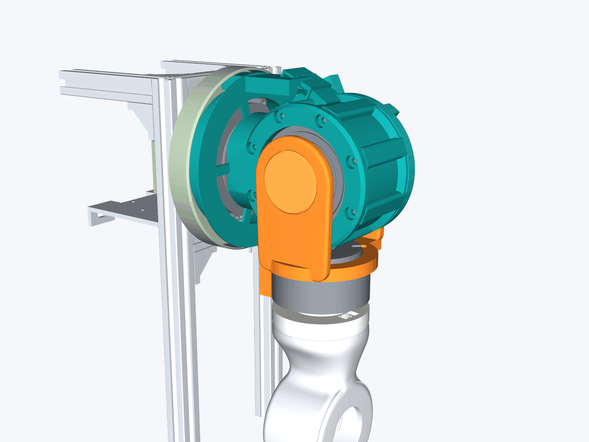

# Left shoulder concept: roll drum and fork (DRAFT, 2026-11-11)

**Status: draft, second pass in progress on Joey-PC.** The first-pass sweep in `data/check.json` (run on holly-pc, whose RAM
is suspect) was spot-checked on Joey-PC and holds (section 9). The geometry fixes, mass trim and full re-sweep follow.

Feasibility mock-up in cadquery, not final CAD. It is built in the torso STEP frame of the
[measurement study](../MEASUREMENTS.md): X outboard, Y up, Z forward, mm. All three motors are the vendor models, at the
positions in MEASUREMENTS.md. Nothing that is frozen was moved: the torso pitch mount, the cage, the arm centreline, and the
hub's interface to the upper arm (spigot, lugs, seam bolts, hub screws).

## 1. What the concept is

- **P1 becomes a drum** round the roll RS03 (teal). The motor slides in from behind, with its 8 cast lugs in 8 slots. It
  still bolts to the drum's front lip with 8 x M4 on PCD 98, as today. A pitch adaptor joins the drum to the pitch output:
  - a pad (6 x M4 on PCD 30.4, heads at X 108.7 as today)
  - a hollow neck. The pitch screws are now reached from inside the drum once the roll motor is out.
  - a flange and skirt, which form the moving wall of the pitch cable-loop channel.
- **Rear cap** (teal), bolted with 3 x M4 through ears at 130/165/200 deg. That is the inboard/top sector, which the fork
  never sweeps. It carries:
  - a hollow stub on the roll axis: OD 40.0 for a 6808, bore Ø25, shoulder Ø45
  - the cable spoke
  - two printed roll stop lugs
  - a window in the drum that leaves the roll RS03's top connector bay reachable from above.
- **Fork** (orange) in two parts:
  - **Front:** the cheek bolts to the roll output through an integral Ø44 boss (6 x M4 on PCD 30.4, r 22, inside r 27).
    It also carries the seat ring on the RS02 rear face (5 x M3 on PCD 73, as today), with pockets for both RS02 sockets,
    and a cable "finger" down the inboard side of the RS02.
  - **Rear:** the cheek holds the 6808 outer race (Ø52 seat) on the stub. It bolts to the seat ring with 2 x M4 along Z
    at a joint face at Z -39.5.
  - The yaw axis (Z 5.99) lies between the two supports, at Z +43 and Z -46.
- **Hub:** the top is dished outside r 23.5, down to Y 315.8. A step ring at r 19.5-23.5 carries the torque down to a
  new floor. A cable window at 8 deg, between two hub screws, leads into the arm's Ø43 opening.
- **Pitch loop cover** (sage, torso side): a fixed outer wall and back wall round the pitch housing, X 75-95, with a feed
  duct from the cage's back face.

## 2. Dimensions chosen (and why)

| Item | Value | Why |
|---|---|---|
| Drum bore / wall / ribs | r 48 / 3.5 mm wall to r 51.5 / 8 ribs to r 57 over the lug slots (slot r 54.5, 11 wide) | The RS02 rear cap is 59.6 from the roll axis. A plain r 57 drum would have left 2.6 mm and weighed about 250 g |
| Front lip | Z 28.3-36.0, r 40-56 (today's lip ends at Z 39.5) | Brings the fork cheek 3.5 mm closer |
| Fork front cheek | Z 39-47, 8 mm | 3 mm clear of the lip |
| Rear cap / stub / 6808 / rear cheek | Cap Z -28.5 to -40.5 (4 mm plate, 12 mm rim and spoke); 6808 at Z -42.5 to -49.5; cheek and duct to Z -58 | 2.5 mm clear of the RS03 rear face |
| Wire passages | Power 14 x 8, signal 10 x 5, separate (2 mm rib), 2 mm walls; stub bore Ø25; yaw loop r 23.5-38.5 x 8.1 mm axial (measured); hub window 16 x 9; pitch loop 15 radial x 9.4 (power) / 6.4 (signal) axial | Power 14 x 8 holds the whole 4 x 14.5 shoulder bundle; signal holds 2.2 x 8; yaw loop meets the 3.5 x 13 arm reserve |

## 3. Interference sweep (first pass, `data/check.json`)

**Poses:** 1,359 in all.

- Roll -20…+110 in 3 deg steps, at pitch -90/0/90/180 and yaw -90/0/+90.
- Pitch -90…+180 in 3 deg steps, at roll -20/0/+110 and yaw -90/0/+90.
- Roll against the drum and cap on its own, -30…+120.
- Yaw -90…+90 against the fork.

**Method:** sampled surfaces at 0.7 mm (frame and arm 1.0 mm), KD-tree, ±0.4 mm. Motor rotors are split off as in the study.

**Result: the first pass is NOT clean.** Contacts (< 0.5 mm) that need the second geometry pass:

| Pair | Min (mm) | Pose (pitch, roll, yaw) | Cause / fix planned |
|---|---|---|---|
| Fork rear ↔ rear cap | 0.02 | any roll (0.02-0.06 from -23 to +113) | The bearing housing face runs on the stub shoulder / cap face. Needs 2-3 mm of axial clearance. Because of this, the stop-lug check below is not valid yet |
| Fork front ↔ drum | 0.03 | roll -20 | Finger/duct on the inboard side meets the drum's lower ribs at inward roll |
| Fork front / fork rear ↔ pitch loop cover | 0.02 / 0.07 | roll -20 with pitch 138 / -45 | The inboard duct swings into the cover's outer wall |
| Fork front ↔ pitch RS03 | 0.13 | pitch 63, roll -20 | Same duct |
| Drum ↔ pitch loop cover | 0.02 (static 0.05) | all | Skirt and flange run on the fixed cover: open the gap to 2 mm |
| Upper arm ↔ cage | 0.03 | roll -20, pitch -15 | Not a shoulder part. Today's study found arm-to-cage contact at -21 deg; -20 deg has no margin |
| RS02 ↔ drum | 0.24 | roll -20, yaw -90 | RS02 socket / housing against the drum's lower rib |

**Clear:**

| Pair | Min (mm) |
|---|---|
| Hub ↔ fork finger | 1.5 |
| Hub ↔ RS02 stator at the rim | 3.4 |
| Drum ↔ pitch stator | 3.5 |
| Drum ↔ pitch mount / cage | 3.0 |
| RS02 ↔ rear cap | 3.7 |
| Fork boss ↔ roll stator | 4.5 |
| Arm ↔ fork | 14.7 |
| Rear fork ↔ cage | 17 |

**Yaw crossing:** the measured axial gap under the RS02 over r 24-38 is **8.1 mm** (hub dish Y 315.8, RS02 underside Y 323.9).

**Passages:** no foreign surface in the yaw loop, the yaw exit or the hub window. Intrusions to fix in the second pass:

- The fork cable runs reach into the RS02 socket; that is intended, it is the socket tap.
- The fork cable runs overlap the rear cap, and the stub cables overlap the 6808 and fork rear, because the cut volumes
  extend past the joint faces.
- The P1 skirt sits inside the pitch loop volume (modelled 0.3 mm too close).

## 4. Masses (solid PETG 1.27 g/cc, from `data/parts.json`)

| Part | Today | Concept |
|---|---|---|
| P1 / drum with pitch adaptor and ducts | 169.8 | 263.1 |
| Rear cap with stub and stops | — | 100.0 |
| P2 / fork front | 178.3 | 113.2 |
| Fork rear | — | 73.1 |
| PF03 spacer / front cap | 24.9 | 8.9 (spacer is now part of the fork) |
| Hub | 62.6 | 60.2 |
| **Total** | **435.6** | **618.5 (+42 %)** |
| Pitch loop cover (new, torso side) | — | 56.4 |
| 6808 bearing (catalogue, not verified) | — | about 32 g |

The P1 breakdown and lightening options are pending. Candidates: windows in the drum wall between the ribs, a thinner
pitch flange, and pockets in the cap plate.

## 5. Still to write after the reboot

These sections are pending:

- overall size against today
- the hub section cost of the dish
- assembly order and screw access
- print orientation and clamshell splits
- variant e numbers (cuff OD 108 mm, sleeve 84.7 g, Ø80 hub band 28.4 g, 6816 catalogue mass not yet verified). Finding
  so far: the sleeve closes the side entry the yaw cable loop uses, so variant e and wire path 5 exclude each other unless
  the bearing grows to about 6818.
- what is not checked.

## 9. Spot check of the first-pass sweep (Joey-PC, 2026-11-11)

holly-pc blue-screened with a faulty-memory code during or near the first-pass sweep. The first-pass model was rebuilt on
Joey-PC from the committed `build_concept.py` (all part volumes came out identical to `data/parts.json`), the study inputs
were regenerated (`torso.py` from TORSO.step, `mesh.py`, upper arm from the `left-arm-organic` branch at 7ad4452), and
`scripts/spot_check.py` re-ran **29 poses** against `data/check.json`:

- all 10 pair minima under 1 mm (the seven contact rows of section 3 and the three other sub-mm fork/drum/cap pairs) at the
  pose where they were found, plus 8 other pair minima spread from 1.5 to 26 mm;
- every frame pair at roll -20 / 13 / 52 / 91 / 110 (pitch 0, yaw 0), every roll-group pair at roll -30 / -9 / 30 / 72 / 120,
  every yaw pair at yaw -90 / -25 / 20 / 90.

**Result: 315 pair values, 277 identical, largest difference 0.28 mm** (fork rear to pitch loop cover at roll -20: 0.35 then,
0.63 now), **none beyond the ±0.4 mm method tolerance.** Every contact reproduced as a contact. The first-pass numbers stand
and the whole sweep was not re-run. Detail: `data/spot_check_firstpass.json`.

## Pictures

| File | What |
|---|---|
| [C1_overall_front_outboard.png](C1_overall_front_outboard.png) | Front-outboard view with the cage corner and the upper arm |
| [C2_overall_back.png](C2_overall_back.png) | Back view |
| [C3_exploded.png](C3_exploded.png) | Exploded |
| [C4_section_roll_yaw_cable.png](C4_section_roll_yaw_cable.png) | Sagittal section through the roll and yaw axes, with the cable route |
| [C5_yaw_crossing_closeup.png](C5_yaw_crossing_closeup.png) | Yaw crossing, cut away |
| [C6_roll_pose_strip.png](C6_roll_pose_strip.png) | Roll -20 / 0 / +110 |
| [C7_today_vs_concept.png](C7_today_vs_concept.png) | Today vs concept, front and back |
| [C8_variant_e_yaw_ring.png](C8_variant_e_yaw_ring.png) | Variant e, yaw ring |

The scripts are in [scripts/](scripts/): `build_concept.py` builds the model, `check_concept.py` runs the sweeps,
`render_concept.py` makes the pictures and `numbers_concept.py` computes the masses and sizes. They run against the
study's `torso.py` / `mesh.py` output.
