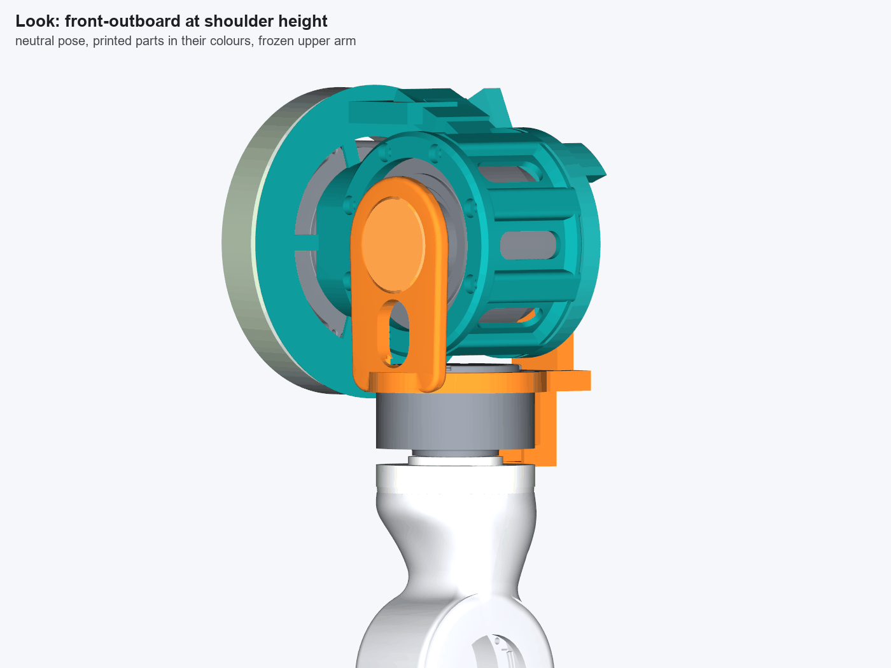

# Left shoulder concept: roll drum and fork (second pass, 2026-11-11)

Feasibility mock-up in cadquery, not final CAD. It is built in the torso STEP frame of the
[measurement study](../MEASUREMENTS.md): X outboard, Y up, Z forward, mm. All three motors are the vendor models, at the
positions in MEASUREMENTS.md. Nothing that is frozen was moved: the torso pitch mount, the cage, the arm centreline, and the
hub's interface to the upper arm (spigot, lugs, seam bolts, hub screws). No actuator has a through hole. Every cable goes
round the motors, and the hollow stub on the roll axis is a printed part behind the roll motor.

Decision (Joey): drum and fork, **no yaw ring**. Variant e is kept below only as a rejected option (section 11).

## 1. What the concept is

- **P1 becomes a drum** (teal) round the roll RS03.
  - The motor slides in from behind, its 8 cast lugs in 8 slots, and bolts to the drum's front lip with 8 x M4 on PCD 98,
    as today.
  - A pitch adaptor joins the drum to the pitch output:
    - a pad (6 x M4 on PCD 30.4, heads at X 108.7 as today)
    - a hollow neck
    - a flange (X 100.5-102.3, r 77.5), which is the moving front wall of the pitch cable-loop channel and carries the
      trunk's mouth.
  - Four windows in the drum wall, and a window over the roll RS03's top connector bay.
- **Rear cap** (teal), 3 x M4 through ears at 130/165/200 deg (the inboard/top sector the fork never reaches). It carries:
  - the radial cable channel from the trunk to the axis
  - a hollow stub on the roll axis: 6808 seat Ø40, bore Ø25, 1 mm inner-race land
  - two printed roll stop lugs.
- **Fork** (orange) in two parts:
  - **Front:**
    - the cheek bolts to the roll output through an integral Ø44 boss (6 x M4 on PCD 30.4, inside r 27 at the face)
    - the seat ring on the RS02 rear face (5 x M3 on PCD 73, as today), with pockets for both RS02 sockets
    - a 7 x 6 tap channel to the inboard socket
    - a joint pad behind the RS02.
  - **Rear:**
    - a cheek holding the floating 6808 on the stub
    - an arm straight down behind the RS02 with both cable channels inside, bolted to the pad with 2 x M4 along Z
    - below the joint, a 16 x 6 duct that turns forward into the gap under the RS02.
  - The yaw axis (Z 5.99) lies between the two roll supports (front boss face Z 39, 6808 at Z -40.3 to -47.3).
- **Hub:**
  - The top is dished outside r 23.5, down to Y 315.8.
  - A step ring at r 19.5-23.5 carries the torque down to the new floor.
  - A cable window at 8 deg, between two hub screws, leads into the arm's Ø43 opening.
- **Pitch loop cover** (sage, torso side, fixed):
  - inner wall r 55-57.4, back wall and outer wall r 73.5-75.9 round the pitch housing, X 75-98.5
  - a feed duct from the cage's back face, ending flush with the inside of the outer wall
  - no rigid part moves inside the channel.

## 2. Dimensions chosen (and why)

| Item | Value | Why |
|---|---|---|
| Drum bore / wall / ribs | r 48 / 3.5 mm wall to r 51.5 / 8 ribs to r 57 over the lug slots (slot r 54.5, 11 wide); four 14 x 40 windows | The RS02 rear cap is 59.6 from the roll axis. A plain r 57 drum would leave 2.6 mm |
| Front lip | Z 28.3-36.0, r 43-56 | Brings the fork cheek 3.5 mm closer than today's lip (Z 39.5) |
| Fork front cheek | Z 39-47, 8 mm, 34 x 24 web window | 3 mm clear of the lip |
| Rear stack | Cap Z -28.5 to -39.3 (2.4 + 6 channel + 2.4); land to -40.3; 6808 -40.3 to -47.3; fork housing from -41.8; fork channel -48.3 to -54.3; back face -56.7 | 2.54 clear of the RS03 rear face, 2.5 axial between cap and fork |
| Rear arm | 34 wide x 10.8 deep, channels inside, 3 mm side walls; below the joint a 20.8 x 10.8 duct | The arm takes the 6808 reaction down to the seat ring |
| Pitch loop channel | r 57.4-73.5 x X 77.4-98.5 (fixed walls), flange at X 100.5 | 2 mm axial between the cover and the flange; 2 mm static between the inner wall and the pitch housing lugs |
| Roll range | -15 inward to +110 outward, printed stops | Decision (Joey); see section 4 for the upper arm |
| Wire passages | Power 16 x 6, signal 10 x 5, 2 mm rib, 2.4 walls; stub bore Ø25; RS02 tap 7 x 6; exit 16 x 6; yaw loop r 23.8-38.2 x 7.5 axial; hub window 16 x 9 | Section 8 |

Section minimum: 2.4 mm everywhere on the load path (drum wall 3.5, neck tube 4.4, cap plate 3.0 and rim 3.0, arm side
walls 3.0, duct walls 2.4). The only thinner wall is the 1.8 mm pitch flange, which carries no load.

## 3. Interference sweep (second pass, `data/check.json`)

**Poses:** 1,299 frame poses, plus the roll-group and yaw sweeps.

- Roll -15…+110 in 3 deg steps, at pitch -90/0/90/180 and yaw -90/0/+90.
- Pitch -90…+180 in 3 deg steps, at roll -15/0/+110 and yaw -90/0/+90.
- The roll group against the drum, cap and stops on its own, -30…+120 (the minima are taken over -15…+110).
- Yaw -90…+90 in 5 deg steps against the fork.

**Method:** as the first pass. Surfaces are sampled at 0.7 mm (frame and arm 1.0 mm) and compared with a KD-tree, so
distances are good to ±0.4 mm. Motor rotors are split off as in the study.

**Result: clean.** Every moving pair of shoulder parts is 2.0 mm or more over the whole range. The only contacts are the
intended stop contact and the frozen upper arm against the cage (section 4).

| Pair (moving ↔ fixed) | Min (mm) | Pose (pitch, roll, yaw) | Note |
|---|---|---|---|
| Fork rear arm ↔ stop lugs | 0.02 | 0, +110, — | **Intended stop contact** (section 4) |
| Upper arm ↔ cage | 0.05 | 9, -15, 90 | **Not a shoulder part** (section 4) |
| Drum flange ↔ pitch loop cover | 2.0 | any | Designed 2 mm axial gap |
| Hub ↔ fork rear exit duct | 2.19 | yaw any | Exit duct is outside r 41.5 of the yaw axis; hub r 39.3 |
| RS02 ↔ drum rib | 2.38 | roll +108 | |
| Fork rear ↔ cap | 2.5 | any roll | Bearing housing 2.5 behind the cap face |
| Fork front ↔ drum | 3.0 | roll -15 | Cheek 3 mm clear of the lip |
| Hub ↔ RS02 stator | 3.41 | any yaw | As today |
| Drum ↔ pitch stator | 3.5 | any pitch | |
| RS02 ↔ cap | 3.72 | roll +110 | |
| Fork boss ↔ roll stator | 4.52 | roll +110 | Outside r 27 at the output face |
| Fork front ↔ pitch loop cover / pitch RS03 | 6.9 / 11.7 | roll -15 | The inboard finger of the first pass is gone |
| Drum ↔ pitch mount / cage | 4.8 | pitch -90 | |
| Upper arm ↔ fork | 12.4 | yaw 40 | |
| Anything ↔ stop lugs other than the arm | 10.4 | roll -16 | |

Static fits within one group (bolted or seated, expected near 0): drum/RS03, drum/cap, fork front/rear, fork/RS02,
6808/stub and housing. Running gaps that do not move: cap ↔ roll RS03 rear face 2.54; fork rear ↔ RS02 2.24.

**Yaw crossing:** measured axial gap under the RS02 over r 24-38 is **8.06 mm** (hub dish Y 315.8, RS02 underside Y 323.86).

## 4. Roll stops

Each lug is an r 44-55 sector on the cap's rear face, minus the rear arm placed at the end of travel. The arm's flank lands
flat on the lug face.

| Roll (deg) | Arm ↔ lug (mm) | Closest other pair (mm) |
|---|---|---|
| -10 | 3.49 | fork rear ↔ cap 2.5 |
| -14 | 0.72 | RS02 ↔ drum 2.46 |
| **-15 (stop)** | **0.06** | RS02 ↔ drum 2.41 |
| -16 (1 deg past) | 0.07 (in the lug) | fork front ↔ drum 1.78 |
| 108 | 1.42 | RS02 ↔ drum 2.37 |
| **110 (stop)** | **0.02** | RS02 ↔ drum 2.43 |
| 111 (1 deg past) | 0.06 (in the lug) | RS02 ↔ drum 2.49 |

**The lugs are the first contact at both ends.**

- At the stops, everything else is 2.4 mm or more away.
- Nothing but the arm comes within 10.4 mm of a lug.
- One degree past the inward stop (only possible if a lug breaks), the fork front closes to 1.8 mm on the drum.

**Upper arm against the cage.** This is not a shoulder part, but it limits the inward stop:

- The frozen organic upper arm reaches the cage side at **roll -12 to -13** when yawed 45-75 deg, for pitch -30…+24.
- At yaw 0 it reaches -20, as found before.
- At roll -15 it is 0.05 mm from the cage. At -10 it is 7.8 mm clear in every pose.

The stop stays at -15 as decided. Two ways to handle it:

- Software holds a coupled limit: roll ≥ -11 when |yaw| ≥ 30 and pitch is -30…+24.
- The inward lug is regenerated at -11. Change `ROLL_IN` in `build_concept.py` and re-run.

## 5. Masses (solid PETG 1.27 g/cc, `data/parts.json`)

| Printed part (g) | Today | First pass | Second pass |
|---|---|---|---|
| P1 / drum with pitch adaptor and ducts | 169.8 | 263.1 | **215.8** |
| Rear cap with stub and stop lugs | — | 100.0 | **81.5** |
| P2 / fork front | 178.3 | 113.2 | **92.3** |
| Fork rear | — | 73.1 | **63.5** |
| PF03 spacer / front press-in cap | 24.9 | 8.9 | **5.3** (the spacer is now the fork boss) |
| Hub | 62.6 | 60.2 | **60.2** |
| **Total, shoulder** | **435.6** | **618.5** | **518.6** (+83.0 g, +19 % on today; −99.9 g on the first pass) |
| Pitch loop cover (torso side, fixed) | — | 56.4 | 89.3 |
| 6808 (catalogue, not weighed) | — | about 32 | about 32 |

**The 520 g target is met, with 1.4 g to spare.** What the trim took out:

- Drum:
  - wall windows
  - lip bore r 40 → 43
  - neck wall 6 → 4.4
  - flange 2.5 → 1.8
- Cap:
  - plate 4 → 3 with three windows
  - rim 4.4 → 3.0
  - boss r 26 → 24
- Fork front: cheek web window; press-in cap 4 → 2.4.
- Fork rear:
  - arm 44 → 34 wide
  - cheek disc r 38 → 35
  - duct-only lower end.
- The pitch loop's inner wall moved from the drum to the fixed cover.

24 g of the saving moved to the torso side with that inner wall. It is off the pitch output, but it is not gone. Against
today, +83 g of printed parts plus about 32 g of bearing buy:

- a second roll support
- a cable path through all three joints
- hard stops
- 125 deg of roll travel instead of 5 deg inward.

## 6. Overall size (`data/numbers.json`, shoulder parts plus roll and yaw motors)

| | Today | Concept (body, outboard of X 104) | Concept with the pitch flange ring | With the fixed cover |
|---|---|---|---|---|
| Width X | 131.0 (X 97.0-228.0) | 123.5 (X 104-227.5) | 130.5 (X 97.0-227.5) | 179.9 (X 47.6-227.5) |
| Height Y | 194.4 (Y 288.0-482.4) | 213.0 (Y 288.0-501.0) | 214.4 | 214.4 |
| Front-back depth Z | 109.5 (Z -37.5 to 72.0) | **107.7 (Z -56.7 to 51.0)** | 155.0 (flange Ø155) | 161.9 |
| Rear reach behind the roll RS03 rear face (Z -25.96) | 11.6 | **30.7** | 51.5 (flange) | 58.4 |

- **Depth:** the body is no deeper than today. It moved about 20 mm rearward: today the P2 bore boss reaches Z 72; the
  concept's front is the seat ring at Z 51.
- **Height:** +18.6, from the cable trunk over the drum (Y 494) and the cap's spoke (Y 501). Today has no cable path
  at all.
- **Pitch flange:** Ø155 round the pitch motor, at X 100.5-102.3. Today's P1 has only the Ø44 pad there.
- **Rear reach:** 30.7 against the first pass's 32.1 (Z -58).

The rear stack cannot shrink much, because the cable crosses the roll axis through the stub:

| Item | Z (mm) |
|---|---|
| Roll RS03 rear face | -26.0 |
| Clearance | 2.5 |
| Cap with its radial channel (2.4 + 6 + 2.4) | to -39.3 |
| Inner-race land | 1.0 |
| 6808 | 7.0 |
| Clearance, then the fork's radial channel with its walls | to -56.7 |

The first pass reached -58 only by running the fork channel through the bearing seat. A 6708 (6 mm wide) would save 1 mm.
A flatter power bundle (for example 3 mm × 18) would save about 2 mm per radial run.

## 7. Hub section cost of the dished top (`data/numbers.json`)

The cuts are planes Y = const through the torque path (spigot to top). J is the polar second moment about the yaw axis;
Zp = J / r_max.

| Band | Today: area (mm²) / Zp (mm³) | Dished: area / Zp |
|---|---|---|
| Window band, Y 302.5 (today's weakest) | 1105 / 30,100 | 1094 / 30,100 (unchanged) |
| Y 313-315 (under the dish floor) | 1770-1780 / 48,000 | 3860 / 87,000 (new floor) |
| Y 316-319 (top) | 3730 / 78,600 (full plate) | **1608 / 19,200** (step ring r 19.5-23.5 and the clamp disc) |
| **Weakest band** | **1105 / 30,100 at Y 302.5** | **1608 mm² at Y 316-319 / Zp 19,200 at Y 316-319** |

The dish moves the hub's weakest polar section from the window band to the step ring under the RS02 output. Zp falls 36 %
(30,100 → 19,200 mm³); area is up because the ring is solid.

- Torque: at 17 N·m (an assumed RS02 peak; the rating is not in the files) the mean shear in the step ring is about
  0.9 MPa. That is low for PETG, but layer bonding in the ring is not checked.
- Bending: the 1.1-1.3 N·m arm moment also crosses this ring at r ≤ 23.5. It is not analysed (section 12).

## 8. Wire passages: free section against the reserves

**Reserves used throughout:**

- whole shoulder bundle: 4 x 14.5 flat, or Ø10 round
- signal: 2.2 x 8
- arm bundle across yaw: 3.5 x 13.

| Passage | Free section | Against the reserve |
|---|---|---|
| Feed from the cage back face into the cover | power 16 x 6, signal 10 x 5 | 4 x 14.5 fits (1 mm a side); **Ø10 does not**; signal fits |
| Pitch loop channel | r 57.4-73.5 x X 77.4-98.5: 16.1 x 21.1 = 340 mm² | 4 x 14.5 + 2.2 x 8 = 76 mm² of cable. Room for a loop of both bundles. Flex life over the 270 deg travel is not checked |
| P1 trunk (mouth on the flange face, over the neck, along the drum) | power 16 x 6, signal 10 x 5 | as the feed |
| Branch to the roll RS03 top bay | power 16 x 6, signal 10 x 5 | carries the roll motor's two leads |
| Cap channel to the axis | power 16 x 6, signal 10 x 5 | as the feed |
| Stub bore (roll crossing) | Ø25 = 491 mm² | power box 16 x 6 above the axis, signal 10 x 5 below; both fit inside r 11 |
| Fork rear arm, down to the joint | power 16 x 6, signal 10 x 5 | as the feed |
| RS02 inboard socket tap | 7 x 6 | one XT30 (2+2) lead; its diameter is not measured |
| Below the joint and the exit into the gap under the RS02 | 16 x 6 = 96 mm² | arm bundle 3.5 x 13 fits (signal joins above the joint) |
| Yaw loop under the RS02 | annulus r 23.8-38.2, 7.5 mm axial (gap 8.1) | 3.5 x 13 laid flat: 3.5 high in 7.5. Loop length for ±90 yaw is not checked |
| Hub window into the arm's Ø43 opening | 16 x 9 = 144 mm² | 3.5 x 13 fits |

**Passage check (neutral pose):** no part's surface lies more than 0.3 mm inside any passage volume. Faces on a passage's
boundary are its walls.

The Ø10 round reserve does not fit any 6-high channel. The 6 mm height was chosen over 8 to shorten the rear stack (section
6). A round Ø10 cable would need 10.8 mm channels, adding about 9.6 mm of rear reach.

## 9. Assembly order, screw access and service

**Assembly** (driver direction for each screw):

1. **Pitch loop cover** onto the cage side; feed cables through the feed duct into the channel.
2. **Drum (P1) onto the pitch output: 6 x M4** into the pad.
   - The heads face +X inside the neck core (X 108.7).
   - The driver goes along -X through the drum's outboard window (window ±7 mm in Y, Z -18…22). Two screws are in line;
     the other four need a 4 deg tilt (ball-end hex).
   - The roll motor is not in yet.
   - The loop cable goes into the trunk mouth on the flange face.
3. **Roll RS03** slides into the drum from behind, lugs in the slots. **8 x M4** go into the lugs from the front (heads at
   the lip face, driver along -Z, open). Plug the roll motor's two leads through the top-bay window from above.
4. **Rear cap: 3 x M4** through the ears from behind (driver along +Z; the ears are at r 61, top/inboard, open). The
   cables go through the cap channel and out of the stub bore. Push the 6808 inner race onto the stub, against the land.
5. **RS02 onto the fork front: 5 x M3** from above, before the fork goes on the roll. Once the fork is on, the drum and cap
   bottom is 6 mm above the screw heads, as today.
6. **Fork front onto the roll output: 6 x M4** from the front through the cheek (driver along -Z, open), then the press-in
   cap. The joint pad passes under the cap.
7. **Fork rear:**
   - Press the 6808 outer race into its housing.
   - Slide the fork rear onto the stub from behind; the lugs meet the pad.
   - **2 x M4** from behind (driver along +Z, heads at Z -56.7, open).
   - The cable passes from the stub bore into the arm channel. The RS02 lead goes through the tap channel.
8. **Hub onto the RS02 output: 6 x M4** from below (open until the arm halves are on). Lay the arm bundle into the dish
   loop and through the window.
9. **Arm halves:** 2 x M3 x 40, as today.

**Service, roll motor out (P1 and pitch untouched):**

1. Arm halves off (or leave them on; the rest comes off as one unit).
2. Fork rear: 2 x M4 from behind; it slides off the stub to the rear.
3. Fork front with the RS02, hub and arm: 6 x M4 from the front; it comes off the roll output forward. Unplug the RS02 lead
   at the socket.
4. Cap: 3 x M4 from behind.
5. Unplug the roll leads through the top-bay window.
6. Remove the 8 x M4 at the front lip (now open), and slide the RS03 out to the rear.

That is 13 screws and two connectors, against today's sequence of P2 off → roll motor out → P1 off.

## 10. Print orientation (Bambu P2S, 256 mm cube, PETG)

| Part | Size (mm) | Orientation | Supports | Split |
|---|---|---|---|---|
| Drum (P1) | 147.7 x 155 x 155 with the flange; 123.5 x 155 x 64.5 without | Front lip face down, roll axis vertical. The ribs, slots and wall windows stand vertical; slots open at the top; trunk channels bridge 6 mm | Under the neck tube's outside and inside its Ø42 core (open to the drum bore, removable); under the trunk duct's outer end | **Split the flange ring off** (it reaches Z ±77.5, past the lip face). Print it flat (1.8 → 2.4 mm as a separate part) and screw it to the five spokes. No clamshell |
| Rear cap | 123 x 133 x 27 | Front face (Z -28.5) down. Rim, boss and spoke start on the plate; stub and stop lugs grow up | Under the 3 mm plate between rim and boss (open from the front, through the windows); channel bridges 16 mm | None |
| Fork front | 93 x 107 x 97 | Upright as installed, RS02 seat face down (the precision face on the plate); the cheek's outer face stands vertical and comes out clean | Under the rear boss (cylinder along Z), about 40 mm tall from the plate | None |
| Fork rear | 70 x 146 x 25 | Back face (Z -56.7) down. Housing and exit grow up; the channels run horizontally and bridge 16 mm | None expected | None. Printed upright, its channels would be vertical but the bearing seat would need support inside |
| Hub | 78.6 x 31.9 x 78.6 | RS02 face down, as today | In the 4 mm dish annulus under the floor (open at the rim, pulls out radially) | None |
| Press-in cap | Ø47.6 x 2.4 | Flat | None | — |
| Pitch loop cover | 51 x 152 x 160 | Back wall (X 75) down; walls and feed duct grow up | Under the feed duct's forward run | None |

No part needs a clamshell to avoid trapped supports. The one split is the flange ring.

## 11. Rejected: variant e, "yaw ring"

The fork seat is extended as a sleeve round the RS02, with a 6816 (80 x 100 x 10) on a Ø80 band on the hub
([C8_variant_e_yaw_ring.png](C8_variant_e_yaw_ring.png), first-pass picture). It was dropped from the model because:

- the cuff is OD 108 round the RS02
- it costs about **113 g** more printed mass (sleeve 84.7 g, hub band 28.4 g), plus the 6816 (catalogue mass not
  verified)
- **the sleeve closes the side entry the yaw cable loop uses.** It would need a bearing of about 6818 to pass the cable.

## 12. What is still unchecked

- **Bearing-seat fits:**
  - 6808 on the printed stub (Ø40) and in the printed housing (Ø52), for a floating outer race
  - the outer race's 1 mm rear lip
  - the inner race's axial retention (nothing but the land and the housing lip).
- **Stop-lug strength.** The lugs are cantilevers about 16 mm long off the cap plate. The impact load at the end of
  travel and the arm flank's contact stress are not analysed. Software limits should sit 2-3 deg inside the stops.
- **Deflection under load.** All clearances are nominal CAD:
  - fork rear ↔ cap 2.5
  - RS02 ↔ drum rib 2.4
  - cover ↔ flange 2.0
  - none is checked against the 2.3 N·m roll and 1.7 N·m pitch moments, or against the stack-up between the motor bearing
    and the 6808.
- **Upper arm ↔ cage** inward of -12 deg when yawed (section 4).
- **Plug bodies in the RS03 bays**, and which bay holds XT30 or GH1.25. The vendor models show empty bays. The top-bay
  window and branch are sized from the bay, not the plug.
- **RS02 socket plugs and leads:** the tap channel (7 x 6) and the pockets are from the socket positions; plug bodies and
  lead diameters are not measured.
- **RS03/RS02 output-bearing ratings** (moment and axial). Not in the files.
- **Cable flex life** over 270 deg pitch in the loop channel, ±90 yaw in the 7.5 mm annulus, and 125 deg roll as twist in
  the stub bore. Minimum bend radii of the real cables are not checked.
- **The Ø10 round reserve** does not fit the 6 mm channels (section 8).
- **Torso shell, head, other arm and covers** are not in the model.
- **Hub step ring:** torque and bending at the RS02 output (section 7).
- **Print** orientations and supports are judged from the geometry, not sliced.

## 13. History: first pass and spot check

The first pass (commit c8e6cf8, holly-pc) had these contacts:

- fork rear on the cap at every roll angle (the bearing housing ran on the stub and cap)
- the inboard cable finger on the drum ribs, the pitch loop cover and the pitch RS03 at roll -20
- the drum skirt on the cover
- the RS02 on a drum rib.

The first-pass sweep was **spot-checked on Joey-PC** because holly-pc had blue-screened with a faulty-memory code.

- **Inputs, regenerated on Joey-PC:**
  - the first-pass model, rebuilt from the committed script (identical volumes)
  - `torso.py` and `mesh.py`
  - the upper arm from the `left-arm-organic` branch at 7ad4452.
- **Poses re-run** (`scripts/spot_check.py`, 29 in all):
  - all 10 pair minima under 1 mm, plus 8 other pair minima
  - frame, roll and yaw curve points.
- **Result:** 315 pair values; 277 identical; largest difference 0.28 mm; none beyond the ±0.4 mm tolerance. Every contact
  reproduced. The first-pass numbers stood, so the whole first-pass sweep was not re-run.
- Detail: `data/spot_check_firstpass.json`.

## Pictures

| File | What |
|---|---|
| [C1_overall_front_outboard.png](C1_overall_front_outboard.png) | Front-outboard view with the cage corner and the upper arm |
| [C2_overall_back.png](C2_overall_back.png) | Back view: cap, fork rear arm, stop lugs |
| [C3_exploded.png](C3_exploded.png) | Exploded along the chain |
| [C4_section_roll_yaw_cable.png](C4_section_roll_yaw_cable.png) | Sagittal section through the roll and yaw axes, with the cable route projected |
| [C5_yaw_crossing_closeup.png](C5_yaw_crossing_closeup.png) | Yaw crossing, cut at the exit centreline |
| [C6_roll_pose_strip.png](C6_roll_pose_strip.png) | Roll -15 / 0 / +110 (the stops) |
| [C7_today_vs_concept.png](C7_today_vs_concept.png) | Today vs concept, front and back |
| [C8_variant_e_yaw_ring.png](C8_variant_e_yaw_ring.png) | Rejected variant e (first-pass model) |
| [C9_cable_route_3d.png](C9_cable_route_3d.png) | Whole cable route in 3D, parts translucent (power red, signal blue) |
| [C10_look_front_outboard.png](C10_look_front_outboard.png) | Look view, front-outboard at shoulder height |

**Scripts** ([scripts/](scripts/)), run against the study's `torso.py` / `mesh.py` output:

| Script | What it does |
|---|---|
| `build_concept.py` | Builds the model. `LIGHT=0` gives the untrimmed step-2 geometry |
| `check_concept.py` | Runs the sweeps, stops and passage checks |
| `numbers_concept.py` | Sizes and hub sections |
| `render_concept.py` | The pictures |
| `spot_check.py` | The first-pass spot check |
| `sweeplib.py` | Shared loading and posing |

The data files are `data/parts.json`, `data/check.json`, `data/numbers.json` and `data/spot_check_firstpass.json`.
