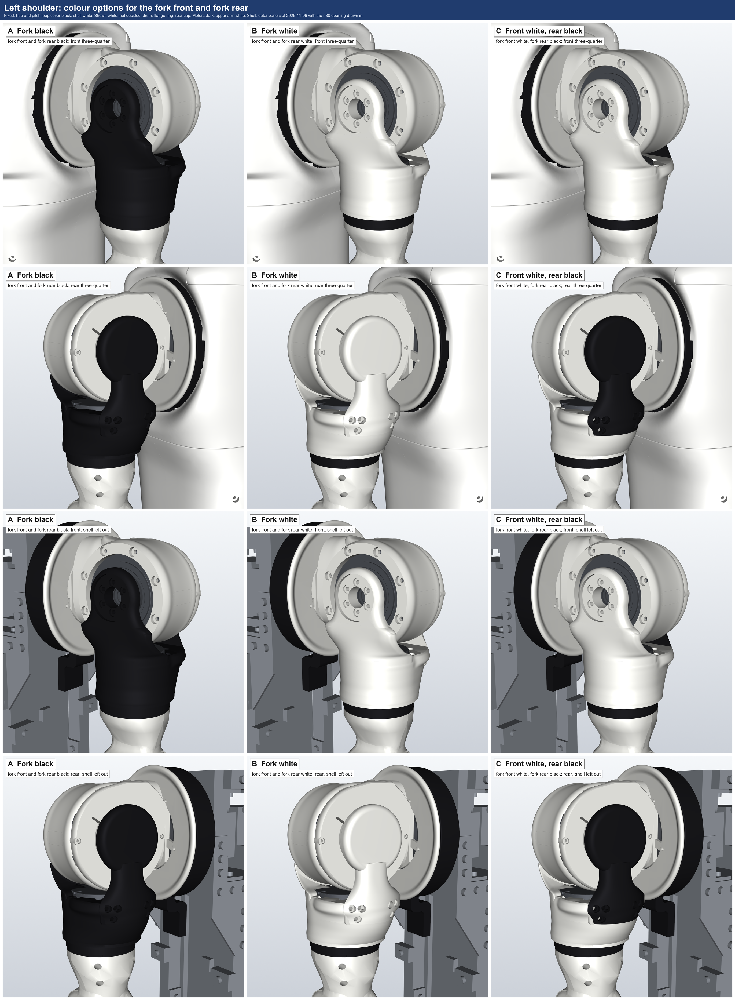

# Fork front and fork rear: print settings and colour, for Joey's decision

**Status:** proposal, 2026-11-17. Nothing is decided and no part or print file was changed. Sources: the fork's strength
record ([FORK_FRONT_FE.md](../checks/FORK_FRONT_FE.md), [A_HUB_LUGS.md](../checks/A_HUB_LUGS.md),
[D_6808_FITS.md](../checks/D_6808_FITS.md)), the hub's print ([PRINT_NOTES.md](../cad-pass1/PRINT_NOTES.md), "Hub"), and
the first-look slices of 2026-11-13 ([OPEN_ASSUMPTIONS.md](../checks/OPEN_ASSUMPTIONS.md), section 10).

## What the strength checks assumed

- **Material:** PETG, E 1.9 GPa, ν 0.38, yield 45 MPa, strength across the layers 22.5 MPa (half of yield).
- **Fill:** every part is one solid, homogeneous body. No walls, no infill, no voids. The masses on record (fork front
  152.3 g, fork rear 68.2 g) are solid volume × 1.27 g/cm³.
- **Orientation:** both parts print upright, Y up, so the layers are normal to Y. "Layer tension" in the tables is σy
  against 22.5 MPa. Another orientation makes those tables void.
- **Target:** safety factor 1.5 on the worst 0.5 mm ball. The fork's lowest figures are at the joint face (1.42 to 1.45
  at the 17 N·m stop), the RS02 screw seats and the boss root: all places where an infill void would sit under the
  governing stress.
- **6808 housing:** Ø52.1, sized on test rings printed on the P2S in PETG **with 4 walls**. The fork's strength depends on
  the race sitting with no play.

## What the hub rev E1 print used

P2S, 0.4 nozzle, Generic PETG (255 °C), Cool Plate SuperTack 70 °C, no glue, **0.20 mm layers, 6 walls, 100 % infill, no
brim**, tree supports with blockers, motor face down. Sliced 115.8 g (4.9 g support), 3 h 15 min. Black.

## Proposed settings

| | Fork front | Fork rear | Why |
|---|---|---|---|
| Printer, nozzle, filament | P2S, 0.4, Generic PETG, as the hub | same | One material record for the whole shoulder |
| Layer height | 0.20 mm | 0.20 mm | As the hub and the test rings. Finer layers buy nothing the checks need |
| Wall loops | 6 | 6 | As the hub. With 100 % infill the count only sets how far the concentric loops reach before the fill starts |
| Infill | **100 %**, the slicer's solid pattern (rectilinear, alternating 90°) | **100 %** | The checks are for a solid body. The governing places are thick sections where infill would otherwise be |
| Top / bottom layers | 5 / 5 (no effect at 100 %) | 5 / 5 | Set so a later change of infill cannot leave thin skins |
| Orientation | Upright, Y up; the sleeve ring's bottom edge on the plate | Upright, Y up; flat underside (Y 340) on the plate | The orientation the layer-tension figures are for |
| Supports | Tree, automatic, from the plate only. Under the sleeve hollow's roof (Y 340 to 350) and the RS02 clearance roof (Y 361 to 367). **Blockers** in the key tunnel, the six insert bores and the three pin holes | Tree, automatic. Under the hollow's roof (Y 340 to 349) and the stop tooth's outer face. **Blocker** in the 6808 housing if the slicer puts any there (the bore has its flat top for this) | Where the 2026-11-13 slices put them. The fork front's RS02 seat is a supported face: check it flat after printing |
| Brim | Outer, 5 mm | Outer, 5 mm | Fork front: its first layer is a thin ring. Fork rear: 120 mm tall on a 73 × 28 mm foot. Neither foot is a fitted face, unlike the hub's |
| Plate | Cool Plate SuperTack, 70 °C, no glue | same | As the hub |
| Estimated, sliced | about **190 g** (152 g part, 37 to 40 g support), about **8 h** | about **74 g** (68 g part, 6 g support), about **3 h 15 min** | Estimates, see below |

**One thing to do first: print test ring 3 (Ø52.1) again with these settings and in the fork rear's filament, and try the
bearing.** The ring that fitted had 4 walls; 6 walls and solid fill can pull a bore a little tighter, and another colour
is another spool. About 9 g and half an hour (estimate). If it no longer fits as a light hand push with no play, the housing size changes
before the fork rear prints.

### The alternative, and why it is not proposed

| Option | Fork front | Fork rear | Verdict |
|---|---|---|---|
| **1. Solid, as the hub** (proposed) | about 190 g, 8 h | about 74 g, 3 h 15 min | The strength record applies as written |
| 2. The arm's profile: 6 walls, 50 % gyroid | 194.7 g, 7 h 29 min (sliced 2026-11-13, older geometry, 155 g solid) | 66.1 g, 2 h 58 min (sliced 2026-11-13, older geometry, 63.7 g solid) | Saves almost nothing: six walls already fill most of these sections. And the checks would need a knock-down nobody has measured |
| 3. Solid at 0.16 mm layers | about 190 g, about 10 h | about 74 g, about 4 h | Smoother skin on the visible sleeve; no figure in the record asks for it |

**How good the numbers are.** Bambu Studio is not installed on the machine this was prepared on, so nothing was sliced
now. Option 2's figures are real slices of 2026-11-13, of slightly older geometry. Option 1 is those slices with the
part's mass replaced by today's solid mass, and the time raised by the hub's rate (115.8 g in 3 h 15 min, solid).
Slice the real project before trusting them to better than about 10 %.

## Colour

Fixed by the colour rule of 2026-11-15: hub black, pitch loop cover black, shell white. In the pictures the drum, the
flange ring and the rear cap are shown white; they are not decided either. Motors dark, upper arm white. The shell is the
outer panel set of 2026-11-06 with the r 80 shoulder opening drawn in.

| Option | Front | Rear |
|---|---|---|
| A. Fork black (front and rear) | [picture](fork_colour_a_fork_black_front.png) | [picture](fork_colour_a_fork_black_rear.png) |
| B. Fork white (front and rear) | [picture](fork_colour_b_fork_white_front.png) | [picture](fork_colour_b_fork_white_rear.png) |
| C. Fork front white, fork rear black | [picture](fork_colour_c_front_white_rear_black_front.png) | [picture](fork_colour_c_front_white_rear_black_rear.png) |

What the pictures show:

- **A** reads as one dark joint between a white body and a white arm, and the hub's black band disappears into it. It
  follows "black for the inner structural and joint parts" to the letter. Support marks and the joint line between the
  two fork parts show least in black.
- **B** makes the arm look like one white limb from the drum down, with the hub as a thin black ring at the yaw joint.
  The six joint screws and the seam between front and rear show most here.
- **C** shows the split between the two parts on purpose: white from the front, a black back. From the rear the sleeve
  stays white round the black fork rear, so the black reads as an inset panel, not a clean half.

Colour does not enter the strength record. A different colour is a different spool, though: see the test ring above.

Pictures: `render_fork_colours.py` in this folder (needs the rev A frame as `FRAME_STEP` and the shell panels as
`SHELL_DIR`).
